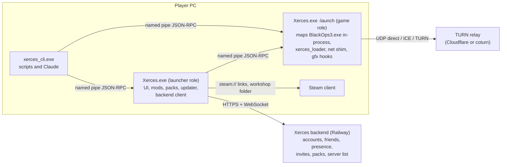

# Xerces design document

Status: **draft 2, for review** (2026-11-04). Draft 1 was reviewed by four
independent reviewers (completeness against your brief, technical accuracy,
security, privacy and licensing, internal consistency); this version fixes what
they found. Implementation started on 2026-11-04 on `xerces-main`: D1 and D2 are
decided, and the headless core of M1, M2 and M4 is built and tested; the game
client builds and waits on the M0 session (status in section 18). The first
slice of the backend is live on Railway (section 10.9).

Xerces is a rename and redesign of the Ezz BOIII client (itself a fork of
momo5502's boiii, GPL-3.0) into a multi-mod launcher and loader for Call of
Duty: Black Ops III. It stays open source under the same licence, keeps every
upstream credit, and only targets self-hosted and offline play.

Research notes behind this document are in [`docs/research/`](research/). They
come from reading the code on 2026-11-04 (upstream `main` 5aa7fac and
`mod-stack` ac356c3c, the fork's `refs/heads/main` 7805319) and from web
research the same day. Treat them as leads with citations: anything marked
"runtime" still needs the real game. The networking notes were written against
upstream `main`; they are re-checked against the chosen base before milestone M6
(section 11).

---

## 0. Summary

### 0.1 What reading the code changed

1. **Start from current upstream, not from the fork's base.** The fork
   (`DeroXP/boiii-free`) is upstream as of 2026-04-09 plus 17 proof-of-concept
   commits; upstream is now 939 commits ahead. The installed `BlackOps3.exe` is
   the September 2026 Steam build (PE checksum `0x6531394`), and every address
   in the proof of concept targets the previous build (`0x888C368`).

2. **Upstream already built additive multi-mod loading.** The unmerged branch
   `upstream/mod-stack` (832-line `mod_stack.cpp`, 2026-10-15) loads extra mods'
   zones as `stack_<id>_<zone>` in the same `DB_LoadXAssets` batch and tiers as
   the main mod, routes their files, xpak streams and sound banks back to each
   mod's folder, and picks asset winners in `DB_OverrideAsset`. It is designed
   to avoid the `en_` language-pair wall and the
   `PMem_Free ... not at the top of the stack` crash without suppressing any
   error; the M0 session confirms that on real mods. Xerces builds its loader on
   that engine and adds what it lacks: manifests, dependency resolution,
   user-controlled deterministic order, conflict reports, merges, chained GSC
   hooks, safe mode and signature-resolved addresses for its hooks.

3. **The base has to include `beta`'s later security work.** `mod-stack`
   branched from `beta` before upstream's 2026-11-02 lobby-message security
   patches. Both `beta` and `mod-stack` also re-enabled the engine's remote
   lobby messages ("Resurrect lobby session system", 2026-10-11) and added voice
   chat, and both contain an anonymous Steam CM/CDN Workshop downloader
   (`workshop/steam_cdn.cpp`) that `mod-stack`'s join path calls automatically
   for missing mods. So: start from `beta` plus the two stacking commits (D1),
   and decide what happens to those downloaders (D15).

4. **"Survive game updates" can only be met in part.** Upstream's client,
   including the fenced anti-tamper and auth code, runs on per-build address
   tables and refuses to start on an unknown exe. After a Steam update the whole
   client is unusable until upstream publishes tables for the new build, and
   Xerces cannot port the fenced parts to signatures. What Xerces can do:
   resolve every address its own features use by signature, check the exe before
   loading it, and explain clearly what to do (4.1, D18).

5. **Two proof-of-concept findings should not be carried forward.** The
   "autoexec queue-add" function (old `0x1412D8810`) sits in the script-string
   (`SL_*`) cluster; its "export table" is exactly upstream's `gScrMemTreePub`
   and its begin/end flag is `gScrAnimPub[inst].animtree_loading`, so it is most
   likely a string-table routine, and calling it would corrupt script strings.
   The hidden FPS cap is already removed upstream by a `Com_FPSLimit` hook.
   Ledger: 2.3.

6. **Railway cannot carry game traffic.** Railway has HTTP/HTTPS and a TCP
   proxy, no public UDP. The API, WebSocket presence, invite signaling and
   Postgres fit it well; the relay has to be a TURN service elsewhere (D7).

7. **Temporal upscaling is feasible in principle but licence-gated.** A
   third-party BO3 mod (Luma Framework) ships DLSS through NGX D3D11 on build
   24784313 by replacing the SMAA T2x resolve and patching its jitter, so depth,
   motion vectors and jitter are reachable. NVIDIA's RTX SDK licence forbids use
   that subjects the SDK to an open-source licence, which conflicts with a
   GPL-3.0 client. FSR 1, NIS and FSR 2.2 (MIT) do not have that problem (13.6).

### 0.2 Decisions

My recommendation comes first. "Needed by" says which milestone waits on the
answer.

| #   | Needed by     | Decision                                                                                                                    | Recommendation                                                                                                                                                                                                                                                                                                                                                                                                                                   | Alternatives                                                                                                   |
| --- | ------------- | --------------------------------------------------------------------------------------------------------------------------- | ------------------------------------------------------------------------------------------------------------------------------------------------------------------------------------------------------------------------------------------------------------------------------------------------------------------------------------------------------------------------------------------------------------------------------------------------ | -------------------------------------------------------------------------------------------------------------- |
| D1  | decided       | Upstream line Xerces starts from                                                                                            | `upstream/beta` f8f7b735 (2026-11-04, has the lobby security patches) plus `mod-stack`'s two commits, on branch `xerces-main`. The six conflicts are resolved (commit 6bc02cb4 says how); `check_valid_mod_stack` names missing mods instead of offering a download (D15). Provisional until the M0 session confirms stacking works. Costs: AGPL-3.0 `sqlite_orm` comes with it (16.5), and `beta` builds with premake 5.0.0 + ninja + LLVM (D2) | `mod-stack` as is (misses the security patches); `main` (no stacking)                                          |
| D2  | decided       | Toolchain                                                                                                                   | What upstream's CI uses for `beta`: LLVM 23 (clang and LLD), Ninja and premake 5.0.0, portable outside the repo, no admin; the VS Build Tools supply the Windows SDK, the MSVC libraries and ATL (the ATL component still has to be added on your PC). The VS clang-cl components are not needed. Upstream does not build with MSVC (verified)                                                                                                   | Port the build to MSVC (diverges from upstream)                                                                |
| D3  | M0            | One supervised game session for runtime checks                                                                              | Yes, with you nearby, using a build whose updater is already disabled (2.2)                                                                                                                                                                                                                                                                                                                                                                      | You run a checklist yourself                                                                                   |
| D4  | decided       | Launcher UI technology                                                                                                      | Decided 2026-11-05: RmlUi. The spike gate passed (7.1) once you restated its first-frame criterion as a native paint under 100 ms and a first RmlUi frame under 250 ms from a warm start; GPU driver start-up alone rules out 150 ms on this PC                                                                                                                                                                                                  | WebView2 (what upstream uses)                                                                                  |
| D5  | decided       | Visual direction                                                                                                            | Decided 2026-11-05: C / Signal, which you picked from the logos and confirmed                                                                                                                                                                                                                                                                                                                                                                    | A / Monolith, B / Vector                                                                                       |
| D6  | decided       | Backend language                                                                                                            | Python 3.12 + FastAPI + Postgres (slice M5a built, 10.9)                                                                                                                                                                                                                                                                                                                                                                                         |                                                                                                                |
| D7  | M6            | Relay                                                                                                                       | Cloudflare Realtime TURN, coturn on Fly.io or Hetzner as fallback. Your brief asked for a relay on Railway; Railway cannot accept UDP, and a TCP or WebSocket relay there would share the spend limit that also stops the API and database, so I recommend dropping it                                                                                                                                                                           | A WebSocket relay in a separate Railway project with its own spend limit                                       |
| D8  | now (backend) | Railway plan                                                                                                                | Pro ($20/month): native backups, point-in-time recovery, monitors                                                                                                                                                                                                                                                                                                                                                                                | Hobby, plus a nightly `pg_dump` to storage outside Railway                                                     |
| D9  | decided       | Upstream download and swap features                                                                                         | Decided 2026-11-05 as recommended; removed from the code, with no build switch: the archive.org `BlackOps3.exe` download that replaced your exe, the old launcher's version picker and Patches tab, and the dedicated-server `-beta` self-download (all ran executables from outside Steam). The official DLC "download page" popup is now "this server uses DLC you don't own or haven't installed" and the Steam store page                    | Keep them                                                                                                      |
| D10 | M9            | Proprietary upscalers (DLSS, XeSS, FSR 4 binaries)                                                                          | A separately built and distributed optional module, outside the GPL release, with vendor binaries supplied by the user; a legal opinion covering headers, static libraries and DLLs before anything ships                                                                                                                                                                                                                                        | Skip them; ask vendors                                                                                         |
| D11 | M4            | Repo and releases                                                                                                           | Rename `DeroXP/boiii-free` to `DeroXP/xerces` (GitHub redirects the old URL); first bring the fork's published `v0.0.x-alpha` releases into GPL compliance (source with submodules) or withdraw them                                                                                                                                                                                                                                             | Keep the name                                                                                                  |
| D12 | M1            | What v1.0 pulls forward from the "extra features" list                                                                      | Updater client (must replace upstream's before any release), crash journal, safe mode and a basic diagnostics bundle (M1); translatable strings and the high-contrast theme (M3); dry-run, backup and rollback, profiles per game mode, manifest-only dependency resolution (M4)                                                                                                                                                                 | Keep all extras in M8                                                                                          |
| D13 | M3            | Names                                                                                                                       | `Xerces.exe` for the user-facing binary; C++ namespaces, libraries, DLLs, other executables and script builtins always `xerces_*`, never a bare `xerces`                                                                                                                                                                                                                                                                                         | `xerces_launcher.exe`                                                                                          |
| D14 | decided       | Upstream's Ezz infrastructure in Xerces builds                                                                              | Decided 2026-11-04 as recommended, built as the premake option `--with-ezz-social` (off by default): v1.0 keeps the read-only public server list from Ezz's masters, and turns off the parts that send identifiers to Ezz or third parties: friend presence, NAT rendezvous, the public-IP lookup and Ezz's Discord application. Xerces' backend replaces them in M5 and M6                                                                      | Keep everything until M6; or drop the server list too                                                          |
| D15 | decided       | Upstream's Workshop downloaders (anonymous SteamCMD, anonymous Steam CM/CDN client, FastDL v1 for maps)                     | Decided 2026-11-04 as recommended, built as the premake option `--with-upstream-downloaders` (off by default): compile them out of Xerces builds, leaving their source untouched; Xerces' join path uses Steam subscriptions instead (9.5)                                                                                                                                                                                                       | Keep them compiled but never called from Xerces flows                                                          |
| D16 | M3            | Update integrity                                                                                                            | Sign update manifests with an Ed25519 key you keep offline before auto-update ships. This needs no certificate and is separate from code signing                                                                                                                                                                                                                                                                                                 | Checksums only, as your brief says (then whoever can publish a release controls every client)                  |
| D17 | M0            | Activision and Demonware data inside upstream (a fastfile and service blobs embedded in the exe, `.gsh` headers in `data/`) | Keep them as upstream has them, as part of the frozen Demonware emulation; the rule becomes "Xerces adds no Activision data"                                                                                                                                                                                                                                                                                                                     | Strip them and accept what breaks                                                                              |
| D18 | M1            | Goal 2 scope                                                                                                                | Accept "Xerces features are signature-based; the client as a whole follows upstream's tables". Port non-fenced upstream symbols to signatures over time to shrink the dependency                                                                                                                                                                                                                                                                 | Port nothing beyond Xerces' own hooks                                                                          |
| D19 | M9            | FSR 3.1 upscaling                                                                                                           | Port it to Xerces' DX11 backend after FSR 2.2                                                                                                                                                                                                                                                                                                                                                                                                    | Run it through Phase C's DX12 interop; drop it                                                                 |
| D20 | M4            | Installer                                                                                                                   | Per-user installer (Inno Setup) with a Start-menu entry, an uninstaller and a `xerces://` link handler for invites and share codes                                                                                                                                                                                                                                                                                                               | Portable zip only                                                                                              |
| D21 | decided       | Telemetry and crash reports                                                                                                 | Decided 2026-11-05: crash reports go to the Xerces backend on Railway automatically, while the launcher setting "Send crash reports" is on (on by default; the first run and Settings say what is sent and offer the switch). A report holds a stacks-only minidump and redacted logs, never a full dump (5.10, `docs/CRASH_REPORTS.md`). Off, nothing is sent and testers report on GitHub with the diagnostics bundle. No usage telemetry      | Before 2026-11-05: none, a scrubbed bundle uploaded only when you agree for that crash; opt-in usage telemetry |
| D22 | M6            | Dedicated servers                                                                                                           | Install the free "Unranked Dedicated Server" tool in M6 and give it its own signature set                                                                                                                                                                                                                                                                                                                                                        | M6 hardens listen servers only                                                                                 |

A position I am taking rather than asking: upstream's README advertises play
without owning the game and Workshop downloads without ownership. Xerces leaves
that code exactly as it is, as you asked, builds nothing on top of it, and its
own docs and launcher describe it as a client for people who own Black Ops III
on Steam. None of Xerces' own features fetch game or Workshop content for
someone who could not get it through Steam.

### 0.3 Milestones at a glance

M0 foundation → M1 loader and manifest → M2 conflict system → M3 launcher UI and
rename → M4 packs and Workshop = **v1.0** (published publicly once code signing
is in place, per your TODO; preview builds before that) → M5 backend and friends
(slice M5a built) → M6 servers → M7 performance → M8 extra features → M9
upscaling. Section 18.

---

## 1. Scope

### 1.1 Goals

Goals from the brief map to sections: 1 rename and UI (7), 2 install-agnostic
loader (4), 3 multi-mod (5), 4 conflicts (6), 5 in-game menu (7.6), 6 packs (8),
7 Workshop (9), 8 friends backend (10), 9 servers (11), 10 performance (12), 11
upscaling (13). The must-haves are in 14 (display and input), 15 (automation),
16 (release, trust, privacy, operations) and 17 (compatibility). Appendix A
traces every line of the brief.

### 1.2 Non-goals

- Anything that touches official online matchmaking, Demonware or Treyarch
  services.
- Frame generation.
- Making the client independent of upstream's per-build address tables. Fenced
  code makes that impossible (4.1).
- Supporting the pre-September-2026 game build in new Xerces code.
- Merging compiled fastfiles offline. Mods are combined at load time.
- Hosting mod content. Xerces points at the Workshop and at author-provided
  URLs.

### 1.3 Hard boundaries

**Fenced code.** [`docs/FENCED.md`](FENCED.md) is the canonical list: Steam
ownership and licence handling, auth tickets, anti-tamper (Arxan), Treyarch
anti-cheat (TAC) workarounds and fastfile authentication. Xerces does not
modify, extend or port these, and does not route new features through them.
Upstream merges may change them.

Some fences cover a whole file; others cover a block inside a file that Xerces
does need to edit. Files Xerces expects to touch outside their fenced blocks:
`client_patches.cpp`, `patches.cpp`, `main.cpp` (game detection and version
checks only), `gsc/vm.cpp` and `gsc/gsc_funcs.cpp` (the `replacefunc` redirect
code is not part of the TAC fence), `network.cpp`, `nat.cpp`, `friends.cpp`.
Enforcement (M0): `tools/ci/check_fenced.py` keeps a normalized-token hash of
every fenced function or block (anchored by name) and fails any non-merge commit
that changes one; whole-file fences are checked by path. Any commit that touches
a file containing a fenced block needs a "fence reviewed" note in its message.

**Matchmaking.** Demonware emulation is frozen. Every Xerces online feature is
either a connectionless command between Xerces peers or a call to the Xerces
backend.

**Steam access control.** Workshop content reaches Xerces features only through
the user's Steam client. Xerces adds no new download path for Workshop content
and never transfers it between players. Upstream's own downloaders are covered
by D15.

**Licence.** GPL-3.0 for the client (plus AGPL-3.0 for `sqlite_orm` if D1 brings
it in). The backend is a separate program under MIT. Release gates for
compliance: 16.5.

---

## 2. Where we start

### 2.1 This machine (checked 2026-11-04)

| Item                               | Value                                                                                                                                                                                                                                             | How it was checked         |
| ---------------------------------- | ------------------------------------------------------------------------------------------------------------------------------------------------------------------------------------------------------------------------------------------------- | -------------------------- |
| Game install                       | `C:\Program Files (x86)\Steam\steamapps\common\Call of Duty Black Ops III`, Steam build 24784313                                                                                                                                                  | `appmanifest_311210.acf`   |
| `BlackOps3.exe`                    | 106,059,256 bytes, PE checksum `0x6531394`, linked 2026-08-11 18:00:53 UTC                                                                                                                                                                        | PE header                  |
| Matches upstream's supported build | Yes: checksum equals `supported_client_checksum` (`src/client/main.cpp:125`); xxh3-64 equals the `verification.json` entry                                                                                                                        | hashed locally             |
| Code encrypted on disk             | Yes: the first `.text` (47 MiB) averages 7.94 bits/byte of entropy, `.rdata` 7.91; plain x64 code is about 6 to 6.5                                                                                                                               | entropy scan               |
| Toolchain                          | VS 2022 Build Tools, MSVC 14.44, Windows SDK 10.0.22621 and 10.0.26100, premake 5.0.0-beta8, CMake 4.4. No ClangCL toolset                                                                                                                        | `vswhere`, toolset folders |
| Baseline build of upstream `main`  | Fails: `MSB8020 The build tools for clangcl cannot be found`. Forcing MSVC fails on clang-only flags (`D8021`)                                                                                                                                    | ran it                     |
| GPU                                | RTX 5070 Ti; WebView2 runtime 156                                                                                                                                                                                                                 | WMI, registry              |
| Workshop content                   | 17 items: 9 mods, 8 maps. Every mod ships `core_mod.ff`; 8 of 9 ship 12 language variants; 7 ship `zm_mod.ff`. Native DLLs: `T7Overcharged.dll` in DS4C, PEGASUS and the Super Mario 64 map (a different 2.9 MB build), `T7AAO.dll` in Ascendance | folder scan                |
| Not installed                      | BO3 Mod Tools, the Unranked Dedicated Server, Node, Go, Docker, Railway CLI                                                                                                                                                                       | PATH, Steam library        |

### 2.2 Upstream today

| Branch      | Head                         | Relation to `main`                                          | Notes                                                                                                                                                                                       |
| ----------- | ---------------------------- | ----------------------------------------------------------- | ------------------------------------------------------------------------------------------------------------------------------------------------------------------------------------------- |
| `main`      | 5aa7fac, 2026-09-27 (v3.0.0) |                                                             | September 2026 exe support; drops remote lobby messages                                                                                                                                     |
| `beta`      | f2fdc83d, 2026-11-03         | +464                                                        | lobby system resurrected (4eb08543, 10-11) and patched (f01c6b5f, 9dc352b4, 11-02); voice chat; premake 5.0.0 + ninja + LLVM; AGPL `sqlite_orm`; Workshop rewrite including `steam_cdn.cpp` |
| `mod-stack` | ac356c3c, 2026-10-15         | +208 (206 from `beta` as of 10-15, plus 2 stacking commits) | stacking; has the lobby resurrection but not the 11-02 patches; join prompt auto-downloads missing mods (`check_valid_mod_stack` calls `start_download`)                                    |

Bringing `mod-stack` onto `beta` conflicts in 6 files: `mods_menu/__init__.lua`,
`dedicated/setup_check.cpp`, `nat.cpp`, `party.cpp`, `workshop/workshop.cpp`,
`workshop/workshop.hpp`. They are resolved on `xerces-main` (D1).

Xerces reuses from upstream: the in-process loader; the component lifecycle; the
symbol tables; mod stacking; the UGC pools; the built-in GSC compiler with
`detour`/`replacefunc`; the Lua UI layer and mods menu; the networking layer;
UPnP; the xxh3 install verifier; the ImGui overlay.

What Xerces must change before shipping any build, and when:

| Problem                                   | Detail                                                                                                                                                                                                                                                                                | When                                                              |
| ----------------------------------------- | ------------------------------------------------------------------------------------------------------------------------------------------------------------------------------------------------------------------------------------------------------------------------------------- | ----------------------------------------------------------------- |
| Updater                                   | In Release builds it replaces the running exe with upstream's `boiii.exe` whenever the hash differs, runs a forced first update **even with `-noupdate`**, and deletes every file under `%LOCALAPPDATA%\boiii` that is not in upstream's manifest. The fork had to stub it (e5968d07) | First commit of M0, before any build is launched                  |
| Unverified downloads                      | archive.org exe swap, version picker, dedicated `-beta`                                                                                                                                                                                                                               | M0 (D9): removed on 2026-11-05                                    |
| Third-party endpoints                     | Ezz masters (server list, presence, rendezvous), ipify, `r2.ezz.lol`, Ezz Discord app, GitHub API, `steamcommunity.com` scraping, Steam Web API, Steam CM/CDN                                                                                                                         | M0 inventory and D14/D15 switches; a CI lint for hard-coded hosts |
| First-run detection                       | An inverted check in `find_steam_game_path` (`main.cpp:649-651`) loops forever when the game is outside the default library and the client lives elsewhere                                                                                                                            | M1 (4.7)                                                          |
| Release logging                           | Release builds write almost no log file                                                                                                                                                                                                                                               | M1 (15.1)                                                         |
| One detour per address                    | MinHook refuses a second hook on a target and upstream's `detour::create` throws                                                                                                                                                                                                      | M1 (3.4)                                                          |
| Hardcoded addresses and the checksum gate | 3,548 `symbol<>` objects, 138 inline `select()` sites, ~585 server relocations, 49 mid-function offsets; unknown checksums throw before anything else runs                                                                                                                            | 4.1 explains what can and cannot change                           |

### 2.3 The proof of concept: re-verification ledger

Status codes: **Verified** (checked on this machine), **Verified wrong** (the
lead was checked and is not what the PoC thought), **Superseded** (upstream
solved it another way), **Likely wrong**, **Runtime** (plausible, needs the
game), **Dropped** (failed or unsafe). Rows 1, 5, 6 and 7 were re-tested in the
D3 session on 2026-11-04 (docs/TESTING.md); rows 10 and 11 are re-measured in
M7.

| #   | Lead from your commits                                                  | Status                    | Evidence today                                                                                                                                                                                                                                                                        | What Xerces does                                             |
| --- | ----------------------------------------------------------------------- | ------------------------- | ------------------------------------------------------------------------------------------------------------------------------------------------------------------------------------------------------------------------------------------------------------------------------------- | ------------------------------------------------------------ |
| 1   | Additive loading by calling `DB_LoadXAssets` directly                   | Superseded                | mod-stack hooks the `DB_ExpandZoneList` and `DB_LoadXZone` call sites inside `DB_LoadXAssets` and adds aliased zones to the same batch. D3: three mods loaded together, in the front end and in a match                                                                               | Build on mod-stack                                           |
| 2   | Extra search paths (`FS_AddSearchPath`, promote-to-head)                | Superseded                | mod-stack routes aliased names in `FS_BuildOSPathForThread`. Your `FS_AddSearchPath` is upstream's `FS_AddGameDirectory`                                                                                                                                                              | Read-only diagnostic only                                    |
| 3   | Skipping unload                                                         | Dropped                   | No working variant was recorded                                                                                                                                                                                                                                                       | Not ported                                                   |
| 4   | Slot redirection                                                        | Dropped                   | Never implemented; the address is a stream file-layer function                                                                                                                                                                                                                        | Not ported                                                   |
| 5   | Second mod's GSC stays inert until `Scr_LoadScript`                     | Superseded, Runtime       | Upstream generates autoexec bootstraps for custom scripts since 2026-06-14; mod-stack runs each mod's entry script (`_clientids.gsc`) as a renamed copy in its own namespace. D3: a match with three mods ran with no script errors, but the log does not say which entry scripts ran | Log each renamed entry script (M1), then check live          |
| 6   | Autoexec queue-add function (old `0x1412D8810`)                         | Verified wrong            | D3 dump: the candidate (new `0x1412D8830`) is `SL_GetStringOfSize`. `SL_GetString` tail-jumps to it and `SL_GetLowercaseString` calls it; 16 call sites. The "runner" is the string-table shutdown for one user (`ecx` 1 or 2)                                                        | Never call it                                                |
| 7   | PMem LIFO crash when two fastfiles share a name                         | Verified (not reproduced) | D3: three mods that all ship `core_mod.ff`, loaded as aliases in one batch. No PMem error in the load, a match round trip, or a main-mod switch that unloaded every stacked zone                                                                                                      | No suppression; the three-mod case stays in the M1 checklist |
| 8   | On-disk `.text` is encrypted                                            | Verified                  | Entropy above                                                                                                                                                                                                                                                                         | Signatures resolve in memory; offline work uses live dumps   |
| 9   | Hidden FPS cap and the one-byte limiter patch                           | Superseded                | Upstream hooks `Com_FPSLimit` to return `UINT32_MAX`                                                                                                                                                                                                                                  | Not ported                                                   |
| 10  | "~200 FPS with the GPU at 58%: CPU-bound"                               | Runtime                   | Measured with the hidden cap still active, so the conclusion is a hypothesis                                                                                                                                                                                                          | Re-measure without the cap (M0, M7)                          |
| 11  | Priority/timer changes crash during startup; Sleep and Wait hooks crash | Runtime                   | Commit text                                                                                                                                                                                                                                                                           | Tweaks only after the main menu, opt-in; no Sleep/Wait hooks |

---

## 3. Architecture

### 3.1 Processes



- One binary, two roles, as upstream already does (`-launch`). The launcher
  stays open while the game runs, so friends, invites, presence and relay
  control keep working and the UI technology never lives in the game process.
- The game role keeps upstream's in-process model: map `BlackOps3.exe`, run
  component phases, jump to the entry point.
- Until the rename (7.7) the launcher builds as its own `Xerces.exe`
  (`src/xerces_launcher`) and starts the client next to it (`boiii.exe -launch`)
  as the game role; folding both roles into one binary is part of the rename.
- `xerces_cli.exe` is a small console program for automation that talks to
  whichever process is running.
- The dedicated server is the same binary with `-dedicated`.

### 3.2 Code layout

| Path                   | Kind                        | Contents                                                                                                                                                                        | Game headers                     |
| ---------------------- | --------------------------- | ------------------------------------------------------------------------------------------------------------------------------------------------------------------------------- | -------------------------------- |
| `src/xerces_core/`     | static lib                  | manifest schema and parser, semver, resolver, planner, asset-index model, conflict engine, merge planners, packs and share codes, checksums, JSON log writer, IPC message types | no (headless, unit-tested in CI) |
| `src/xerces_tests/`    | console app                 | doctest unit tests, scanner tests on synthetic buffers                                                                                                                          | no                               |
| `src/xerces_cli/`      | console app                 | the CLI (15.2)                                                                                                                                                                  | no                               |
| `src/client/xerces/`   | client components           | `xerces_loader`, `xerces_hookbus`, `xerces_sigscan`, `xerces_gfx`, `xerces_input`, `xerces_ipc`, later `xerces_net`, `xerces_perf`, `xerces_upscale`                            | yes                              |
| `src/xerces_launcher/` | launcher module             | UI host, views, game detection, updater client, backend client                                                                                                                  | no                               |
| `src/xerces_dev/`      | plugin DLL, dev builds only | RE tooling moved out of the production path (5.9)                                                                                                                               | yes                              |
| `data/xerces/`         | assets                      | UI documents and styles, tokens, fonts (OFL), translations, in-game Lua scripts                                                                                                 |                                  |
| `tests/`               | fixtures                    | loose fixture mods, scenario definitions, expected outputs                                                                                                                      |                                  |
| `compat/`              | data                        | `signatures.json` (4.3), `builds.json` (4.6)                                                                                                                                    |                                  |
| `backend/`             | separate service, MIT       | section 10                                                                                                                                                                      |                                  |
| `tools/`               | scripts                     | rename, signature tooling, memory dump (dev), release, deploy, CI checks                                                                                                        |                                  |

Headless code must not include `std_include.hpp`, `game/` headers or
`dependencies.imports()`, because `game/symbol.hpp` routes through the fenced
`arxan::detail` proxy. Tests live under `src/` but outside `src/client/`, which
the client project globs.

### 3.3 Startup phases

Upstream's phases are implicit. Xerces names them and logs each transition:

1. `preload`: component constructors. No game memory access.
2. `image_mapped` (`post_load`): import-table and OS hooks only.
3. `symbols_resolved` (new, first step of `post_unpack`, after the fenced arxan
   component): the signature registry resolves Xerces' symbols and reports per
   feature.
4. `features` (`post_unpack`): Xerces components install hooks through the hook
   bus.
5. `game_ready`: first frame of the main menu. Process tweaks and anything that
   prints to the in-game console wait for this (both crashed earlier phases in
   your tests).
6. `shutdown` (`pre_destroy`).

Xerces components declare `depends_on` and are ordered by a logged DAG instead
of link order.

### 3.4 Hook bus

One owner per engine function or vtable slot. The bus installs one detour and
runs, in declared order: `before` callbacks, a **chain** stage (each callback
either handles the call and returns, or passes it on; the last link is the
original), and `after` callbacks that may inspect or change the result. A
callback that throws is logged and disabled instead of crashing the frame.

Shared targets known on day one: `IDXGISwapChain::Present`/`ResizeBuffers` (and
`Present1`/ `ResizeBuffers1`), `DB_LinkXAssetEntry`, `DB_OverrideAsset`,
`DB_FindXAssetHeader`, `DB_AssetPoolInit`, `DB_LoadXAssets`,
`FS_BuildOSPathForThread`, `Com_Error`, the `Scr_BeginLoadScripts` call site,
and the console interceptor. Upstream components that hook these move onto the
bus with small, mechanical diffs. Until the bus exists,
`IDXGISwapChain::Present` has one owner, the download overlay (the frame probe
and flip model call into it), and with `-xerces-flip-model`
`IDXGIFactory::CreateSwapChain` and `IDXGISwapChain::ResizeBuffers` are detoured
by `xerces_flip` (12.4 item 4); a second user goes through them. Demonware's
import-table hooks are not moved (11.2). A second detour on a taken address
fails (`MH_ERROR_ALREADY_CREATED`); `utils::hook::detour::create` then leaves
its detour empty, so clearing it afterwards never removes the first owner's hook
and its trampoline.

### 3.5 Paths and data

| Root                                 | Contents                                                               | Owner                                  |
| ------------------------------------ | ---------------------------------------------------------------------- | -------------------------------------- |
| `<home>\app\`                        | binaries and data the updater installs                                 | updater (the only folder it may clean) |
| `<home>\config\`                     | one versioned JSON config, packs, profiles, plans                      | user                                   |
| `<home>\cache\`                      | signature cache, asset index, Workshop metadata                        | Xerces (safe to delete)                |
| `<home>\logs\`, `crash\`, `backups\` | logs, crash bundles, pre-change backups                                | Xerces                                 |
| `<home>\run\`                        | one file per running process: pipe name and token (ACL: current user)  | Xerces                                 |
| `<game>\xerces_players\`             | files the engine expects next to the game (upstream's `boiii_players`) | engine                                 |

`<home>` defaults to `%LOCALAPPDATA%\Xerces` and can be overridden with
`XERCES_HOME` or `-xerces-home`. The override matters for automation: on this
PC, files that processes started from the Claude app create under AppData land
in a private copy other programs cannot see, so Claude-driven runs use a folder
such as `C:\Users\Ginld\XercesHome`.

`<home>\cache\hashes.txt` is the Workshop hash cache (12.6): each file's SHA-256
by path, size and write time. A new home can start from another one:
`XERCES_HASH_CACHE` names a `hashes.txt`, a cache folder or another home, which
is read and never written.

Compatibility paths stay where they are: upstream's identity key
(`%LOCALAPPDATA%\boiii\user\`, read by the fenced `auth.cpp`) is never moved or
regenerated, and `<game>\boiii\` (user scripts, script data, lookup tables)
keeps working. On first run Xerces offers a read-only import of settings,
favourites and binds from `%LOCALAPPDATA%\boiii` and `boiii_players`. All paths
use wide-character APIs.

Developer memory dumps default to `C:\Users\Ginld\XercesDev\dumps` (outside
OneDrive and AppData); the dump tool refuses OneDrive folders.

### 3.6 Staying in sync with upstream

- Xerces code lives in its own folders (3.2), so upstream merges rarely touch
  it.
- The rename (7.7) has a brand tier, applied by a re-runnable script that never
  touches fenced paths, and a compatibility tier that keeps upstream
  identifiers.
- Upstream changes arrive on `sync/upstream-YYYYMMDD` branches: build, run the
  checklist, merge.
- `mod_stack.cpp` becomes Xerces-maintained code pinned to a known upstream
  commit; changes upstream makes to it are reviewed and taken by hand.
- Generic fixes (hook bus, updater, detection) could be offered upstream as pull
  requests. Your call.

---

## 4. Signatures and build compatibility (goal 2)

### 4.1 What survives a game update, and what does not

When Steam ships a new `BlackOps3.exe`:

- **The whole client stops** until upstream publishes address tables for the new
  build and Xerces merges them. Upstream's code, including the fenced
  anti-tamper and auth parts (1,223 integrity-check addresses in `integrity.hpp`
  alone), uses per-build addresses, and `main.cpp` refuses to start on an
  unknown checksum. Fenced code cannot be ported to signatures under the hard
  boundary, so Xerces cannot remove this dependency. Upstream adapted to the
  September 2026 build within weeks.
- **Xerces' own features** resolve every address they use by signature, so they
  keep working across upstream's table updates, and if one of their signatures
  misses, only that feature turns off (4.4).
- **Xerces explains the situation** instead of failing obscurely (4.2).

D18 asks whether to also port non-fenced upstream symbols to signatures over
time. That shrinks the work each update needs; it cannot remove the dependency.

### 4.2 Pre-flight check

Before mapping the game, the launcher compares the exe's size, checksum, link
time and SHA-256 with `compat/builds.json`:

- **Supported**: launch.
- **Newer than any supported build**: "Steam updated Black Ops III (build
  24901234). Xerces supports build 24784313. Play through Steam until a Xerces
  update supports the new build. Xerces does not check for updates yet: the
  tester channel announces the next zip." (Until the update client of 16.2
  exists; it then says so itself.) No download offers, no file changes.
- **Unknown or modified**: the same message, plus "Verify the game files in
  Steam".

This replaces upstream's archive.org patch prompt, which is removed (D9); the
client's own message for a build it cannot load says the same, without a
download. `xerces_core/compat` implements the check (the most specific matching
entry wins; "newer" needs Steam's `buildid` from the appmanifest), and
`xerces_cli game check` runs it on the installed game.

### 4.3 Signature registry

- A generated data file, `compat/signatures.json` (schema `xerces.signatures/1`,
  parsed by `xerces_core/sigregistry`), lists every symbol Xerces code needs:
  name, kind (function, data reached through a RIP-relative operand,
  mid-function site), one or more byte patterns with wildcards, an anchor and
  offset rule for data, the expected section, and known addresses for builds
  already mapped.
- Day-one entries include everything `mod_stack.cpp` uses: `DB_OverrideAsset`,
  `DB_LinkXAssetEntry`, the `DB_ExpandZoneList` and `DB_LoadXZone` call sites
  inside `DB_LoadXAssets`, `FS_BuildOSPathForThread`, `SND_StartHeaderRead`,
  `KeyValuePairs_GetNextValue`, `UGC_ModChange_ApplyQueued`, and the
  `UIElement_RenderLoadedMod` call site. Since 2026-11-05 also the two PMem
  helpers the opt-in zone memory detours (`pmem.create_pool`,
  `pmem.init_page_budget`, feature `db_pool`, 5.4).
- The engine's out-of-memory handler, `Sys_OutOfMemErrorInternal`
  (`sys.out_of_mem_error_internal`, added 2026-11-05), is its own feature,
  `oom_report` (5.6), so a miss turns only that report off, never multi-mod. The
  function references the strings "Out of Memory", `win_main.cpp`,
  `WIN_OUT_OF_MEM_TITLE` and `WIN_OUT_OF_MEM_BODY`, and its six callers pass it
  an empty file name and line 0. Its pattern is longer than the shortest unique
  one: its first 20 bytes match 75 places in `.text`, `sigmaker.py`'s 25-byte
  proposal is unique by one instruction, and the client's detour never returns,
  so a wrong match would end the game. The pattern runs on through the
  `ShowCursor` import call and the 0x32 that follows it (39 bytes, one match in
  the first `.text` of the D3 dump, at 0x1422881B0).
- Resolution runs once in `symbols_resolved`. It scans the first `.text` and
  `.rdata` (string anchors), and the `.interpr` section (the Havok Script
  interpreter, which holds three upstream symbols) read-only. It never scans or
  patches the second `.text`.
- A symbol must match exactly once in its section and agree with a known address
  when one exists. Zero or several matches fail closed.
- Results are cached by exe identity and re-validated by comparing bytes, so a
  normal start costs milliseconds. The cache file is
  `<home>\cache\signatures-<build>-<registry hash>.json`: a new registry (a
  Xerces update that adds or changes a pattern) never reads an old result. Every
  resolved address is checked against the mapped image before use, and each run
  writes `cache\signatures-report.json` (what matched, what missed, whether the
  cache was used).
- Code bytes are never written without first checking the whole expected
  instruction sequence.

### 4.4 When a Xerces signature misses

This happens on a build upstream supports when upstream's update moved something
Xerces' pattern no longer matches. Each feature declares the symbols it needs; a
miss turns that feature off and the launcher says, for example:

> Multi-mod loading is off on this game build. Xerces could not find
> `DB_OverrideAsset` (signature `db.override_asset`, 0 matches). Vanilla play
> and single mods still work. Diagnostics > Copy report.

### 4.5 Making and testing signatures

- `tools/dev/re/dump-module.ps1` saves the decrypted in-memory image of
  `BlackOps3.exe` from a running game to the dev dump folder, laid out by RVA,
  with chunked reads, unreadable pages skipped and a JSON sidecar. It runs out
  of process; Xerces has no in-process dump command. `dump-xrefs.ps1` lists call
  sites in a dump and writes a copy `llvm-objdump` disassembles by address.
- `tools/dev/re/sigmaker.py` proposes the shortest unique pattern for an
  address, wildcarding rel32 targets and RIP-relative displacements. A dump
  comes from a running client, so the client's own hooks are in it: a jmp whose
  target lies outside the image is wildcarded too, which is why the detoured
  functions' entries start with five `??`. For a function Xerces itself detours,
  `--detoured` wildcards those five bytes up front (the client checks them
  before writing), and `--through <address>` extends the pattern over what the
  detour relies on.
- `xerces_cli sig check --dump <file|folder>` runs the registry against a dump
  offline (exit 4 when a signature misses). One dump of a new build shows
  exactly which signatures need work.

### 4.6 Supported-build matrix

`compat/builds.json` lists each known build with one status:

- **supported**: upstream's tables and every Xerces signature match;
- **upstream-only**: upstream supports it but some Xerces signatures miss, so
  those features are off;
- **unsupported**: upstream has no tables for it; the pre-flight check stops the
  launch.

### 4.7 Install-agnostic detection (M1)

A Xerces detection service, separate from the fenced Steam code:

1. a path the user saved earlier;
2. `HKCU\Software\Valve\Steam\SteamPath` and
   `HKLM\SOFTWARE\WOW6432Node\Valve\Steam\InstallPath`;
3. every library in `steamapps\libraryfolders.vdf` (parsed properly), checking
   `appmanifest_311210.acf`;
4. a folder picker in the launcher.

The game role loads `BlackOps3.exe` and its DLLs by absolute path (bare
`LoadLibraryA` names let a same-named DLL next to Xerces win today) and fixes
the inverted detection check, so Xerces can live anywhere.

---

## 5. Multi-mod loader (goal 3)

### 5.1 Terms

- **Mod**: a Workshop or local BO3 mod, identified by a stable id.
- **Map**: a custom map. The engine allows one at a time, alongside mods.
- **Stack**: the ordered list of mods for a session. Position 1 has the highest
  priority.
- **Plan**: the resolved, deterministic description of one launch (stack, map,
  merges, hook chains, settings) with a `plan_id` hash.
- **Content id**: a narrower hash used to check that a joining player has the
  same content as the host (5.3).
- **Pack**: a named, versioned, shareable plan template (8). **Profile**: the
  default pack for a mode.

### 5.2 Mod manifest (`xerces.mod.json`)

Lives in the mod's root folder next to `workshop.json`. Schema:
`docs/schema/mod-1.schema.json` (M1).

```json
{
  "schema": 1,
  "id": "vela.perk_rebalance",
  "name": "Perk Rebalance",
  "version": "2.1.0",
  "authors": ["vela"],
  "license": "CC-BY-4.0",
  "requires": { "xerces": ">=1.0 <2", "modes": ["zm"] },
  "source": { "workshop": 1234567890 },
  "dependencies": [
    { "id": "orrin.better_hud", "version": "^1.4.0", "optional": false }
  ],
  "conflicts": [
    { "id": "pell.faster_revive", "reason": "Both rewrite perk purchase" }
  ],
  "order": { "after": ["orrin.better_hud"], "before": [], "priority": 0 },
  "assets": {
    "provides": [
      { "type": "scriptparsetree", "name": "scripts/zm/vela_perks.gsc" }
    ],
    "overrides": [
      {
        "type": "scriptparsetree",
        "name": "scripts/zm/_zm_perks.gsc",
        "reason": "perk limit"
      }
    ],
    "extends": [
      {
        "type": "stringtable",
        "name": "gamedata/weapons/zm/zm_levelcommon_weapons.csv",
        "key": [0]
      }
    ]
  },
  "scripts": {
    "entry": ["scripts/zm/vela_perks.gsc"],
    "hooks": [
      {
        "target": "scripts/zm/_zm_perks.gsc::give_perk",
        "handler": "scripts/zm/vela_perks.gsc::on_give_perk",
        "kind": "wrap"
      }
    ]
  },
  "capabilities": {
    "native_code": false,
    "lua": { "unsafe": false, "net": [], "files": [] },
    "gsc": { "exec_command": false, "files": false, "replacefunc": false }
  },
  "settings": [
    {
      "key": "cost_mult",
      "type": "float",
      "default": 1.0,
      "min": 0.25,
      "max": 2.0,
      "label": "Perk cost multiplier",
      "dvar": "xm_vela_cost_mult"
    }
  ],
  "integrity": { "core_mod.ff": "sha256:...", "zm_mod.ff": "sha256:..." }
}
```

Rules: `id` matches `^[a-z0-9][a-z0-9._-]{2,63}$` and never changes; versions
are SemVer 2.0; ranges use npm-style syntax; unknown fields are kept with a
warning. `xerces_cli mod validate <path>` checks schema and semantics (files
exist, hashes match, hooks name real exports once the mod is indexed).

**Mods without a manifest** (every Workshop mod today) get a synthesized one,
marked **legacy**: id `ws.<publishedfileid>` or `local.<folder>` (lowercased,
invalid characters replaced, a short hash suffix on collisions), name from
`workshop.json`, version `0.0.0+ws.<time_updated>` or a content hash,
`native_code` set when the folder contains executable files, assets from the
index (6.1).

### 5.3 Resolving a plan

All in `xerces_core`:

1. Expand dependencies transitively and pick the highest installed version that
   satisfies every range. Missing or unsatisfiable dependencies become a fix
   action (9.4), not a crash.
2. A declared conflict blocks the plan unless the user overrides it for this
   pack.
3. Order: a dependent ranks above its dependencies (so it can override them);
   manifest hints add constraints; the user's drag-and-drop order is applied
   last and wins. A broken hint is a warning, a broken dependency an error. Ties
   break by priority, the user's last saved position, then id.
4. Validate against mod-stack's limits: every stacked mod's folder name or
   Workshop id is at most 37 characters (mod-stack skips longer ones, because
   its aliases must stay under 60 characters) and has no comma; a main mod is
   set. A Workshop mod known to run only as the main mod gets a warning
   (`plan.stack.top_only`) with a "Move to the top" fix (`move_to_top`) when it
   is stacked under another (built 2026-11-07). PEGASUS (2804432292) is the one
   known: its own `ui/uieditor/menus/lobby/lobby.lua` compares `fs_game` with
   its ids and runs `quit` otherwise, and the game then crashes building the
   menu. The check is the mod's own, so Xerces leaves it alone.
5. Budget: count the zones the plan adds from the files actually present (each
   stacked zone, its language variant and `_patch` variant) on top of the stock
   zones of the plan's mode and map, against the engine's 64-slot table (63
   usable). Also check script and pool limits (500 linked script objects per VM;
   pool sizes from `assetlimits.txt`). Over budget is an error with the numbers.

   Zone memory sits next to the slot budget (built 2026-11-05, headless). When a
   custom map loads, the engine takes blocks 5 and 6 of every loaded zone from
   one fixed pool, the DB stack's main pool (2048 MiB on the September 2026
   build). A zone that does not fit reaches the engine's out-of-memory handler
   (`0x1422881B0` in the 2026-11-04 dump image; strings `Out of Memory`,
   `WIN_OUT_OF_MEM_TITLE`), which shows a message box only when a dvar asks for
   it and otherwise calls `exit(-1)` on the DB thread: the CRT runs static
   destructors while the main thread still draws loading frames, and the main
   thread crashes on a destroyed object. Players see the game vanish while the
   map loads. With DS4C (450.5 MiB of blocks 5 and 6) the pool held about 1299.3
   MiB before a custom map's main zone, so the stock Zombies baseline is about
   849 MiB; Super Mario 64 (813 MiB) and BACKROOMZ (1160 MiB) then overflow it,
   and the other six installed maps fit.

   A second pool has the same limit (found 2026-11-07): block 8 of every loaded
   zone, its streamed images, takes address space in the DB stack's
   streamed-texture pool (the first `gpu_prt`, 18 GiB, flags 0x7E). MW4 Shipment
   (Workshop 3829169329) has 10.4 GiB of block 8 and overflowed it with DS4C
   (the engine's own shortfall: 1322 MiB) and with six mods (5950 MiB), while
   the main pool had room (2035 and 2753 MiB used). Both figures give a stock
   Zombies baseline of 6338 MiB (the six-mod run predicts 5951.5).
   `compat/zone_memory.json` carries it as `prt_pool_mib` and
   `prt_baseline_mib`; the catalog reads block 8 from the same headers
   (`installed_content::zone_prt`), and a map is over when either pool is. Its
   `maps_over` entry then has `texture` set, need and over are that pool's, the
   advice names the mod that takes the most texture memory, and the plan JSON
   has a `textures` object beside the main pool's figures. Larger zone memory
   raises both pools, so a map fits it when both do.

   - `xerces_core/fastfile_header` reads the ten block sizes from a `.ff`'s
     first 0x100 bytes (`TAff0000`, version 0x251, u64 sizes at +0xA8). The
     catalog reads the header of every zone file
     (`installed_content::zone_headers`); it never hashes anything for this.
   - `compat/zone_memory.json` holds, per build (named by `steam_build` and
     `checksum` as in `compat/builds.json`), `db_main_pool_mib` and a per-mode
     `baseline_mib`. Only Zombies is measured; Multiplayer and Campaign are
     `null`, and their plans get the info `plan.memory.unknown` instead of a
     check. Detection matches the installed game to an entry
     (`game_state::zone_memory`) and the profile's request carries the mode's
     budget; `xerces_cli plan resolve`, `conflicts check` and `packs import`
     take `--game-build` and `--zone-memory` (a pack is checked in its own
     mode).
   - The planner adds, per stacked mod, the zones that load in the mode
     (core_mod, the mode's tier, their `_patch`, the largest language copy of
     each), and every zone of the plan's map. Each installed custom map of the
     mode (its zone names say which mode: `zm_backrooms`) is checked: baseline +
     stack + map against the pool. The plan JSON's `zone_memory` (`checked`,
     `pool_mib`, `baseline_mib`, `stack_mib`, `map_mib`, `total_mib`,
     `maps_over` with `id`, `name`, `need_mib`, `over_by_mib` and
     `over_without_mods`, most over first, `maps_unread` with `id` and `name`
     for the installed maps of the mode with a zone header Xerces could not read
     and that fit without it, so whether they fit is unknown, and `unread`: the
     ids of the stack's mods and the plan's map with such a header, a zone that
     `stack_mib` and `map_mib` leave out) is outside `plan_id` and `content_id`,
     as `asset_pools` is: it depends on every installed map. A map over the pool
     without its unread zones is in `maps_over`.
   - A plan whose own map does not fit is an error (`plan.memory.over`, so
     Launch refuses it). The other maps that do not fit are warnings that name
     them and the MiB over and say the game closes while loading them:
     `plan.memory.maps_over` for those that would fit with fewer mods (it says
     to remove a mod and names the mod that takes the most), and
     `plan.memory.maps_too_big` for those that do not fit even with no mods (it
     says to play another map; with no mods every map over is one of these).
     `plan.memory.maps_unread` names the maps in `maps_unread` as not checked.
     `xerces_cli plan` and `plan apply` print a zone memory line; Mods shows the
     notes as plan notes, in words the screen translates.
   - The larger zone memory (5.4) moves the pool, not the baseline. When the
     settings pass `-xerces-db-pool`, the profile's request is checked against
     4096 MiB (`zone_budget::larger_pool`; the notes then say "the larger zone
     memory"); safe mode and the culprit search's tests launch without it, so
     their plans are checked against the stock pool. Without it, a map over the
     stock pool that fits 4096 MiB with the plan's mods is marked
     `fits_larger_pool` and the notes add "Turn on Larger zone memory
     (experimental) in Settings" (never when a counted zone's header was not
     read). Only a build whose pool is the stock 2048 MiB the client raises gets
     that figure (`larger_pool_mib`, 0 otherwise). The plan JSON carries
     `larger_pool`, `larger_pool_mib` and each map's `fits_larger_pool`;
     `xerces_cli plan resolve --db-pool` checks against the larger pool. If the
     client's `db_pool` signatures miss, the game keeps the stock pool and a map
     past it ends in the out-of-memory report (5.6), not a silent exit.
   - Not known yet: whether the baseline moves with the player's language, the
     stock zones a map pulls in, or settings; the in-game check is in
     `docs/TESTING.md` (Loader and manifest).

6. Hash: `plan_id` = SHA-256 over canonical JSON of everything in the plan,
   including client-only settings. `content_id` = SHA-256 over what must match
   between host and joiner: mod ids, versions, content hashes, order, map,
   server-relevant settings, game build and the Xerces protocol version.

The planner explains every ordering decision ("Perk Rebalance is above Better
HUD because it depends on it"), shown in the dry-run (8.6) and by
`xerces_cli plan explain`.

**Priority is the stack order.** In v1, conflicts are resolved by reordering.
Per-script winners that differ from the stack order (for example "use Faster
Revive's perks script but keep Perk Rebalance on top") are an M2 stretch: they
need the hook bus chain stage to run after mod-stack's own `DB_OverrideAsset`
logic, keyed by script base so the `.gsc` and `.csc` halves always move
together.

### 5.4 Loading a plan in the game

1. The launcher writes `config\plans\<plan_id>.json` and starts
   `Xerces.exe -launch -xerces-plan <plan_id> +set fs_game <top> +set fs_extramods "<rest, in order>"`.
2. M0 checks whether `+set fs_game` on a client reaches the engine's mod-load
   path the way it does on a dedicated server. If it does not, `xerces_loader`
   loads the main mod through `UGC_LoadModByPublisherId_Impl` once the front end
   is up.
3. After the dvars are loaded, `xerces_loader` only verifies them against the
   plan and the files (cached hashes) and registers its hook-bus callbacks:
   ownership capture, override policy, merges, GSC chains.
4. Asset pools. The copy-and-free growth path this step was written against (it
   copied part of a pool and freed the previous extension while assets still
   pointed into it) is gone from this base: upstream replaced it on 2026-10-25
   (276543d9, part of `beta` f8f7b735), and growth now links a new block onto
   the free list without copying or freeing. It is still in upstream `main`,
   `mod-stack` and Ezz's release builds made from them. What remains (research
   2026-11-05, on the D3 dump): IMAGE and XMODELMESH never grow, so exhausting
   them is the engine's "Exceeded limit" error; MATERIAL, XMODEL and SANIM are
   addressed by index from their built-in arrays yet are allowed to grow, which
   would give grown entries wrong indices; CLIPMAP's `cm` binding is taken at
   start-up only; and pool-file growth and the engine's frees do not share a
   lock. None of the 17 Workshop items on the test PC ships a pool file, and no
   limit was hit in the 2026-11-05 custom-map runs. Sizing pools once at
   start-up stays the plan for the pools that may grow; the index-addressed ones
   must be budgeted, not grown. Built (2026-11-05), headless only:
   `xerces_core/asset_limits` reads pool files, the client's default sizes and
   `launcher_settings.json` the way the client does, and every plan file carries
   `asset_pools.stack` (per pool, the largest size a stacked mod or the plan's
   map asks for) and `asset_pools.installed` (the same over every installed mod
   and map; the CLI's covers one `--mods-dir`), plus `stack_unread` and
   `installed_unread` for pool files Xerces did not read (over 1 MiB, or held
   open), outside `plan_id` and `content_id`, shown by `xerces_cli plan` and
   Mods; sizing the pools in the game and the growth block are not built.
   Upstream's parser never counts a pool file's first line
   (`utils::string::replace` replaces at position 0 before it searches); the
   headless parser keeps that so its numbers match today's game, and the in-game
   half decides whether Xerces does too. Zone memory, which is not an asset
   pool, can be raised with an opt-in flag (Zone memory, below).
5. Front end: the engine loads the core tier, and mod-stack adds
   `stack_<id>_core_mod` and its language pair to the same batch. Map load does
   the same for the mode tier (`zm_mod`, `mp_mod`, `cp_mod`) and the map's
   zones. Xerces records every asset link and override decision.
6. Script load: mod-stack's entry-script copies load; Xerces binds hook chains
   after all scripts are known.
7. Every step writes JSON events (`loader.plan.applied`, `loader.zone.loaded`,
   `loader.asset.override`, `loader.gsc.chain.bound`, `loader.ready`) with the
   `plan_id`.

#### Zone memory (opt-in, built 2026-11-05, five game runs the same day)

- Why: the engine's DB (fastfile) stack keeps blocks 5 and 6 of every loaded
  zone in a fixed 2 GiB PMem pool, "main". DS4C's zones take about 450 MiB of
  it, so Super Mario 64 (813 MiB) and BACKROOMZ (1160 MiB) overflow it while
  their main zone loads, and the engine's out-of-memory handler ends the game
  (docs/TESTING.md, Mods on custom maps).
- Where the size comes from: a constant inside a start-up function Arxan keeps
  encrypted; Xerces never reads, scans or patches that function. It hands each
  pool's size to a plain helper (`pmem.create_pool`: rcx name, edx flags, r8
  size, r9 the pool's region; the only writer of the size, which it reserves
  with `VirtualAlloc(NULL, size, MEM_RESERVE)`) and the shared page budget to
  another (`pmem.init_page_budget`, rcx in bytes). Both are in the first
  `.text`, upstream hooks neither, and they run after the components'
  `post_unpack`.
- What changes: with `-xerces-db-pool` on the command line (Settings > Launch,
  "Larger zone memory (experimental)"), `src/client/xerces/db_pool.cpp` detours
  both. The first pool created, if it is exactly `main`, flags 0x1E, 2 GiB, gets
  4 GiB; the first `gpu_prt` pool, if it is exactly flags 0x7E, 18 GiB, gets 30
  GiB (2026-11-07, for MW4 Shipment: it reserves address space only, and a
  pool's 19-bit page index caps any pool below 32 GiB); the page budget, if it
  is exactly 5 GiB, becomes 8 GiB (the budget is bookkeeping, and the page table
  holds at most 16 GiB). Every other call passes through, including the five
  later 2 GiB `main` pools and the three later `gpu_prt` pools of other stacks.
  Apart from the allocator's bounds check, the only plain-code reader of a
  `gpu_prt` pool's size is a test of whether an address lies in it (0x1420C3AC0,
  base and size), which a raised size keeps consistent. Before writing, the
  client checks the bytes each jmp overwrites (wildcards in the registry) and
  the whole registry pattern, and installs both detours or neither. The detours
  only record what they see. The first frame logs `xerces.db_pool` (every pool
  call, the budget, the size read back), and `xerces.db_pool.usage` gives the
  pool's committed size the first time it passes 2 GiB and the first time the
  player is in a level. The journal records whether a launch had the flag. Safe
  mode and every "find the culprit" test leave it out, and a crash with it makes
  the setting a suspect of its own (5.6). Since 2026-11-07
  `xerces.db_pool.usage` is also logged each time the journal enters the front
  end, a level's load or a level, and `xerces.db_pool.pools` then lists every
  pool in use (index, name, flags, MiB committed, size): the descriptor of each
  pool the detour recorded has the same size and page fields as the main pool's.
- Why opt-in: it has run in the game five times only (2026-11-05: BACKROOMZ and
  Super Mario 64 with DS4C, alone and stacked, and Cheese Cube; all loaded and
  went back to the menu, docs/TESTING.md). Risks (reverse-engineering verdict,
  2026-11-05): Arxan guards may cover these bytes, repair them or use them (a
  crash before the menu, or hooks that are never hit); no committed pool has
  used offsets above 2 GiB before, and code inside the encrypted function or the
  second `.text` could keep such offsets in 32 bits (a crash after the zone
  allocation); the streamer may use the extra budget; commit grows by what the
  map uses (about 1.2 GiB more for BACKROOMZ); a Steam update turns the feature
  off (signature miss). The one-run test in docs/TESTING.md passed (as five
  runs); whether the setting becomes the default is still open. If the hooks are
  never reached, the remaining options are replacing the main pool's reservation
  after start-up and before the first zone loads, or having the launcher explain
  the overflow instead of loading the map.

### 5.5 Unload and reload

- The stack changes only in the front end. mod-stack already supports it
  (`ModStack.Reload`, then a full mod reload): the engine unloads the mod tiers
  as one batch and loads the new plan.
- No partial unload of one mod in v1. Unloading one mod's zones can leave other
  mods holding stale references; your proof of concept hit exactly that ("Could
  not load default asset").
- In-game changes queue until the next front-end visit. A change that needs
  larger pools asks for a restart.

### 5.6 Safe mode and crash recovery

- A launch journal (`logs\journal.json`) records phases (`launching`, `symbols`,
  `frontend`, `loading_map`, `in_game`, `clean_exit`) with the `plan_id`, the
  stack, the game mode, whether the launch ran in safe mode and whether it had
  the larger zone memory (`db_pool`, 5.4), the precise frame limiter
  (`precise_limiter`, 12.4) or flip-model presentation (`flip_model`, 12.4). The
  client writes all of them (2026-11-05). After the game joins another player's
  game it also writes `joined` and the host's mods, `joined_stack` (11.10): a
  crash or a culprit test after that is not judged against this launch's own
  stack.
- Who owns the journal. The launcher writes it as `launching` with a fresh
  one-time launch id and hands the same id to the game in `XERCES_LAUNCH_ID`.
  The game takes the journal over only when the ids match and the phase is still
  `launching`, clears the id, and removes the variable from its own environment,
  so a game restarted from the crash dialog never overwrites the record of the
  launch that crashed (it logs `loader.journal.none`). `symbols` lasts while
  signatures resolve and returns to `launching` afterwards; the first main-loop
  frame writes `frontend`; a once-a-second check moves between `frontend`,
  `loading_map` (a level is loading: the engine is in a level but the local
  client's connection is not yet `ACTIVE`) and `in_game` (then
  `loader.map.ready` is logged with the map).
- How a launch ends. The engine's `quit` command is wrapped (its entry in the
  command list, no code bytes) and notes that the player quit. `clean_exit` is
  written when the exit then happens: by the shutdown at the game's
  `ExitProcess` (main.cpp's exit hook), or, when the console's close forces the
  exit 3 s after `quit` (before any shutdown code runs, code 1), just before
  that forced exit. Never once the crash handler has run, so a crash while the
  game shuts down still counts. Without a quit, an exit with a code other than 0
  (two custom maps with DS4C ended the game with 0xFFFFFFFF in the middle of
  their load) keeps the journal's phase and logs `loader.exit.unexpected` with
  the code, the phase, the map and the last 60 console lines
  (`xerces_core::game_exit_is_clean`). Engine errors the player sees
  (`Com_Error`, and `Sys_Error` before its fatal dialog) are logged as
  `loader.engine.error` the same way. The crash handler writes a `.dmp` file
  before its report, because the engine can end the process during the report.
- Out of memory (2026-11-05). When a Workshop custom map loads, the engine
  places blocks 5 and 6 of every loaded zone in one fixed 2 GiB pool (the DB
  stack's "main" PMem pool), which mods and the map share. With DS4C (about 450
  MiB of those blocks in `core_mod` and `zm_mod`) the pool holds about 1299 MiB
  before a custom map's main zone loads, so Super Mario 64 (813 MiB) and
  BACKROOMZ (1160 MiB) overflow it; the six other installed custom maps fit. A
  `.ff` file gives its block sizes in its header (`TAff0000`, version 0x251 at
  +8, ten u64 sizes from +0xA8). The engine's handler,
  `Sys_OutOfMemErrorInternal`, shows a box only when a dvar is set (it is not)
  and calls `exit(-1)` on the loading thread: the C runtime ran static
  destructors while the main thread still drew loading frames, and the main
  thread crashed on a destroyed object (a Demonware task or the sound queue).
  The player saw the game vanish, and the crash report blamed the main thread.
  The client replaces the handler (`src/client/xerces/out_of_memory.cpp`,
  feature `oom_report`, 4.3). The replacement never returns (5.7): it logs
  `loader.out_of_memory` with the zone still loading (the console's last
  `Loading fastfile '<zone>'` line that no later
  `FastFileLoad: Setting <zone> to XZONE_LOADED` line follows), the map,
  `fs_game`, `fs_extramods`, the mods by their names from the plan file, the
  journal phase, the caller's RVA and the console's last 60 lines (2026-11-07:
  with the larger zone memory, also the main pool's use, peak and size, every
  pool in use and `failed_pool`, the pool whose descriptor the allocator held in
  rbx, captured first thing in the handler; and, from any pool, `shortfall`,
  which the allocator's bounds check stores before it calls the handler, read
  through the `mov [rip+x], rax` right before the call after checking that
  instruction sequence byte by byte); notes the crash and leaves the journal's
  phase, so the launcher counts a crash and nothing writes `clean_exit`;
  suspends the other threads; shows "Black Ops III ran out of memory" (not with
  `-headless` or `-quiet-crash`, which it reads before the threads stop); and
  ends the process with `TerminateProcess` and the engine's code, 0xFFFFFFFF. No
  destructor runs under the main thread, and no crash dump is written. The text
  is put together in `xerces_core/out_of_memory`. Without the signature the game
  ends as the engine ends it.
  - The map is the engine's active custom map (`mod_stack::active_usermap`, set
    when the map's load starts), else the `mapname` dvar. `mapname` still names
    the level before while one loads: in all four out-of-memory runs on
    2026-11-05, `loader.exit.unexpected` recorded `core_frontend` in phase
    `loading_map`. That event and `loader.engine.error` still take `mapname`
    first, so during a load their map is the front end; for a stock map that is
    still loading, the zone is the better guide here too.
  - The mods follow `mod_stack::get`: `fs_game` `usermaps` (the engine's
    pseudo-mod for a custom map played without a mod) is no mod, and without a
    main mod `fs_extramods` loads nothing, so the box says no mods are loaded
    and to play another map.
  - The handler is not only the pool's: two of its six callers (`0x14224FE5C`,
    `0x14224FF24` in the D3 dump) are the engine's allocation wrappers, one
    around the C runtime's `malloc`, so a process heap that runs out ends here
    too. The caller's RVA is logged for that, but Xerces code uses no offsets,
    so the wording follows the zone instead: with a zone still loading, the box
    names it and the mods and says to remove a mod or play another map; with
    none (in a match, say), it only says the game ran out of memory.
  - With mods loaded, the box also sends the player to Xerces' Mods screen,
    whose plan note (the zone-memory check, 5.3 step 5) names the installed
    custom maps that do not fit with the mods.
- Exit code 0 is not proof of a clean exit: the crash dialog's restart and fatal
  engine errors also end with 0. The launcher counts 0 as clean only when the
  game never took the journal over (it quit before Xerces' code ran); otherwise
  the journal decides. A game that is still running is never counted as a crash.
- "Find the culprit" keeps its state in `config\culprit.json` (the crashed mode
  and stack, the experimental settings it had, the search, the test launch still
  to be recorded and what its plan loaded), so it spans launcher restarts. The
  suspects are the whole crashed stack, the dependencies the planner pulled in
  included. A test asks for some of them as the profile's mods and keeps its
  map, so it loads what they and the map need. Each split tests the lower part
  first: dependencies sit below the mods that need them, so it loads nothing
  from above. A crash narrows the suspects to what that test loaded; a test that
  runs fine clears what it loaded, and the rest must then crash on its own. The
  map's dependencies load in every test, so they are tested alone (with the map)
  when one other suspect is left; suspects that only ever load with the map end
  the search without a culprit. A culprit that is a dependency is turned off
  through the enabled mods that pull it in. When the profile's map needs it too,
  turning mods off would leave it loading, so Home offers no button and says to
  pick another map (`culprit_remedy_for`).
- Limit: the map is never a suspect, but every test keeps it. So a culprit the
  map needs never ran without the map, and Home says "it, or the map that needs
  it". A map that crashes by itself makes every test crash, and the search ends
  on the lowest mod, as when that mod crashes; until a test runs fine
  (`culprit_search::ran_fine`, kept in `culprit.json`), Home names the map as a
  possible cause and still offers to turn the mod off.
- Experimental settings in crash recovery: larger zone memory
  (`-xerces-db-pool`), the precise frame limiter (`-xerces-precise-limiter`,
  12.4) and flip-model presentation (`-xerces-flip-model`, 12.4 item 4), listed
  in `xerces_core::suspect_settings`. The journal records which a launch had
  (`db_pool`, `precise_limiter`, `flip_model`). Safe mode and every culprit test
  leave them all out whatever the settings say
  (`launch_inputs::crash_followup`), so they all run on the stock pool, the
  engine's own frame limiter and the engine's own swap chain, and a crash or a
  black screen a setting causes is never narrowed down to a mod. When the
  crashed launch had any, the safe-mode message names each (with one, the
  phase's sentence names it and where it is turned off; with more, a fixed
  sentence per setting follows the phase's), the search can start with one mod
  (the settings count as one suspect), and its first test runs the whole crashed
  stack without them: if that runs fine, Home says the setting caused the crash
  and offers to turn it off (the profile keeps its mods; with several on, the
  test cannot tell them apart, so Home names them all and turns off just those:
  "Turn both off", "Turn them all off"; turn one back on to find out which); if
  it crashes too, the mods are bisected as usual. `culprit.json` keeps the
  settings as a `settings` list of flag names and the step under its first name,
  `db_pool`; a file saved before the list existed had only larger zone memory,
  and one whose list names a flag this version does not know (or one twice) is
  not continued, so Home never names or turns off the wrong setting. A stack
  that only fits with the larger pool also crashes in that first test, so its
  search can end in "these mods together"; when the crashed launch had larger
  zone memory, Home then adds that together they may need more zone memory than
  the stock pool.
- After **any** crash with mods enabled, the next launch defaults to safe mode
  (all mods off, same game settings) with one-click "Retry with mods", and the
  launcher names the plan that crashed. Other options: report, or "find the
  culprit", which bisects the stack over a few launches.
- Upstream's `-safe` flag forces windowed mode and turns vsync off; Xerces keeps
  that and adds mods-off.

### 5.7 No suppressed fatal errors

The proof of concept returned from `Com_Error` for the PMem and "default asset"
errors. `Com_Error` does not return normally, so the engine then ran code that
assumed it had stopped. Xerces never does this. Instead: unique aliased zones in
one batch are designed to make the same-name collision impossible (tested in
M0), plans are validated before anything loads, pools never grow under live
assets, and when the engine still raises a fatal error, the journal ties it to
the plan and safe mode takes over.

The engine's out-of-memory handler (5.6) is replaced, not suppressed: Xerces'
version ends the process as the engine's does, says why first, and skips the C
runtime's shutdown, which crashed the main thread that was still running.

### 5.8 Native code and unsafe Lua in mods

From the code (to confirm in M0): upstream blocks a list of known mod DLLs by
name, including `T7Overcharged`, `T7Recharged`, `AAE` and `discord_game_sdk`,
and pretends `T7Overcharged` is present to the mods' Lua. On `main` and
`mod-stack` no other Lua DLL loads; after the `beta` merge (D1), DLLs not on the
list load through the engine's `load_dll` path. Xerces:

- keeps upstream's block list and `-disable-loadlib` exactly as they are;
  consent never overrides them;
- adds consent inside the `load_dll` detour, keyed by the DLL's SHA-256 and its
  PE export name rather than its file name, and attributed to the mod or map
  whose folder it came from;
- treats consent as trust in the whole plan (all mods share one Lua VM, so
  consent is not isolation) and asks again whenever any mod in the plan changes;
- never accepts native-code consent for content that arrived through a join or a
  share code.

### 5.9 Debug and reverse-engineering tooling

The useful parts of the `bundle_*` commands move into `xerces_dev.dll`, built
only with `--xerces-dev` and loaded only with `-xerces-dev`: disassembly, byte
dumps, string/xref/data-ref search, zone table, search path and script inventory
dumps, the `Scr_LoadScript` caller histogram, draw and Present profilers, and
file-open tracing. Memory dumps stay in the out-of-process tool (4.5).

Not carried over: hardware breakpoints and thread-creation hooks (they overlap
the anti-tamper layer), the unauthenticated command-file watcher, the arbitrary
memory-patch command, `SendInput` automation, the `Com_Error` suppression, the
validator patch, skip-unload and the queue-add path.

**Plugins.** Upstream loads every DLL in two user-writable folders at startup,
in Release builds too. Xerces release builds compile plugin loading out; dev
builds load only DLLs whose SHA-256 the developer approved. Dev plugins use a
versioned ABI (`xerces_plugin_query()` returning name, version and API version,
plus a host function table). Existing upstream plugins therefore stop loading in
Xerces release builds. Built 2026-11-05 as a build switch like D14 and D15:
`--with-upstream-plugins` builds upstream's loader back in; without it,
`plugins.log` says how many DLLs were left alone. The approved-hash loader for
dev builds comes with the dev module.

### 5.10 Crash bundle and diagnostics

`xerces_cli diag bundle` and the launcher's "Copy report" produce one zip:

- a **minimal** minidump (thread stacks only; no data segments or referenced
  heap, which would hold transport keys, tokens and other players' addresses);
  full dumps stay local and are never uploaded;
- the last JSON logs (already scrubbed: profile paths replaced, no addresses)
  and the launch journal;
- the plan with mods in order, versions and hashes, and the signature report;
- system specs: Windows build, CPU, GPU and driver, RAM, displays and refresh
  rates, Proton detection, Xerces and game build.

Symbolication: release PDBs are archived for every version from v1.0 (M4
pipeline); Xerces frames are resolved offline; game frames are labelled with the
nearest signature-registry symbol plus an offset.

Crash reports (D21, decided 2026-11-05, replacing "uploading a bundle is opt-in
for each crash"): while "Send crash reports" is on (the default), the game's
crash handler also writes a stacks-only minidump
(`MiniDumpNormal | MiniDumpWithThreadInfo`) and a note with the code, module,
offset, thread and frames to `<home>\crash\pending`, and the launcher sends them
with the launch, the specs and redacted log tails to the backend after the game
exits. Full dumps stay local and are never sent. The stacks are raw memory, so
before queueing the client masks the profile folder names, the Windows user name
and the player names the game knew in the dump (keeping its layout), and chat
never enters the console lines it keeps. A fatal engine error writes the note
without a dump. Off, nothing is sent; the crash dialog then points to GitHub
issues and this bundle. The contract and what is sent: `docs/CRASH_REPORTS.md`.
Upstream's "post it on Discord" text is gone: the dialog names Xerces and says
what happens to the report.

---

## 6. Conflict prevention (goal 4)

### 6.1 Asset index

- **Capture.** A hook-bus callback on `DB_LinkXAssetEntry` records type, name,
  zone, owning mod and size, plus an exact content hash for script parse trees,
  rawfiles, stringtables and localized strings. Other types (weapons, models,
  images, sounds, materials, effects) are identified by zone-file hash, type and
  name only. `DB_OverrideAsset` decisions are recorded too.
- **Cache.** `cache\index\<sha256 of the mod's zone files>.json`, plus a stock
  index per game build. A changed file means a new hash and a re-index.
- **Index runs.** For a mod Xerces has never seen, `-xerces-index` starts the
  game role, loads the stack and one stock map per mode it supports (so the mode
  tier, where most gameplay content lives, is indexed too), writes the index and
  exits. That takes minutes, not seconds, and runs once per mod version. The
  stock index is built the same way. Until a mod is indexed, the report says
  which tiers are missing.

### 6.2 Ownership map

`xerces_core` combines the plan and the indexes into
`(type, name) -> owners in plan order -> winner and rule`. It is computed before
launch and checked against the runtime events; differences are logged as
`conflict.index_mismatch`.

### 6.3 Rules

1. Adding new assets is always allowed.
2. Extending a mergeable asset (stringtable, config, localized strings, precache
   list) is always allowed and merges (6.5).
3. Replacing an asset the game or another mod provides needs a declared override
   in `assets.overrides`. An undeclared override from a manifest mod is blocked
   (the next owner's copy wins) and reported; the user can allow it per mod.
4. Legacy mods declare nothing, so their overrides are implicit. Two legacy mods
   replacing the same hashable asset with different content is a conflict the
   user resolves once by reordering (saved in the pack).
5. Identical content is never a conflict, for the types that have an exact hash.
   Overlaps on other types are reported as "overlap, not compared, resolved by
   order" without asking.
6. The map ranks above all mods for its own scripts by default; the user can
   change that per pack.

### 6.4 Strategy per asset type

| Asset                                                            | Strategy                                                                                                                                                                            |
| ---------------------------------------------------------------- | ----------------------------------------------------------------------------------------------------------------------------------------------------------------------------------- |
| Stringtable (`.csv`)                                             | Row and key merge, three-way against the base table                                                                                                                                 |
| Rawfile config (`.cfg`, `.json`, key=value)                      | Merge by key for known formats; otherwise exclusive                                                                                                                                 |
| Localized strings                                                | Merge by key; the same key in two mods resolved by order                                                                                                                            |
| Precache lists (`BG_CACHE`)                                      | Union (mod-stack already does this)                                                                                                                                                 |
| Scripts (`.gsc`/`.csc`)                                          | Exclusive per script, `.gsc` and `.csc` always from the same mod (mod-stack); entry scripts run as per-mod copies (mod-stack); function-level chaining through declared hooks (6.6) |
| UI (`.lua` rawfiles under `ui/`)                                 | Exclusive by order                                                                                                                                                                  |
| Weapons, attachments, models, images, sounds, materials, effects | Exclusive by order; not compared                                                                                                                                                    |

### 6.5 Merges

**Stringtables.** Key columns come from the manifest (`extends[].key`), default
column 0. The base is the stock table; for a table the game does not have, the
base is the lowest-priority provider's copy (or a base declared by a shared
dependency). Each mod's diff against the base (added, changed, removed rows)
applies from the lowest priority up, so the higher mod wins a cell both changed,
and that cell is reported. The result is a new `StringTable` built by Xerces
(counts, cells, cell hashes, sorted cell index) and served through a
`DB_FindXAssetHeader` override registry scoped to the plan. The engine's
cell-hash function and sort order are found by signature and matched exactly:
unit tests compare against reference tables the engine built from Xerces' own
fixture CSVs on this PC (derived data, no Activision content).

**Configs.** `.cfg` merge by dvar name, `.json` by key path, key=value files by
key. Anything else is exclusive. **Localized strings** merge by key.

### 6.6 GSC hook registry

Upstream today has `detour` and `replacefunc`: one replacement per target, no
call-original, server VM only, cleared on `G_InitGame` and by
`clearreplacefuncs`. Xerces turns it into a chain:

- Each target function has an ordered list of hooks. Kinds: `before`, `after`,
  `wrap` (gets to call the next link once) and `replace` (needs a declared
  override; exclusive).
- The highest-priority mod's hook is outermost.
- Calling the next link uses a new unqualified builtin, `xerces_next(...)`. (A
  namespaced call such as `ns::next()` would compile into a script import, not a
  builtin call.) It is registered like upstream's other custom builtins and
  calls the next link or the original through a per-call bypass.
- Chains bind after every script in the plan has loaded, survive `G_InitGame`,
  and are rebuilt only when the plan changes. CSC gets the same support where
  the client VM allows it.
- The M2 spike proves call-next in the VM, and includes a handler compiled with
  Treyarch's Mod Tools to show their compiler accepts the syntax. If call-next
  fails, chains offer `before` and `after` only.

Legacy mods never declare hooks; their whole-script overrides stay exclusive.
Every mod's entry script runs, so mods that use the game's own callbacks
(`callback::on_spawned` and friends) already combine.

### 6.7 Reports

> **1 conflict needs a decision.** Faster Revive and Perk Rebalance both replace
> `scripts/zm/_zm_perks.gsc` with different code. Perk Rebalance wins because it
> is higher in the order. Faster Revive's revive speed change will not apply.
> [Move Faster Revive up] [Keep order] [Disable Faster Revive]
>
> **12 rows merged.** Extended Box Pool and Classic Weapons Pack both add rows
> to `zm_levelcommon_weapons.csv`. Both apply.

`xerces_cli conflicts check --pack <file> --json` returns the same data for
scripts. M2 promises that the pre-launch report matches runtime events for the
tiers that have been indexed.

### 6.8 Determinism

The same inputs always produce the same plan, load order and winners. Xerces
code sorts every directory listing (upstream lists files unsorted and loads
rawfile trees in parallel with first-insert-wins races; no Xerces path relies on
either). A CI test shuffles inputs and checks the plan is byte-identical.

### 6.9 Proof that two mods editing the same element both apply

Two fixture pairs, both edited the same way: each mod adds a row to, and changes
a different row of, the same stringtable, and wraps the same GSC function with a
hook that appends its id to a dvar and calls next.

- **Loose pair** (`tests/fixtures/mods/`, plain files): runs in CI as unit tests
  of the planner, the merge and the chain order. Loading loose files per stacked
  mod is new work (M2): compile each mod's `.gsc` with upstream's compiler,
  serve it through the override registry, link it with `Scr_LoadScript`, parse
  CSV into `StringTable`, and attribute these zone-less assets to their mod.
- **Fastfile pair**: two minimal mods built once on this PC with the free BO3
  Mod Tools, kept out of git (they contain engine-built data). This pair
  exercises the real path every Workshop mod uses: zone-linked stringtables and
  mod-stack's `DB_OverrideAsset`.
- `xerces_cli test run both-apply` launches the game with each pair; a probe
  script reads the table and the dvar, writes the result and quits. M2 is done
  when both pairs show both rows, both edits and both hook ids in the right
  order. If the call-next spike failed, the expected result is both `before`
  hook ids.

### 6.10 Custom maps

Maps get the same treatment: a manifest (`"kind": "map"`, synthesized for
Workshop maps), dependencies, indexing and reports, and rule 6 above for their
position. A plan holds mods plus at most one map; mod-stack stacks only when a
main mod is set, so a map-only plan is just the map. A test pairs a map and a
mod that override the same script.

In the game (built 2026-11-05). The engine ranks every mod tier (core_mod
1408/1409, zm_mod 1410/1411, the same for an extra's `stack_<id>_*` copies)
above a custom map's own zones (1406/1407), so a mod that ships its own version
of a script the map also ships replaced the map's copy, with one mod as with a
stack. With DS4C that broke four of the eight custom maps tested: a GSC link
error (SANCTUM OBITUS), a level-init script error and freeze (PROJECT: KABOOM)
and two crashes while the map loaded (Super Mario 64, BACKROOMZ); every one of
them plays with the stack minus DS4C. Rule 6 now runs in the game: mod_stack
reads the engine's active usermap (set when a usermap starts loading, before its
zones are found; a level set-up hook comes too late, because on a local game the
server loads the map's zones first), and `asset_priority_stub` keeps the map's
copy of any script a mod also ships (`xerces_core::decide_script_override`,
logged once per script and map as `loader.script.map_first`). With DS4C alone,
SANCTUM OBITUS and PROJECT: KABOOM then load and play (15 and 36 decisions, all
perk scripts); the two load crashes are a separate problem: the maps do not fit
in the zone memory DS4C leaves (5.3 step 5), which the planner now warns about.
The dvar `xerces_map_scripts_first` (on by default; the pack decision
`map_scripts_first` is not yet carried into the plan file) turns it off for the
next map load. Stock maps are never affected and entry scripts keep the stack's
own rule. The map's HUD and other UI Lua (`ui/` rawfiles, `.lua`) follow the
same rule (the user's decision, 2026-11-05: DS4C's `t7hud_zm_custom.lua`
replaced RUST V5's and errored; with the rule RUST keeps its own HUD and
`datasources.lua`, logged as `loader.ui.map_first`, and the errors are gone).
`xerces_map_ui_first` (on) turns that part off; UI runs on each client alone, so
it needs no agreement with the host.

A script's server and client halves (.gsc, .csc) must come from the same source,
so map-first never splits them (`xerces_core::decide_map_half`): the map takes a
half from a mod only when no mod ships the other half or the map ships both. The
map's zones link one script at a time, so whether it ships the other half is
known for sure only from an earlier load: the halves each custom map's zones
carried are cached in `<home>\cache\map-scripts\<map>.txt` once the player is in
the level, keyed to the size and time of the map's zone file. With the cache, a
map that ships one half while a mod ships both leaves the mod both
(`loader.script.map_first_skipped`); on a map's first load the map takes its
half and a mixed pair is logged (`loader.script.mixed_halves`) so the next load
avoids it.

The choice must also agree between a host and its clients (the server runs the
.gsc, each client its .csc). A host announces its own setting in getinfo
(`mapScriptsFirst`) and in the lobby content (a fifth field, which older clients
drop); a client joining another host follows it, and one that hears nothing (a
host without Xerces) keeps the engine's order. A game the client starts itself
uses its own setting again. The pack decision `map_scripts_first` should become
the host's setting when packs reach the plan file.

---

## 7. Launcher, in-game menu, rename, installer (goals 1 and 5)

### 7.1 UI technology

|                     | RmlUi 6.3 (recommended)                                                                                          | WebView2 (upstream today)                                                                               |
| ------------------- | ---------------------------------------------------------------------------------------------------------------- | ------------------------------------------------------------------------------------------------------- |
| Startup             | Native; first frame in milliseconds                                                                              | Runtime start plus browser processes, typically a few hundred ms cold                                   |
| Memory              | Tens of MB                                                                                                       | 100 MB or more across `msedgewebview2` processes                                                        |
| Steam Deck / Proton | GL3 renderer runs on Wine's OpenGL; the DX11 renderer would go through DXVK like the game                        | Fragile; upstream detects Wine and falls back to the IE-era control rendered by Wine Gecko 2.47         |
| Styling             | RCSS: flexbox, transitions, keyframe animations, transforms, gradients, CSS variables, `@font-face`; no CSS grid | Full CSS                                                                                                |
| Logic               | C++ data models (Lua optional)                                                                                   | JavaScript plus a bridge                                                                                |
| Attack surface      | No web content                                                                                                   | Browser engine; upstream's bridge passes any string to `ShellExecuteA` and sets no navigation allowlist |
| Accessibility       | No screen-reader support                                                                                         | UI Automation                                                                                           |
| Licence             | MIT                                                                                                              | Microsoft SDK licence, binary-only loader library                                                       |
| Maturity            | GL3 backend mature; DX11 backend new (August 2026)                                                               | Mature                                                                                                  |

Spike (first week of M3), on the C / Signal home screen: typography against the
mockup at 100, 150 and 200 percent scale; transitions at 144 Hz; first frame
under 150 ms (restated on 2026-11-05, see below: a native paint under 100 ms and
a first RmlUi frame under 250 ms from a warm start); controller navigation; GL3
and DX11 backends. Failing any of these on Windows switches M3 to WebView2 with
a native splash and the same tokens. The Proton check is recorded but does not
decide the fallback.

**Spike results (2026-11-05).** RmlUi 6.3 with FreeType 2.14.3, built with the
project's LLVM toolchain as `xerces_spike_dx11` and `xerces_spike_gl3`
(`src/xerces_launcher_spike/`, `data/xerces/ui/home.rml`, `signal.rcss`). Run on
this PC (RTX 5070 Ti, driver 621.14, 2560×1440 display at 150 percent, 240 Hz)
while you were away; numbers are medians of warm runs. How to repeat them is in
docs/TESTING.md.

| Criterion                     | Result                                                                                                                                                                                                                                                                                                                                                                                       | Verdict                    |
| ----------------------------- | -------------------------------------------------------------------------------------------------------------------------------------------------------------------------------------------------------------------------------------------------------------------------------------------------------------------------------------------------------------------------------------------- | -------------------------- |
| Typography at 100, 150, 200 % | Matches the mockup rendered by Edge with the same font files: same layout to within a few pixels, sharp at every scale (glyphs are rasterized at the real size). Display text runs about 2 % wider: RmlUi's FreeType engine reads only legacy `kern`, and Inter Tight kerns in OpenType GPOS                                                                                                 | Pass, one fix              |
| Transitions at 144 Hz         | Mode switches with 200 ms transitions: worst frame 5.0 ms (DX11) and 5.3 ms (GL3), p99 0.57 ms, inside the 6.9 ms budget. Vsync pacing on a live display was not observable (the display was asleep)                                                                                                                                                                                         | Pass (cost)                |
| First frame (restated)        | GPU driver start-up alone takes 115 to 145 ms per process (D3D11 device or OpenGL context). RmlUi's own work (document, layout, first render) is about 50 ms. First RmlUi frame: DX11 216 ms with the GPU on a worker thread, GL3 about 190 ms. A native window paint (black, the token background) shows at 21 ms. Cold first launches measured 262 to 415 ms; the native paint covers them | Pass (warm); 150 ms failed |
| Controller navigation         | XInput mapped to the keyboard action map; RmlUi's spatial navigation (`nav: auto`) and Enter/A activation moved focus and clicked as expected on both renderers (scripted pad; no physical press)                                                                                                                                                                                            | Pass                       |
| GL3 and DX11                  | Both run. RmlUi ships no Win32 + GL3 backend, so the spike pairs its Win32 platform with the GL3 renderer. Moving a GL context to another thread crashed NVIDIA's driver; warming the driver on a worker instead is stable                                                                                                                                                                   | Pass                       |
| Proton                        | Not run                                                                                                                                                                                                                                                                                                                                                                                      | Recorded                   |

The original 150 ms cannot be met by any GPU-drawn UI on this PC, WebView2
included (it starts a browser and a GPU process on top). Decided 2026-11-05:
RmlUi stays, and the criterion is a native paint under 100 ms (the boot splash
in 7.3) plus a first RmlUi frame under 250 ms from a warm start. M3 therefore
adds RmlUi's HarfBuzz font engine for kerning (HarfBuzz is MIT; its download
needs your approval first), precompiled DX11 shaders (about 30 ms), the
overlapped GPU start (on a worker for D3D11; for OpenGL a driver warm-up, never
a context moved between threads) and the native boot paint.

**HarfBuzz (built 2026-11-05).** HarfBuzz 15.0.0 ("Old MIT" licence) was
downloaded with your approval from its GitHub release (hash in docs/TESTING.md)
into `third_party\harfbuzz\harfbuzz-15.0.0`, next to RmlUi and FreeType and
outside the repo. `premake/xerces_launcher_spike.lua` finds it there as it finds
the other two and sets `XERCES_HARFBUZZ_DIR`; `premake/xerces_launcher.lua` then
builds `xerces_harfbuzz` (the amalgamated `src/harfbuzz.cc` with the FreeType
integration only: no ICU, GLib or Cairo) and `xerces_rmlui_harfbuzz` (RmlUi's
HarfBuzz font engine from `Samples/basic/harfbuzz`, MIT, linked statically as
its private Core headers need), and defines `XERCES_LAUNCHER_HARFBUZZ`. Without
the folder (CI, other PCs) the launcher builds and runs with RmlUi's FreeType
engine as before. Either way the log's `launcher.font.engine` says which engine
runs and how the text is tagged. The context's root carries the launcher
language as `lang`, which every document inherits, and the engine shapes the
text in that language's script (`xerces_core::text_language_for`: English and
the pseudo-locale, `en-XA`, are Latin; a translation gets its language's script,
or HarfBuzz reads it from the text). The language and the UI scale are set
before the first document loads: RmlUi lays a document out as it loads it, and
changing either afterwards lays out and shapes all its text again. About lists
HarfBuzz and the engine. Their licence texts are in the package's
`THIRD_PARTY_NOTICES.txt` (16.1), which `tools/release/notices.py` writes from
HarfBuzz's own `COPYING` and `src/ms-use/COPYING` (the Microsoft Universal
Shaping Engine data, MIT) and from the Unicode License V3 for the Unicode data
HarfBuzz's built-in tables are generated from
(`tools/release/licences/Unicode-License-V3.txt`, as no HarfBuzz file holds it);
a new licence file under HarfBuzz's `src/` fails the package until it is added.
The engine file the repository keeps has RmlUi's licence next to it
(`src/xerces_rmlui_harfbuzz/LICENSE.txt`, checked against the RmlUi being
built). Before the beta package (2026-11-05) these texts were copies in
`data/xerces/licenses`, which the notices replace.

What it changed, from dry-run captures of every screen at 100 and 150 percent
and the pseudo-locale (docs/TESTING.md, Launcher): Inter Tight's OpenType
kerning now applies, so "Yo" in "Your packs" closes by 2 px at 100 percent and 3
px at 150, "Pa" in the Packs title and "ay" in "Display" by 1 px; the strings
measured get 0 to 7 px narrower, and nothing wraps, clips or moves otherwise.
The first frame is unchanged: 212 ms against 210 ms (medians of 20 dry starts),
211 against 211 when the two builds alternate. Since the review fixes (one
layout per document, below) the screen is ready as soon as with RmlUi's FreeType
engine: Home shown in 27.7 ms against 28.8, the first screen loaded at 60 ms
against 62, first frame 223 against 226 (alternating starts on a busier PC).
`Xerces.exe` grows from 4.3 to 5.0 MB, and the running launcher by about 5 MB
(working set 93 against 88 MB on Mods at 150 percent, private bytes 196 against
190): each weight and size gets its own HarfBuzz face and a second FreeType face
that HarfBuzz opens on the same font data (`hb_ft_font_set_funcs`) to read the
hinted advances at that size without resizing the face RmlUi shares between
sizes. One HarfBuzz face per font across sizes, or giving HarfBuzz the advances
RmlUi has already loaded, would cut that if it ever matters.

Three things in the parts did not work as shipped, and are handled:

- HarfBuzz 15.0.0 records a FreeType face's variation as normalized coordinates
  with NaN design values when `HAVE_FT_GET_VAR_BLEND_COORDINATES` is set (as
  HarfBuzz's own builds set it), and hands those NaNs back to FreeType when the
  font changes: every Inter Tight weight but Regular was measured at its
  thinnest. The define is left out, so the named instance comes from the face
  index in both libraries.
- The sample dropped the fraction of every advance (`x_advance >> 6`) and took
  unhinted advances for glyph images FreeType draws hinted, which are up to a
  pixel wider at 13 to 15 px: text ran tight and "RUST V5" read "RUSTV5". The
  copy of `FontFaceHandleHarfBuzz.cpp` in `src/xerces_rmlui_harfbuzz` uses the
  hinted advances RmlUi's FreeType engine uses and keeps the pen in 26.6 fixed
  point, rounding where a glyph lands and where white space starts or ends; the
  file lists its changes. The white-space edges matter because RmlUi lays a line
  out as the sum of its words, each measured alone, and draws the line shaped
  whole: rounding the pen once for the whole line (the first version) drew some
  lines a pixel or more wider than their box (4,647 of 96,256 lines in a check
  of every launcher string, weight and size from 12 to 120 px), enough for an
  ellipsis on text that fits. Rounding also where RmlUi splits words draws every
  line within its box and keeps both the layout and the kerning inside words;
  rounding each advance would fit too, but drops most kerning under half a pixel
  (two thirds of it at 14 px). This depends on how RmlUi 6.3 splits text
  (`ElementText`), so recheck it when RmlUi is updated (docs/TESTING.md has the
  check).
- Shaping a word costs about 4 µs against 0.1 µs for adding advances, and RmlUi
  measures the same words many times while laying out: showing Home took about
  70 ms instead of 29. The same copy keeps each handle's measured widths, which
  brings it to 39 ms, and laying each document out once (the language and scale
  set before it loads) to 28 ms.

The spike's "display text runs about 2 % wider" is mostly not kerning: with
kerning in, headings are still up to 9 % wider than the mockup ("Settings" at 40
px: 149 px designed, 157 drawn by either engine). FreeType's hinting widens
Inter Tight's advances, and RmlUi keeps only the whole pixels of a letter
spacing (-1.2 px becomes -1). A try with unhinted advances and fractional letter
spacing matched the designed widths to 0.2 % but set 13 to 15 px text unevenly
against the hinted glyph images, so it was not kept; light hinting for both the
images and the advances would be the next thing to try. Not checked either:
right-to-left layout, and marks positioned by OpenType (the sample adds
HarfBuzz's upward y offsets to the downward screen y; Latin text has none). Both
matter only for a translation that needs them.

### 7.2 Design language

C / Signal (your pick from the logos, D5). Mockups, all three directions with
boot, home and mods screens: https://claude.ai/artifact/ALqqCpC4HVuemFTfDFoz3r
(private; share it from the page to show others).

- Colour tokens. Dark: background `#000000`, surface `#0D0D0D`, surface-2
  `#161616`, rule `#2B2B2B`, text `#FFFFFF`, text-2 `#A6A6A6`, accent `#FF4A1C`,
  text on accent `#000000`, accent as text `#FF6A42`. Light: background
  `#FFFFFF`, text `#000000`, text-2 `#595959`, rule `#D4D4D4`, accent as text
  `#C2330B`. High contrast: black and white, accent `#FFD400`, 2 px rules. A
  primary button under the pointer turns `#FF6A42` (dark), `#E8401A` (light) or
  white (high contrast), keeping its black text at 4.5:1 or more.
- Type: Inter Tight (display 700 to 900, body 400 to 500) and IBM Plex Mono
  (data, labels, key hints), both SIL OFL and bundled unmodified. Scale 12, 14,
  16, 20, 28, 40, 64, 80.
- Spacing on a 4/8 px grid; corners 0 to 2 px; 1 px rules instead of boxes where
  whitespace works.
- Motion: 200 ms ease-out opacity plus a 4 px move; never blocks input; reduced
  motion respected.
- Focus: 2 px accent outline, 3 px offset, always visible for keyboard and
  controller.
- Tokens live in `data/xerces/ui/tokens.json` and generate the launcher styles
  and the in-game Lua colour table. A lint (`tools/ci/check_contrast.py`) checks
  every text and background pair for 4.5:1 contrast: the listed pairs, and each
  stylesheet rule that sets a background token against its text colour, hover
  and focus states included.

### 7.3 Screens

| Screen      | Contents                                                                                                                                                  | Milestone                                                       |
| ----------- | --------------------------------------------------------------------------------------------------------------------------------------------------------- | --------------------------------------------------------------- |
| Boot        | Native splash, first frame under 100 ms, mark animation at most 900 ms, signature and plan progress; never waits on the network                           | M3                                                              |
| First run   | Find the game (4.7), BOIII import (3.5), theme and scale, privacy; optional sign-in once M5 exists                                                        | M3                                                              |
| Home        | Mode switch with its profile, **Launch modded (multi-mod)**, **Launch vanilla**, load-order preview, status strip (build, signatures, safe mode, updates) | M3; **Dry-run preview** in M4; friends and host panels in M5/M6 |
| Mods        | Search, filters, load order (drag and controller), enable switches, inline conflict notices, details (capabilities, what it touches, settings)            | M3 (conflicts from M2)                                          |
| Packs       | List, apply, import and export (file or share code), pins, validation                                                                                     | M4                                                              |
| Servers     | Direct connect, favourites, public list per D14; browser filters and host flow                                                                            | M3 (list), M6 (host, filters by pack)                           |
| Friends     | Requests, presence, invites, block and report, privacy, parties                                                                                           | M5                                                              |
| Settings    | Game, display, input and binds, network, privacy, updates, accessibility, language                                                                        | M3                                                              |
| Diagnostics | Build and signature report, verify install, logs, crash bundles, copy report                                                                              | M3; benchmark view in M7                                        |

Upstream launcher features and where they go (part of M3's exit):

| Upstream                                                     | Xerces                                                                 |
| ------------------------------------------------------------ | ---------------------------------------------------------------------- |
| PLAY and 15 launch options                                   | Home and Settings                                                      |
| Player name                                                  | Settings                                                               |
| Workshop downloader, browse and search (scraped HTML)        | Not carried over (D15); Workshop items open in Steam (9.2)             |
| Library (installed items, updates, delete)                   | Mods                                                                   |
| Friends (local friend codes)                                 | Friends, backed by the Xerces backend (M5); local friend codes per D14 |
| Settings: General, Graphics, Asset Pools, Binds, Diagnostics | Settings and Diagnostics                                               |
| Settings: Patches (older exe downloads)                      | Removed (D9)                                                           |
| Verify installation                                          | Diagnostics, plus "Verify with Steam" (`steam://validate/311210`)      |
| Manage installation (deletes campaign, MP or ZM files)       | Removed; Steam's own DLC settings do this safely                       |
| Version picker                                               | Removed (D9)                                                           |
| Credits                                                      | About and Legal                                                        |

Where the rows stand on 2026-11-05, in `Xerces.exe`: PLAY is Home's Launch
modded and Launch vanilla; the launch options are in Settings (skip intro, skip
cinematics, display mode through `-windowed`/`-borderless`, FPS limit, field of
view, V-Sync and the FPS counter as dvars confirmed in the client, extra flags,
close on launch). The player name is in Settings, written where the client reads
it (`boiii_players\properties.json`). The Library is Mods; Friends is a page
that says what is off until M5; Verify installation is Diagnostics' "Verify with
Steam"; Credits is About (the footer link), with the licences and credits; asset
pools and binds are Settings' "Binds and asset pools" (the game's binds.cfg and
launcher_settings.json). Patches, the version picker and the archive.org exe
download are removed (D9, 2026-11-05); manage installation and the Workshop
downloader are not carried over.

### 7.4 Navigation and input

One action map for keyboard (Enter, Esc, `/` search, Q and E tabs, Ctrl+Z undo)
and controller (A, B, Y, LB, RB, D-pad and sticks for spatial focus), read
through XInput and friendly to Steam Input. Every screen works without a mouse.
Up and Down scroll a screen where no control lies that way; Down past a screen's
end, or Up from the tabs, reaches the footer's About link.

### 7.5 Localization and accessibility

Strings in `data/xerces/i18n/<lang>.json` with named placeholders, plus a
pseudo-locale that exposes truncation. `tools/i18n/extract_strings.py` writes
the template every language starts from: the documents' text, and every string
the C++ passes to `tr()`, directly, through a screen's helpers, or marked with
`xerces_core::ui_text()` where a message is made elsewhere; CI fails when the
template is stale. UI scale 75 to 200 percent; light, dark and high-contrast
themes; reduced motion.

### 7.6 In-game Xerces menu

Built in LUI (the game's Lua UI), not as an overlay: LUI already handles
keyboard, mouse and controller, pauses correctly and shows native button
prompts. It starts from mod-stack's mods menu, restyled to the C / Signal tokens
with the game's fonts. Features: list, enable and disable, reorder (LB/RB, Q/E),
inline conflict warnings, per-mod settings (dvars from manifests), search, pack
switching; changes apply at the next front-end reload, or after a restart when
pools must grow.

Security: every mod's Lua runs in the same VM as this menu. C++ exposes
read-only `Engine.Xerces*` functions to everyone; functions that change the plan
check a loader-assigned origin tag on the calling chunk (only Xerces' own
scripts pass; chunk names can be faked, origin tags cannot) or become requests
the launcher asks the user to confirm. Consent, native-code approval and friends
or invite actions never exist in Lua.

Mod labels (built 2026-11-06): `data/ui_scripts/mod_labels` puts the name of the
mod (or custom map) that supplied each camo or character icon on that icon, in
the game's camo picker (Zombies weapon kits, Gunsmith, Create-a-Class) and in
DS4C's in-match camo and character screens. It reads the owner with two
read-only calls next to `game.ismodrawfile`: `game.getassetowner(type, name)`
(the Workshop id whose zone holds the copy of the asset the game uses, from the
live entry's zone; "" for the game's own, a stand-in or an asset not loaded) and
`game.getmodtitle(id)`. Only one mod's camo list and character roster load per
stack (6.3), so the labels name the mod whose copy won; tabs per mod are not
built.

Mod menu entry (built 2026-11-07): mods made from the common mod-settings
template (PEGASUS, the Avali character pack) ship a menu,
`StartMenu_ModSettings_Main`, and open it from a button in their own copy of the
pause menu's game options list (data source `ModStartMenuGameOptions`, in
`ui/uieditor/widgets/startmenu/startmenu_gameoptions_zm.lua`). A mod with its
own pause menu leaves that list out, and the button with it: DS4C's uses
`StartMenuGameOptions_Death`. `data/ui_scripts/mod_menu` then adds `<MOD> MENU`
to the pause list in use (any data source named `*StartMenuGameOptions*` but the
template's own), above Restart and End Game. It opens the menu the way the mod's
own button does (`NavigateToMenu`), and Back returns to the pause menu. The name
is the Workshop title of the mod whose copy of the menu's rawfile the game uses
(`game.getassetowner`), without colour codes, `[tags]` and a trailing version,
up to the first ":" or " - " ("^3[^5PZM^3] ^9PEGASUS^7 v0.2.3.9" gives PEGASUS,
"Avali: Solspace - Character Pack" gives AVALI); "MOD MENU" when more than 16
characters are left. Zombies matches only.

Pause lists keep the height they were made with, so an added row would push the
last one (Quit to Desktop, End Game) out of view (seen 2026-11-07). Both added
entries (this one and XERCES SETTINGS, 7.9) grow the list: the stock list
through `BoiiiStartMenuOptionCount`, which `data/ui_scripts/party` sizes it from
right after it is filled, and a mod's list whose height is a whole number of
stock-height rows (33.6, as DS4C's) by a row per item. Another mod's list is
left as it is.

### 7.7 Rename

- **Brand (renamed):** executable and workspace names, window titles and
  classes, version strings, URLs, user agent, Discord application, log and crash
  file names (`boiii_lua_errors.log`, `ezz-crash-*.zip`), CI, README and docs,
  `%LOCALAPPDATA%\boiii` (to `<home>`, except the identity key), `boiii_players`
  (to `xerces_players`), mutex and pipe names, splash and launcher art (upstream
  uses official Activision key art; Xerces uses its own).
- **Compatibility (kept):** `Engine.IsBOIII` and `Engine.IsEZZBOIII` (mods test
  them; `Engine.IsXerces` is added), `Boiii*` Lua menu names mods reference,
  `<game>\boiii\`, the identity key location, protocol strings (depending on
  open question 2), and everything in fenced files. Xerces never sets upstream's
  `boiii_invite` and `boiii_game_info` rich-presence keys; that path runs
  through fenced `steam_proxy`.
- `tools/rename/rename.py` applies the brand tier from an explicit list (about
  230 lines in 57 source files, plus data, CI and docs), skips fenced paths
  (enforced in CI), shows a dry-run diff, is idempotent and runs again after
  each upstream merge. The Steam store URLs for official DLC are never
  rewritten.
- The identity key is never regenerated: a test checks the player's XUID is
  identical before and after migration.

### 7.8 Installer (D20)

A per-user Inno Setup installer into `%LOCALAPPDATA%\Xerces\app`, with the
Xerces icon and wordmark, a Start-menu entry, an optional `xerces://` handler
for invites and share codes, and an uninstaller that removes app, cache and
logs, asks about config and backups, and says account deletion is separate.
Unsigned installers trigger SmartScreen; `TRUST.md` says so. A portable zip is
published as well.

### 7.9 Zombies round settings (stages 1 to 4 built 2026-11-07)

Settings that change how a Zombies match plays, asked for and decided by the
user on 2026-11-07. They are all off by default, the host's settings apply to
everyone in the match, and they apply to solo and private matches only (the game
script returns at once on a dedicated server). They come in four stages, each
built on its own branch, tested in the game with the user's stack and pushed
only when the user says so:

1. The XERCES SETTINGS menu and the simple toggles (built, below).
2. A double Pack-a-Punch wheel (2,500 points, once per round, on a gun already
   Pack-a-Punched; 8 slices: the five ammo mods and 3 "nothing" slices that show
   the mystery box's teddy bear and play its laugh; during a Fire Sale it costs
   what the box does then, asked for on 2026-11-07) and a coin flip (the
   player's bet, at least 100 points; 50/50; a win pays the bet times 2 at round
   1, plus 0.1 per round, at most 5). Built, below.
3. Round skips (special and prime rounds, +400 points each, a majority vote in
   co-op, a Max Ammo with a special-round skip), a random loadout each round
   (two guns from the map's box), self-revives (one per player, refilled every
   10 rounds) and round 999 (a majority vote between exfil, which ends the game
   with a win, and going on with only smart zombies, every perk, infinite ammo
   and infinite points). Built, below.
4. Smart zombies (pack hunters, burst sprinters and ambushers): none before
   round 20, 10% at round 20 rising evenly to 99% at round 998, all of them at
   round 999, each type with its own eye glow or aura from effects every map
   already loads. Built, below.

**Stage 1.** Saved dvars, registered by `src/client/xerces/round_settings.cpp`
with the archive flag: `xerces_zm_maxAmmo`, `xerces_zm_autoPap`,
`xerces_zm_startPoints` (0 keeps the map's own), `xerces_zm_noPerkLimit`,
`xerces_zm_boxStays`, `xerces_zm_powerOn`, `xerces_zm_doorsOpen` and
`xerces_zm_roundHud`, for stage 2 `xerces_zm_wheel` and `xerces_zm_coinFlip`,
for stage 3 `xerces_zm_roundSkips`, `xerces_zm_randomLoadout`,
`xerces_zm_selfRevives` and `xerces_zm_round999`, and for stage 4
`xerces_zm_smartZombies`. `data/ui_scripts/xerces_settings` is the menu: in the
front end a settings screen like BOIII SETTINGS, with ZOMBIES, GAMBLING and
ROUNDS tabs, whose button `data/ui_scripts/frontend_menus` adds after BOIII
SETTINGS in the Zombies lobbies (`UI_ZMLOBBYONLINE`, `UI_ZMLOBBYLANGAME`), with
or without mods.

`data/custom_scripts/zm/xerces_rounds.gsc` reads the dvars once, as the match
loads, and uses only scripts the core Zombies script uses itself, so it links on
every Zombies map. Each toggle goes through a hook the game's own scripts read,
not a replaced script:

- Max Ammo every round: at `start_of_round` it does what the Max Ammo power-up
  does for every player (`givemaxammo` on each weapon but hero weapons, the same
  exclusions, `zmb_max_ammo` notifies) with the game's own "Max Ammo" HUD text.
- Auto Pack-a-Punch: wall buys and the box give guns through
  `zm_weapons::weapon_give`, which notifies `weapon_give`. At the end of that
  frame a gun that can be upgraded and is not yet is swapped for its upgrade the
  way the Pack-a-Punch machine hands one over (`give_build_kit_weapon`, so it
  gets the map's camo, then start ammo; no ammo mod, as on a first upgrade).
  Hero weapons, offhand and melee weapons, ballistic knives, shields and guns
  with their own give callback are left alone.
- Starting points: `level.player_starting_points` for players who join later,
  and each player's score when the black screen ends.
- No perk limit: `level.perk_purchase_limit` and
  `level.get_player_perk_purchase_limit` both give 99.
- Box stays: `level._zombiemode_chest_joker_chance_override_func` returns -1, so
  `treasure_chest_should_move` never moves it (the `magic_chest_movable` dvar is
  left alone, as a dvar would outlive the match).
- Power on: a `trigger` notify from a player to every `use_elec_switch`, which
  runs the map's own power-on (`zm_power::electric_switch` or the map's
  `level.temporary_power_switch_logic`). Maps that power up another way are left
  as they are.
- Doors open: a forced `trigger` notify to every `zombie_door` and
  `zombie_debris`. A forced door opens for free (`door_buy`), but debris charges
  its cost unless `zombie_unlock_all` is set, so it is set for the few seconds
  this takes and put back. A map's own door check still applies; electric doors
  open with the power.
- Round HUD: zombies left (`get_current_zombie_count` plus `level.zombie_total`)
  and the round's time, between `start_of_round` and `end_of_round` (the last
  round's time shows between rounds), top left on every player's screen (below).

**What reaches the other players.** The game only sends a LUI event or shows a
HUD label whose name it loaded from the map's zones
(`#precache("eventstring", ...)` and `#precache("string", ...)` lines, which the
game's linker turns into zone data; Xerces' compiler parses them and drops
them). `LUINotifyEvent` with another name stops the thread with "LUI event name
(string) is not precached", and a label is set to nothing unless a hidden engine
dvar (hash `0xefd7ca2e`, off) lets the engine register it on the fly.
Registering the names through the engine's own functions (`0x1400A3FF0` for LUI
events, `0x1400A4690` for localized strings, build 0x6531394) was tried on
2026-11-07: the game then compares the server's and the client's lists ("BG
Cache Diff ... Mismatched") and ends the map at once, and a player joining later
would hit the same check. So nothing is registered. What every map does register
are the game's generic script menus (`HudElementText`, `HudElementImage`,
`HudElementTimer`, `ScriptMessageDialog_Compact`) with their data keys (`text`,
`x`, `y`, `width`, `height`, `alignment`, `red`, `green`, `blue`, `alpha`,
`material`, `zRot`), and the script menu `StartMenu_Main`. A script opens one
for a player (`OpenLUIMenu`) and fills it (`SetLUIMenuData`), and the game sends
a text as it is. Measured on 2026-11-07: the screen is 1280x720, an image's `x`
and `y` are its top left corner, and a text sits in the box from `x` to
`x + width`, by `alignment` 1 left, 2 centre or 4 right. An image needs a
registered material: the five ammo mods' HUD icons (`t7_hud_zm_aat_*`), `white`
and `black` are on every Zombies map.

- Every player gets the host's settings as a game message when they first spawn
  (`IPrintLn`, plain text), such as "Xerces settings: Max Ammo every round, Auto
  Pack-a-Punch, 5,000 starting points".
- The round HUD is four `HudElementText` per player (two more each for stage 3's
  SELF-REVIVES and ROUND lines), updated four times a second, sending only what
  changed.
- Each player also gets a hidden `HudElementText` (alpha 0) whose text is
  "XERCES <mask> <starting points> <round> <skip> <vote>" (skip: 1 on a prime
  round and 2 on a special round that can be skipped; vote: 1 while the round
  999 vote is open). Xerces' Lua on the player's PC finds it (a menu named
  `HudElementText` whose `text` model starts that way; a host on an older Xerces
  sends the first three numbers only) to show, in the pause menu, XERCES
  SETTINGS (a read-only list of what the match uses), PACK-A-PUNCH WHEEL and
  COIN FLIP (when they are on), SKIP ROUND (on a round that can be skipped) and
  EXFIL and KEEP GOING (while the round 999 vote is open). The entries go above
  Restart and End Game in whichever game options list the pause menu uses, as
  the mod menu entry does, and grow that list the same way (7.6).
- Back to the game script the Lua sends
  `Engine.SendMenuResponse(controller, "StartMenu_Main", response)`, which
  arrives as the player's `menuresponse` notify. The game's own handler
  (`zm_gametype::menu_onmenuresponse`) acts only on its own responses. A
  response ends at its first space, so its parts are joined by ":"
  (`xerces_wheel`, `xerces_flip:1000`, `xerces_flip:all`, `xerces_skip`,
  `xerces_exfil`, `xerces_keep`). The pause menu is closed first
  (`StartMenuGoBack`, which also unpauses a solo game), so the request runs at
  once.

**Stage 2.** Both are the host's settings (`xerces_zm_wheel`,
`xerces_zm_coinFlip`); with one off its entry is not shown, and a request for it
gets "The host has not turned ... on". A player has one wheel or flip at a time.
As the pause menu has closed by the time a request arrives, every refusal says
why on the player's screen (down or out, the last spin or flip still going, and
the reasons below).

- The wheel costs 2,500 points, or during a Fire Sale
  (`level.zombie_vars["zombie_powerup_fire_sale_on"]`) 10, which is what the
  mystery box costs then (`zm_magicbox::fire_sale_fix`). It is a purchase
  (`zm_score::minus_to_player_score`, so the Shopping Free gum covers it). It
  works once a round per player, counted by rounds started (the round number
  stops at 255, below), on the gun in hand when it is Pack-a-Punched and can
  take an ammo mod (`level.aat_in_use`, `aat::is_exempt_weapon`). Its eight
  slices, clockwise from the top, are Blast Furnace, nothing, Dead Wire,
  Fireworks, nothing, Thunder Wall, Turned, nothing. An ammo mod the map does
  not register counts as nothing. The wheel is drawn on the player's screen (a
  dark panel, each mod's HUD icon or "NOTHING", a highlight that goes round
  three times and slows onto the result); then `aat::acquire(weapon, name)`
  gives the mod, with its own sound, or, for nothing, the box's teddy
  (`level.chest_joker_model`) rises and turns in front of the player with its
  laugh (`level.zmb_laugh_alias`). If the gun is gone by then, what the spin
  took comes back (nothing, under Shopping Free) and so does the round's spin.
  An ammo mod a mod registers without a HUD icon shows its name.
- The coin flip's bet menu offers 100, 500, 1,000, 2,500, 5,000, 10,000, 25,000,
  50,000 and ALL IN, each with what heads pays at this round. The game script
  takes a bet of at least 100 and at most the player's points straight from the
  score (a bet is not a purchase, so no gum makes it free), flips a coin on the
  player's screen, and on heads pays the bet times 2 at round 1 and 0.1 more for
  each later round, at most 5, which includes the bet, rounded down to a whole
  point. The round is the one the menus show, set at each round's start: the
  game raises `level.round_number` as a round ends, and between rounds the flip
  pays what the menu said. It works the payout out in whole numbers: GSC
  multiplies and divides in single-precision floats, where 2.1 is 2.0999999 and
  100 x 2.1 came to 209. A win never takes a score past 4,194,303, the game's
  own points cap (measured on 2026-11-07: a score a script sets higher reads
  back as 4,194,303). A win the cap cuts says MAX POINTS instead of the
  multiplier, ALL IN's description names the cap, and a player at the cap cannot
  bet, as a win could not pay.

**Stage 3.** Four more host settings: Random Loadout and Self-Revives on the
ZOMBIES tab, Round Skips and Rounds to 999 on the ROUNDS tab. Each goes through
hooks the game's own scripts read; none replaces a game script.

- Xerces counts the rounds. `zm::set_round_number` keeps the round in
  `world.roundnumber` (XORed with 115) and clamps it at 255, and once the round
  logic starts a game thread copies it into `level.round_number` every 0.05 s,
  so the game's round stops at 255. At each `start_of_round` Xerces takes the
  game's round below 255 and adds one a round from there. Prime rounds,
  self-revive refills and round 999 go by that count. With Rounds to 999 on,
  past round 255 the HUD gets a ROUND line with it (the game's own HUD stays at
  255), and a game over shows Xerces' end screen in place of the game's (which
  would say 255 rounds): `zm::end_game` leaves its own out when
  `level._supress_survived_screen` is set and runs `level.custom_end_screen`.
  Zombie health is the game's: it stops growing at round 163, at 2,035,642,980
  (`zombie_utility::ai_calculate_health`: 150 at round 1, +100 a round to 950 at
  round 9, then +10% a round, kept at its last value once it would pass 2^31).
- Round skips. A round that sets the game's `special_round` flag (every map's
  dog, parasite, spider and similar rounds do) or whose number is prime can be
  skipped. As it starts, every player sees "PRIME ROUND 7: SKIP IT FROM THE
  PAUSE MENU FOR 400 POINTS" (or "SPECIAL ROUND: ... AND A MAX AMMO"), and the
  pause menu gets SKIP ROUND. Each player's SKIP ROUND is a vote, and more than
  half the players skips; solo, one press. Round 999 cannot be skipped. A skip
  ends the round the way the Round Robbin gum does (`zm_bgb_round_robbin`): no
  more spawns this round (`level.zombie_total` 0, `kill_round`), `last_ai_down`
  with the last zombie, then every zombie dies except Round Robbin's own
  exceptions. On a special round `last_ai_down` is what drops the round's own
  Max Ammo where its last enemy was, as when that enemy dies; nothing listens
  for it on other rounds, so a prime skip drops none. A special round's first
  enemies come a few seconds in, so a skip waits for them. Each player who is up
  gets exactly 400 points (`zm_score::add_to_player_score`, which Double Points
  does not multiply).
- Random loadout. At each round's start, once a player is up and not drinking a
  perk or holding a power-up's gun, two guns are drawn evenly from those the
  mystery box would give that player
  (`zm_magicbox::treasure_chest_canplayerreceiveweapon`: in the box, under its
  wonder-weapon limits and any mod's own box rules, never a gun the player has).
  The box's own pick (`treasure_chest_chooseweightedrandomweapon`) is not used:
  it lets a mod order the guns, and with DS4C its first gun was always the same,
  which left one gun a round. The two replace the player's guns and come the way
  the box hands one over (`zm_weapons::weapon_give(weapon, 0, 1)`), so Auto
  Pack-a-Punch upgrades them. Hero weapons, equipment and knives stay.
- Self-revives. Each player starts with one and is back to one at rounds 10, 20,
  30 and so on. Down with one, the player sees HOLD USE TO REVIVE YOURSELF and
  holds the use button 1.5 s to get up through the game's own revive
  (`zm_laststand::auto_revive`, as solo Quick Revive does). The HUD's
  SELF-REVIVES line shows how many are left. Solo Quick Revive goes first. When
  the last player up goes down, `zm::player_damage_override` asks
  `level.check_end_solo_game_override` (solo) and
  `level._game_module_game_end_check` (co-op) whether the game ends: Xerces'
  answers keep it going while a player who is not out has a self-revive, after
  asking any check the map or mode set. If that player bleeds out instead and
  nobody is up, Xerces ends the game (`pre_end_game`, `end_game`), as the game
  would have.
- Round 999. When it starts, every player sees "ROUND 999: EXFIL OR KEEP GOING?
  VOTE IN THE PAUSE MENU", and the pause menu gets EXFIL and KEEP GOING. More
  than half the players decides; with no decision by the round's end it keeps
  going. Exfil ends the game as a win, with an end screen of EXFIL, YOU WIN and
  the rounds survived. Keep going gives every player every perk (each of
  `level._custom_perks` through `zm_perks::give_perk`, again whenever one is
  missing), infinite ammo (the clip and stock topped up four times a second) and
  infinite points (the score held at 4,194,303, the game's cap), and from then
  on every new zombie is a smart one (stage 4), with Smart Zombies on or off.
- The notices are one more `HudElementText` per player, centred under the HUD;
  the self-revive prompt is another, shown while it applies.

**Stage 4.** Smart Zombies, a host setting on the ROUNDS tab
(`xerces_zm_smartZombies`). Each plain zombie (archetype `zombie`; dogs, bosses
and other kinds never) is rolled once, when it comes into the play area
(`zm_spawner::add_custom_zombie_spawn_logic`, then its
`completed_emerging_into_playable_area`): out of 1,000, none before Xerces'
round 20, 100 at round 20 rising evenly to 990 at round 998 (in whole numbers),
and all of them from round 999, or once round 999 has kept going. A smart zombie
is one of three kinds, drawn evenly.

- How they steer. Only through what the game's own chase reads
  (`zm_behavior::zombiefindflesh`): `v_zombie_custom_goal_pos` and
  `n_zombie_custom_goal_radius` send one zombie to a spot instead of its player,
  and the run-cycle override
  (`zombie_utility::set_zombie_run_cycle_override_value`) sets its speed. Only
  walk, run and sprint are used: those are the speeds the game itself picks, so
  every map has their animations (`super_sprint` is mapped but a map may lack
  it). Anything else goes first, checked four times a second: a point of
  interest such as a Monkey Bomb (`zombie_poi`), something the zombie attacks
  (`attackable`), a goal a map set, `ignore_find_flesh`, a speed override
  something else set (a slowing effect), a zombie without legs, and a turned
  zombie.
- The glows. A `tag_origin` model linked to the zombie's `j_head` plays one of
  the power-up glows `zm_powerups` loads on every map: `powerup_on_caution`
  (yellow) for pack hunters, `powerup_on` (green) for burst sprinters,
  `powerup_on_solo` (blue) for ambushers. Its red one (`powerup_on_red`) is only
  loaded on some maps. The glow lights the zombie too. The model goes with the
  zombie (dead, removed or turned).
- Pack hunters come to within 600 units of the pack's player and hold there
  until three hunters are waiting, or for 10 s; then that pack sprints at the
  player together and leaves the last 160 units to the game's own attack. The
  pack's player is kept while it can be attacked; otherwise it is the player
  furthest from the other players (solo: the player).
- Burst sprinters walk, and within 900 units of their player sprint for 1.5 to
  2.5 s every 2.5 to 4.5 s.
- Ambushers run to a spot on the navigation mesh 350 to 700 units from their
  player that the player cannot see (of the 12 spots nearest the zombie, the
  first a sight trace from the player's eye does not reach), for at most 12 s,
  and wait there for at most 10 s. They strike, sprinting, when the player comes
  within 320 units or, within 1,000 units, faces away from them.
- On the first round with smart zombies that has no other notice, every player
  sees "SMART ZOMBIES: YELLOW HUNT IN PACKS, GREEN SPRINT IN BURSTS, BLUE LIE IN
  WAIT". The script splits the colour words: `shared.gsh` defines `YELLOW`,
  `GREEN`, `BLUE` and others as vectors, and the GSC compiler expands a macro
  inside a string too (the first test showed "(1, 1, 0) HUNT IN PACKS").

---

## 8. Packs, profiles and safety nets (goal 6 and extras)

### 8.1 Pack file

`<name>.xerces-pack.json`, canonical JSON:

```json
{
  "schema": 1,
  "id": "7b1e2c4a-1f0d-4f5e-9a51-3c2f8d0e9b11",
  "name": "Weekend Zombies",
  "mode": "zm",
  "map": { "id": "ws.3735179543", "content_hash": "sha256:..." },
  "mods": [
    {
      "id": "ws.1944930083",
      "version": "0.0.0+ws.1700000000",
      "source": { "workshop": 1944930083 },
      "content_hash": "sha256:...",
      "settings": {}
    }
  ],
  "order": ["ws.1944930083"],
  "requires": { "xerces": ">=1.0", "game_build": "0x6531394" }
}
```

No local paths, no user names, no third-party files: packs reference mods and
never contain them.

### 8.2 Share codes

- **Offline code**: `XRC1.` + base64url of the zstd-compressed canonical JSON.
  Self-contained, no account needed, a few hundred characters for a typical
  pack.
- **Short code** (M5): `XRC-` + 8 Crockford base32 characters, stored by the
  backend, 90-day expiry.
- **Sharing with friends** (M5): send a pack to chosen friends; it appears under
  "Shared with you" (10.3).
- Importing always shows the dry-run first, and content that arrives this way
  never gets native-code consent (5.8).

### 8.3 Applying a pack

Validate (schema, versions, hashes) → resolve dependencies (offer subscriptions
or downloads) → conflict check → dry-run → backup → write the plan → verify. One
click when everything is installed.

### 8.4 Profiles per game mode

Each mode has a default pack. Campaign defaults to vanilla.

### 8.5 Backup and rollback

Before any change to packs, config or plan, Xerces snapshots `config\` and the
engine's config and bind files into `backups\<timestamp>\` (last 10, with a size
cap). Restore is one click and is itself backed up first. Credentials are never
in backups (10.4).

### 8.6 Dry-run preview

For a pack or a change: the plan diff, assets that change owner, scripts that
get hooked, conflicts and merges, downloads and their sizes, and safety flags
(native code, unsafe Lua, capabilities).

### 8.7 Extras that build on this

- **Mod signing** (M8): optional Ed25519 author signatures over the manifest's
  file hashes, shown as "signed by" with a key fingerprint pinned on first use;
  unsigned mods allowed with a notice. Author-URL downloads on join need a
  signed author manifest (9.5), so the signing format lands in M6.
- **Capabilities** (Lua part in M6, GSC part in M8): declared Lua file and
  network access enforced on `game.httpget`, `game.httppost`, Lua file I/O and
  the unsafe gate; file writes to plugin, app or game executable folders, and
  writes of `.dll`, `.exe` or `.asi` files, are always denied. GSC capabilities
  (`exec_command`, `files` limited to a per-mod script-data folder,
  `replacefunc`) are enforced in wrappers around those builtins, attributed
  through the script-to-mod ownership map, outside the fenced TAC code. Legacy
  mods default to "allowed with a notice"; a strict mode denies undeclared
  capabilities. Tests: a fixture mod without `gsc.exec_command` is denied.
- **Dependency auto-resolver** (9.4).
- **Author tools** (M8): manifest validator, conflict linter
  (`xerces_cli mod lint`), project template (`xerces_cli mod new`), and hot
  reload. Lua UI reloads live through upstream's existing watcher; loose GSC
  source reloads on `map_restart`; a spike checks replacing a GSC function
  mid-match through the chain registry. Scripts compiled into fastfiles cannot
  be hot-reloaded.

---

## 9. Steam Workshop (goal 7)

### 9.1 Where mods come from

- Steam subscriptions: `steamapps\workshop\content\311210\<id>\`, with install
  state and update times from `appworkshop_311210.acf`.
- Local folders: `<game>\mods\` and `<game>\usermaps\`.
- Upstream's existing Workshop component keeps discovering and loading both (its
  UGC pools and scans).

### 9.2 Getting a mod

"Get on Workshop" opens the item in Steam
(`steam://url/CommunityFilePage/<id>`); the player subscribes there and Steam
downloads it. For several items, a guided queue opens each in turn and moves on
by itself when the item's folder appears. Steam decides who may download what.

### 9.3 Updates and pins

Steam updates subscribed items itself. Xerces notices through the update time
and the content hash. The Workshop keeps no old versions, so a pinned pack means
"expect this content hash": when an item changes, the pack warns (or blocks, per
pack setting) and shows what changed in the index.

### 9.4 Dependencies

- M4: manifest dependencies and the explicit mod lists in packs.
- M5: Workshop "required items", which need the keyed
  `IPublishedFileService/GetDetails` call, made by the backend so no key ships
  in the client.
- M6: author-URL downloads (9.5).

Missing dependencies show as one-click fixes: subscribe, download from the
author's signed manifest, or pick an installed alternative.

### 9.5 Downloads when joining (M6)

1. The host advertises its `content_id` and the list of what it runs: ids,
   versions, content hashes and sources.
2. The joiner's launcher computes what is missing and shows the total size.
3. Workshop items: the guided Steam queue (9.2). Never transferred between
   players.
4. Mods with an author URL: only when the URL comes from a signed author
   manifest or from Workshop metadata, never from the host's list; HTTPS,
   SHA-256 check, staged install.
5. Mods the host made and declared shareable: sent inside the authenticated game
   channel (11.3) with size caps, and labelled "unverified code from the host"
   in the prompt.
6. Nothing executable is ever installed during a join, and joined content never
   gets native-code consent.
7. mod-stack's own join prompt (`check_valid_mod_stack` and friends, which call
   upstream's downloaders) is replaced by this flow in Xerces builds.

### 9.6 Upstream's downloaders (D15)

Upstream ships three download paths for Workshop and map content: anonymous
SteamCMD, an anonymous Steam CM/CDN client (`workshop/steam_cdn.cpp`) and FastDL
v1 (maps from a server's web folder, any file type, trusting the server's own
SHA-1 list). Decided: the premake option `--with-upstream-downloaders`, off by
default, leaves `workshop/steamcmd.cpp`, `workshop/steam_cdn.cpp`,
`workshop/download.cpp`, `fastdl.cpp` and `launcher/launcher_workshop.cpp` out
of the build without editing them; `xerces/no_upstream_downloaders.cpp` stands
in for the few functions other code calls. Joining a server with a missing mod
or map names it and offers to open its Workshop page in Steam; the
`workshop_download` command does not exist. No Xerces flow calls the downloaders
and no Xerces screen offers them.

---

## 10. Backend, accounts and friends (goal 8)

Offline and LAN play never need the backend. It adds accounts, friends,
presence, invites, parties, pack sharing, the server list and relay credentials.

### 10.1 Stack

Decided (D6): **Python 3.12, FastAPI, Uvicorn, PostgreSQL on Railway**,
SQLAlchemy 2 (async) with Alembic migrations, Pydantic validation,
`argon2-cffi`, Ed25519-signed access tokens (JWT with the algorithm pinned to
EdDSA), structured JSON logs, a Dockerfile build. It mirrors how your
`ghostshell-site` service already runs on Railway. The code lives in `backend/`
under the MIT licence.

The game client talks HTTPS through upstream's curl, pinned to an October 2023
release; M5 moves it to a current release and CI gains a dependency-advisory
check.

### 10.2 Data

| Table                             | Fields (summary)                                                                                              | Retention                                          |
| --------------------------------- | ------------------------------------------------------------------------------------------------------------- | -------------------------------------------------- |
| `users`                           | id (UUID), username (unique, normalized), password hash, optional email, privacy settings, created            | until deletion; deleted usernames reserved 90 days |
| `refresh_tokens`                  | hashed token, family, expiry, revoked, replaced-by (no address, no user agent)                                | 30 days                                            |
| `friend_requests`                 | from, to, expiry                                                                                              | 30 days                                            |
| `friendships`                     | pair, since                                                                                                   | until either side removes it                       |
| `blocks`                          | blocker, blocked                                                                                              | until removed                                      |
| `reports`                         | reporter, reported, reason code, short text, status                                                           | 90 days; links removed when an account is deleted  |
| `invites`                         | from, to, session reference, pack code, expiry                                                                | 10 minutes                                         |
| `packs`                           | short code, owner, validated pack JSON (64 KB cap)                                                            | 90 days                                            |
| `pack_shares` (M5)                | pack code, from, to, created                                                                                  | 30 days                                            |
| `parties`, `party_members` (M5)   | leader, members, expiry                                                                                       | while active, 24 h after the last activity         |
| `servers` (M6)                    | listing fields, server key fingerprint, last heartbeat                                                        | while heartbeating                                 |
| `sync_blobs` (M8)                 | user, kind, ETag, blob (size cap)                                                                             | until deletion                                     |
| `crash_reports` (2026-11-05, D21) | install id, report id, the redacted report (`docs/CRASH_REPORTS.md`), the stacks-only minidump; no IP address | 90 days                                            |

Presence lives only in memory in the WebSocket hub.

### 10.3 API

REST under `/v1` plus one WebSocket. Slice M5a (10.9) has the first block; the
rest follows in M5 to M8.

- M5a: `auth` (register, login, refresh, logout); `me` (profile, privacy
  settings, password change, export, delete); `friends` (requests, accept,
  decline, cancel, remove); `blocks`; `reports`; `invites`; `packs` (create a
  short code, resolve, delete); `/v1/ws` (presence, pushes); `/healthz`,
  `/v1/meta`.
- M5: `packs/{code}/share` and `packs/shared` (friends pack sharing, with a
  privacy setting for who may send packs and a rate limit); `parties` (10.8);
  `workshop/details` (cached proxy for the keyed Steam Web API call, so no key
  ships in the client).
- M6: `sessions` (a host registers a session and its public key; friends request
  join tickets), `relay` (TURN credentials bound to a ticket), `servers` (signed
  listings).
- M8: `sync/{kind}` (GET and PUT with ETag and If-Match; kinds: packs, profiles,
  portable settings, never local paths or credentials; last writer wins with a
  conflict prompt; off by default; included in export, deleted with the
  account). The crash upload planned here moved ahead for the first beta (D21,
  2026-11-05): `POST` and `DELETE /v1/crashes` and the admin routes,
  `docs/CRASH_REPORTS.md`.

### 10.4 Security

- TLS only. Passwords: Argon2id at or above OWASP's minimum (19 MiB, 2
  iterations, 1 lane), with hashing concurrency capped.
- Access tokens live 10 minutes and are checked for issuer, audience and type;
  the algorithm is pinned. Refresh tokens are 256-bit random values stored
  hashed, rotated on every use; reuse of an old one revokes the whole family
  (RFC 9700).
- Clients keep the refresh token encrypted with Windows DPAPI (current user) in
  its own file, never in config, backups, sync, logs or diagnostics bundles.
- WebSockets authenticate in the first frame, never in the URL. A socket closes
  when its token expires unless a fresh one arrives over it, and the hub drops
  sockets on logout, deletion, password change and token-family revocation. A
  new block stops every event between the two users at once.
- Password change needs the current password and revokes every session. Deleting
  the account needs the password. Password recovery needs a mail provider
  (Railway's SMTP is Pro-only); until one is chosen, email is optional and
  unused, and a forgotten password cannot be recovered (the sign-up screen says
  so).
- Rate limits are in the app (Railway has none built in): per account, and per
  client address keyed by an HMAC that is never stored; IPv6 addresses are keyed
  by /64. The client address is the first `X-Forwarded-For` entry. Railway staff
  say the edge replaces any header a client sends and puts the client first, and
  a forum measurement from September 2026 agrees, but Railway's docs do not say
  so, and one staff answer contradicts it. So the M5a deploy steps include a
  forged-header test, and `XERCES_PROXY_HOPS` counts from the right instead if
  the edge ever appends.
- Failed logins are limited per (account, address), 5 per 15 minutes, and per
  account across all addresses, 50 per 15 minutes. Guessing at one account stays
  capped however many addresses are used, and locking an owner out takes at
  least ten addresses at once. Signed-in launchers refresh instead of logging
  in, so a lockout never signs anyone out. In M5, device tokens (OWASP's "device
  cookies") can let a known launcher skip the per-account cap. Counters are in
  memory in the slice and move to Postgres for registration in M5.
- Every input has a Pydantic model with length limits. Usernames are normalized
  (NFKC) and limited to `A-Z a-z 0-9 _ . -`. Pack JSON is schema-checked and
  rejects local paths.
- Secrets carry key ids and have a rotation runbook. Railway reported a security
  incident on 2026-10-20 to 22 that exposed some environment variables;
  everything for Xerces is created after that and rotated on schedule.

### 10.5 Privacy and retention

What the backend stores is in 10.2. What the product as a whole processes, and
must say in `PRIVACY.md`:

- **IP addresses.** The backend never stores them; it processes them in memory
  for rate limiting. Railway keeps request logs (7 days on Hobby, 30 on Pro).
  Cloudflare sees addresses when it relays (STUN and TURN). Direct play shows
  each player's address to the other players; relay-only mode avoids that. A
  public server listing shows the host's address to everyone, with a warning in
  "Host a game".
- **Game identity.** The game identity (XUID) inherited from upstream is derived
  from hardware ids, survives reinstalls and is sent to every server you join
  (upstream behaviour, fenced). Xerces' backend never stores it and never uses
  it to authenticate anything; Xerces bans use Xerces accounts.
- **Voice.** `beta` adds voice chat. Xerces starts it as push-to-talk on a new
  game profile (decided 2026-11-05; built the same day, not yet run in the
  game), says that audio reaches other players, and accepts voice only from
  authenticated session peers (11.2). The launcher's Settings, Privacy, says it
  in one line (not the first-run privacy step: in the pseudo-locale its Finish
  button already sits at the bottom edge of the default window).
  - The game keeps the choice in the player's profile, not in a dvar: the "Push
    to talk" switch in its voice options is the "user" profile setting
    `snd_voicechat_open_mic` (1 open mic, 0 push-to-talk;
    `data/ui_scripts/lua_fixes`). No dvar has that name (looked up in the dvar
    pool of a game dump), so `config.cfg` never holds it. The engine's
    `cl_voice` (voice on or off) is not archived either.
  - The talk key is the `+talk` bind, B in the game's default bindings
    (`boiii_players\bindings_0.cfg`). Players change it in the game's key
    bindings or with `bind <key> +talk` in the console.
  - The profile cannot say whether the player ever chose, so Xerces sets
    push-to-talk only where there is no choice to keep: when the game has no
    profile yet. The client (`src/client/xerces/voice_default.cpp`, the rule in
    `xerces_core/voice_default`) looks for the game's user profile,
    `boiii_players\user_settings_<n>.cgp`, as it starts, before the game reads
    or makes it. With none there it sets the session dvar `xerces_voice_ptt` to
    1, and at the first front end the Lua (`data/ui_scripts/xerces_voice`) marks
    the attempt as made, sets push-to-talk in the profile and reads it back. It
    tries once a session, so a choice made in the options after a failed attempt
    is not overwritten. Any profile already there, from BOIII or an earlier
    start, keeps its own setting, and `config.cfg` plays no part. The client
    decides at `post_unpack`, not at the `dvars_loaded` step, which runs only
    when `config.cfg` exists.
  - Limits: an existing BOIII profile keeps the game's own setting; the player
    turns on Push to talk in the game's voice options. If the one attempt fails
    (`xerces.voice.not_set` in the game log), or the first session runs with
    `-nouiscripts`, the profile the game saves keeps the game's setting. A
    profile that is deleted or reset is a new one and starts as push-to-talk
    again. The game's own `players` folder, which the client does not use, is
    never touched.
- **Discord.** Presence is off until you turn it on.
- **Deletion.** Self-serve and immediate in the live database. Backups roll off
  on published schedules (30-day lifecycle on the dump bucket; Railway's own
  schedules keep up to 89 days, so either use only its daily and weekly
  schedules or publish 89 days). A deletion journal of user ids is replayed
  after every restore so deleted accounts never come back. `PRIVACY.md` states
  the longest window.
- **Export.** JSON from the account page.
- **Crash reports** (D21, decided 2026-11-05). After a crash the launcher sends
  a report to the backend while "Send crash reports" is on, which it is by
  default; the first run's privacy step and Settings > Privacy list what is sent
  and what never is, and offer the switch and "Delete my crash reports". A
  report holds a stacks-only minidump, the launch (mode, map, mods, flags),
  versions, the PC's specs and redacted log tails, tied to a random install id;
  the server stores no IP address and keeps reports 90 days
  (`docs/CRASH_REPORTS.md`). Off, nothing is sent and pending crashes are
  dropped. There is no usage telemetry.
- `docs/legal/PRIVACY.md` and `docs/legal/TERMS.md` are written in M5 and need
  your review; this is not legal advice. BO3 is rated M, so the terms state a
  minimum age.

### 10.6 Friend safety

- Blocking hides presence both ways and stops requests, invites and pack shares.
- Reports have reason codes and rate limits; an admin CLI lists them for review.
- Privacy settings: who can send friend requests (everyone, nobody), who can see
  presence (friends, nobody), who can invite (friends, nobody), who can send
  packs (friends, nobody).
- Invite limits: a per-recipient cooldown, hourly caps, and invites only between
  friends.
- Friend requests, blocks and reports answer the same whether or not the target
  exists, has blocked you or accepts no requests, and a request that is held
  back (blocked or "nobody") still shows in the sender's outgoing list like any
  other. Whether a username exists cannot be hidden completely (registration has
  to say a name is taken, and the outgoing list only holds requests to real
  accounts), so registration attempts are rate limited instead.

### 10.7 Operations

- **Deploy**: Railway's GitHub integration, root directory `backend`, Dockerfile
  build, health check `/healthz`; migrations run in the start script before the
  server starts (safe with one replica). These are set in the dashboard.
  Railway's config file (`railway.json`) is deprecated: new services cannot use
  it, and existing ones stop reading it on 2026-12-01. Its replacement,
  Infrastructure as Code (`.railway/railway.ts`, applied with the Railway CLI
  and Node), is worth adopting once there are more services than this one.
- **One replica**: presence and rate limits live in memory, so they reset on
  each deploy and clients reconnect with jitter. Going to several replicas needs
  Redis first.
- **Monitoring and alerting**: an external uptime check on `/healthz` and
  error-rate alerts to a Discord webhook you own; Railway monitors as well on
  the Pro plan (D8).
- **Logs**: JSON to stdout, no personal data, tokens or addresses.
- **Backups**: per D8, plus a nightly encrypted `pg_dump` to storage outside
  Railway with the key kept outside Railway. A scripted monthly restore test
  loads the latest dump into a scratch database, runs integrity queries, replays
  the deletion journal, then destroys the scratch database; its result is
  logged.
- **Cost caps**: Railway's soft-limit email alert, and a hard limit set well
  above normal use (reaching it stops every service, the database included).
  Nothing relay-related runs in this project (D7).
- **Abuse prevention**: rate limits, registration throttling, the username
  filter, report review.

### 10.8 Discord and parties

- **Discord**: a new "Xerces" application (Ezz's current one is turned off per
  D14). Rich presence and join secrets go over the Discord client's local IPC
  (the vendored MIT `discord-rpc` or a small own implementation), not the
  proprietary Social SDK. A join secret is redeemable only by a Xerces account
  that is the host's friend or that the host accepts. Under Proton presence
  needs `rpc-bridge`.
- **Parties** (data and API in M5, automatic joining in M6): a backend party
  (leader, members, expiry) that persists across matches. Events over the
  WebSocket: create, invite, join, leave, kick, promote. When the leader starts
  or joins a session, the backend issues join tickets to every member and their
  clients connect automatically; if the leader leaves, the oldest member becomes
  leader. Party invites respect the invite privacy setting. The UI is a party
  strip on Home and in the in-game menu. In game, members land on the same
  server through the engine's own party and lobby system, which `beta` extends
  to dedicated servers. Test: a three-player party plays two consecutive
  matches, one on a dedicated server, without re-inviting.

### 10.9 Slice M5a: the Railway service

At your request the first backend slice is built ahead of v1.0, in `backend/`:
accounts and tokens, friends, blocks, reports, privacy settings, presence over
WebSocket, invites, short pack codes, export, deletion, rate limits, health
check, Dockerfile, Alembic migrations and tests. It has no game-server sessions,
relay credentials, server list, parties or pack sharing yet, and the game client
does not talk to it until M5. `backend/README.md` has the deployment steps.

It went through two rounds of adversarial review, each followed by fixes with
regression tests. The tests run on SQLite, Python 3.12 and 3.14, and against a
local PostgreSQL 16, plus a smoke test against a real uvicorn server. Not
verified before the first deploy: the Docker build (no Docker on the build PC),
how Railway's edge fills `X-Forwarded-For` (the README's forged-header check),
and the Markdown formatting check (no Node on the build PC).

### 10.11 Friends in the launcher, stage 1 (2026-11-07)

The friend plan the user approved on 2026-11-07 has five stages: 0, joining from
Servers once the main menu is up (11.10); 1, accounts, friends, presence and
invites in Xerces (this section); 2, invite links and the missing-mod check with
a restart and rejoin; 3, encrypted join tickets and a relay, so nobody forwards
a port; 4, a party that follows its host. Steam's own invites and Join Game stay
out: the Steam code is fenced, a Steam lobby under BO3's app id is the official
matchmaking, and Steam would start BO3 rather than Xerces.

- **Accounts.** The Friends tab signs in or makes an account on the backend's
  M5a routes (10.3): username and password, checked here by the backend's own
  rules first (`xerces_core/account.hpp`). The sign-in is kept in
  `<home>\config\account.dat`: the account's id, name and refresh token,
  encrypted with DPAPI for the current Windows user (with entropy "Xerces
  account v1"); the access token lives in memory only, the password nowhere. A
  refresh token that rotates is saved again; one the backend refuses signs out.
  Sign out revokes it on the backend and deletes the file.
- **One worker, one listener.** `src/xerces_launcher/friends_service.cpp` makes
  every call on a worker thread (the REST API over `winhttp_send`, now shared
  with crash reports, and the game's pipe), and a second thread only receives
  the account socket (`/v1/ws`, `xerces_core/websocket.hpp`, WinHTTP's own
  WebSocket: wss to the backend, ws to this PC for tests, as the requests). The
  screen reads a snapshot the worker posts; nothing on the UI thread waits on
  the network. The socket reconnects with a growing wait (2 s to 60 s), at once
  after a 4401 (token ran out); every 25 s a ping, and a fresh access token over
  the socket when the old one is about to end; the lists again every 60 s, as
  nothing tells a player they were removed or blocked.
- **Presence.** While Xerces is open and signed in: "online", or "in_game" with
  the mode (from the launch journal) and `joinable` when the running game hosts
  a lobby others can join by address. The game says that over its pipe (new
  method `host`: `nat::hosting()`, the lobby open to direct connect or a match
  it hosts, its UDP port, and the router's outside endpoint while UPnP forwards
  it), asked every 5 s while it runs. Nothing else about the player or the PC is
  sent. Friends who hide their presence, or who are offline, show "Offline".
- **Invites.** Invite (next to each friend while the game hosts an open lobby)
  sends the backend's invite (10.3) with the session text
  `xerces/1 <host:port> <mode> <modded 0|1>`. The address is UPnP's outside
  endpoint when the router gave one; otherwise the public address the backend
  sees (`GET /v1/me/address`, new: signed-in callers only, the exact IP from the
  same proxy rule as the rate limits, 503 when it is not a global address, 30
  per hour) with the game's port, which the host then forwards by hand as for
  direct connect. The friend's launcher shows the invite on Friends and in the
  footer, and, while their game runs, a toast in the game (pipe method
  `notify`). Join has a running game connect from its main menu (pipe method
  `join`, refused elsewhere, as a join before the menu crashed); otherwise it
  starts the game with the join, as Join in Servers does. The invite is marked
  accepted on the backend after the running game took it, so one the game could
  not take yet stays to try again.
- **Safety.** Remove and Block ask first; Blocked lists the blocks with Unblock;
  the three privacy settings (requests from everyone or nobody, presence and
  invites to friends or nobody) are buttons that switch. Logs name no friend:
  notices that name one log a fixed line instead.

`xerces_cli host`, `join --address` and `notify --title --text` call the same
pipe methods, for tests. The toast shows about 36 characters of title and 26 of
text: "Invite from <name>" over "<Mode>, join in Xerces".

Tested on one PC on 2026-11-07, with two launchers (two homes, two test
accounts) against the backend run locally, and with the game: the open lobby
seen as joinable, the toast, Join into a running game (docs/TESTING.md). Not
tested: two PCs, and the live backend, which does not have `/v1/me/address`
until `xerces-design` is pushed.

---

## 11. Self-hosted servers and netcode (goal 9)

The networking research was done on upstream `main`. `beta` and `mod-stack`
differ in ways that matter here (remote lobby messages are back, voice chat
exists, the game binds its own socket again), so that research is redone on the
chosen base at the start of M6, and this section is revised from it.

### 11.1 How players connect

Paths in order: LAN, direct (open or UPnP-mapped port), ICE hole punching
(public STUN such as `stun.cloudflare.com`), then a TURN relay. Measured direct
hole-punch success is around 70 to 80 percent; the rest (both sides behind
symmetric NAT, shared carrier-grade NAT) need the relay. Networks that block UDP
entirely are not supported unless D7's alternative is chosen. A relay-only
privacy mode is always available and refuses to connect when the relay is
unavailable.

### 11.2 Where it sits in the client

- After demonware's `post_load`, the net shim overwrites the game image's import
  slots for `sendto` and `recvfrom` with its own functions and calls demonware's
  stubs as the next hop. `demonware.cpp` stays untouched, and traffic to
  emulated Demonware hosts passes through unchanged. `network::send_data` is
  wrapped in `network.cpp`.
- Direct peers: the same socket, with encryption added.
- ICE and relay peers: packets go through a libjuice agent (MPL-2.0). Each gets
  a synthetic IPv4 address from `240.0.0.0/4`, which is never a real source
  address; the shim checks it against local interfaces and ICE candidates, drops
  real packets that claim that range, and lets synthetic peers pass the engine's
  host checks only after the handshake.
- In Xerces sessions the shim drops every non-connectionless packet (engine
  lobby, party, voice) that does not come from an authenticated session peer or
  the host the player joined.

### 11.3 Authenticated join and encrypted transport

- **With the backend.** When a host creates a session it registers a session
  public key. A friend asks for a join ticket; the backend checks friendship,
  blocks and privacy, then signs a ticket (its own signing key, separate from
  access tokens) that carries the session id as audience, type `xerces-join`, a
  single-use ticket id, a 60-second expiry, the joiner's ephemeral key and the
  host's session key. Host and joiner run a mutually authenticated Noise IK
  handshake whose transcript includes the ticket. Hosts remember used ticket ids
  until they expire.
- Packets are sealed with XChaCha20-Poly1305 (libsodium, ISC), a counter nonce
  and a replay window, about 24 bytes of overhead. The engine's own
  `getchallenge`, connect and rcon run inside that channel.
- **Without the backend** (LAN, self-run dedicated servers): the server has a
  persistent identity key, pinned on first use. Password servers use a PAKE
  (CPace), not a hash anyone can replay; rcon uses a generated high-entropy
  secret.
- A pinned or backend session never falls back to plaintext. Plaintext exists
  only in an explicit "BOIII-compatible" mode for joining upstream servers,
  which keeps `main`'s behaviour of dropping remote lobby messages.

### 11.4 Server hardening

These filters live in `network.cpp`'s connectionless-command dispatcher, before
upstream's `auth.cpp` handlers run. Anything that would need an `auth.cpp`
change is brought to you first.

| Gap found upstream                                                                                                                               | Fix                                                                                                                                      |
| ------------------------------------------------------------------------------------------------------------------------------------------------ | ---------------------------------------------------------------------------------------------------------------------------------------- |
| Remote engine lobby, party and voice messages accepted again on `beta` and `mod-stack`                                                           | Accepted only from authenticated session peers or the joined host, with per-type size and rate limits; the dedicated-server filter stays |
| No rate limit on most connectionless commands; idle clients answer `getInfo` and `getchallenge`, leaking the friend code and enabling reflection | Token bucket per source for every command, before any crypto; only hosting processes answer, with a minimal reply                        |
| `getChallengeResponse` accepted from any sender                                                                                                  | Clients accept it only from the address they are connecting to; challenges are bound to that address and used once                       |
| Unbounded challenge and fragment tables                                                                                                          | Global caps and expiry                                                                                                                   |
| rcon password sent in plaintext with a simple compare                                                                                            | rcon inside the encrypted channel, with a generated secret; disabled when unset; lockout                                                 |
| `net_password` publishes an unsalted hash the server never checks                                                                                | Server-enforced password through the PAKE                                                                                                |
| No ban system                                                                                                                                    | Bans by Xerces account and by address (stored on the host only); kick and ban in the in-game and launcher UI                             |
| A new random dedicated-server identity on every run                                                                                              | Persistent server key, separate from `auth.cpp`'s GUID; fingerprint shown in the browser                                                 |
| `modStack` is a list of ids with no versions or hashes                                                                                           | Join compares `content_id`; a mismatch starts 9.5; a Xerces protocol mismatch says "update Xerces"                                       |

Since 2026-11-05 the beta has a stopgap for `net_password` (11.10, "The network
password"): the host checks it itself, on the joins Xerces handles, with a
challenge-response keyed by a salted hash of the password, publishes no hash,
and limits wrong answers per address and in all. The PAKE above replaces it in
M6.

### 11.5 Relay hosting and cost

Default: Cloudflare Realtime TURN (first 1,000 GB a month free, then
$0.05 per GB). Fallback: coturn on
Fly.io (UDP needs a dedicated IPv4, $2 a month
plus egress) or Hetzner, with private and loopback ranges denied.

- Credentials are minted only for an issued join ticket, for that session's host
  and joiner, with a 10-minute lifetime renewed over the authenticated WebSocket
  while the session lives, and a per-account cap.
- The budget uses measured usage: a cron polls Cloudflare's usage analytics (or
  coturn's counters), alerts at 80 percent of the monthly budget you set, and at
  100 percent stops issuing credentials (direct connections keep working).
  Anomalies revoke the TURN key.
- BO3's real bandwidth per player is measured in M6 before the budget is set.

### 11.6 Server browser

- v1.0 shows upstream's public server list (D14). From M6 the backend lists
  servers that opt in.
- A listed address comes only from the heartbeat's source address, never from
  its payload. Heartbeats are signed with the server's key, and the launcher
  shows a server only after its `getInfo` reply proves the same key. Listings
  are capped per account and per source.
- The launcher pings only the rows on screen, at a bounded rate; a "no direct
  ping" option hides latency instead of revealing the player's address to every
  listed server.
- Joining a public server uses the server identity key path (11.3), not backend
  tickets.

### 11.7 Host a game

Pick a pack, choose who can join (default: invite only), create the session, map
the port with UPnP (skipped in relay-only mode), probe the NAT type, start a
listen server or a background dedicated server (D22), and send invites.
Connection candidates go only to invited players. A hard NAT is reported with an
offer to use the relay.

### 11.8 Latency

A harness measures round-trip time, jitter and loss per path (direct, ICE,
relay) between two instances with repeatable network impairment. The shim sends
immediately (no batching), keeps NAT bindings alive every 15 to 25 seconds, and
keeps packets under a conservative MTU.

### 11.9 Dedicated servers (D22)

Dedicated mode maps a different executable (checksum `0x14C28B4`) that is not
installed here. With D22, M6 installs the free tool, dumps it, builds its
signature set, and adds a dedicated-server acceptance test (authenticated join,
`content_id` check, rcon, bans). Without it, M6 hardens listen servers only and
dedicated servers keep upstream behaviour.

### 11.10 Joining in the beta (built 2026-11-05, not yet run on two PCs)

You decided that joining another tester's self-hosted game is in the first beta,
and that a host may open a UDP port on its own router with UPnP while a lobby is
open. Ezz's social features stay off (D14), the read-only server list stays, and
nothing touches official matchmaking. Until M6, joins are upstream's plaintext
direct connect, except that the host checks the network password itself (below,
since 2026-11-05); 11.3 and 11.4 still apply later. The two-PC test is
`docs/TWO_PC_TEST.md`.

- **Open to direct connect.** The lobby button upstream labelled "PARTY IS OPEN"
  now reads DIRECT CONNECT: OPEN or CLOSED. Open, a lobby in the menus answers
  joins by address (`nat.cpp`, `joinable_lobby`), and nothing is sent to Ezz's
  masters. A match the host runs was already joinable. While it is open, anyone
  who can reach the port can join. A network password, when the host sets one,
  is checked on the joins Xerces handles, not on the engine's own lobby join
  (below). The Servers screen's Hosting panel says so, how to set one, and that
  the router's toast shows the outside address on screen.
- **The router.** While the lobby is open the game asks the router to forward
  its UDP port (`upnp.cpp`) and says what the router answered: forwarded (with
  the outside address, so the host can share it), forwarded without an outside
  address (the host gives their public address themselves), a shared or private
  outside address (carrier-grade NAT or a second router), no UPnP router, or
  refused. The mapping goes when the host closes the lobby or quits; the game's
  exit waits at most about 3 s for the router and logs when it did not answer.
  It is also meant to go when the host has had no lobby in the menus for about
  15 s, but whether Black Ops III keeps the party lobby in the main menu is not
  yet seen (`docs/TESTING.md`). A crash leaves the mapping on the router until
  the next time the port is mapped.
- **What a host advertises.** getinfo and the lobby content carry each mod's and
  the custom map's short content id (the first 16 hex digits of the catalog's
  content hash), as `key=id` pairs in getinfo's `contentIds` and in a sixth
  lobby content field, and getinfo carries `xercesVersion`. Older clients ignore
  both and older hosts send neither, so their joins work as before. The ids come
  from `<home>\config\installed.json`, which every launch writes from the
  launcher's catalog; a game not started by the launcher sends none. The index
  is as fresh as the plan file.
- **Join from Servers waits for the main menu** (since 2026-11-07,
  `src/client/xerces/join_after_menu.cpp`). The launcher passes
  `+set xerces_join <address>`; the client reads it from the command line (as
  `mod_stack.cpp` reads `fs_extramods`; the dvar is registered on the main
  thread, since registering it in `post_unpack` crashed at start) and runs
  `connect <address>` 3 s after its main menu first shows (`gpu::on_main_menu`,
  which is after the title screen's key press), once; with no menu in 10 minutes
  it drops the join. Before, the launcher passed `+connect`, which the engine
  runs as it starts: on a second PC with a new profile the joining game crashed
  three times in a row about 90 s in, in `Storage_SerializeTransferData` under
  `CL_CheckForResend` (a null read as the handshake sent the player's stats),
  while `connect` typed at its main menu joined the same host. Logs and bundles
  hide the address after `xerces_join` as after `+connect`.
- **The joiner's check** (`src/client/xerces/join.cpp`,
  `xerces_core/join_check.hpp`). Before the host's mods load, everything the
  host runs that is missing here (main mod, stacked mods, custom map) is named
  in one dialog that offers each Workshop page in Steam. Items whose content id
  differs are named in a dialog whose Yes joins anyway; a Yes holds for both
  checks of one join (getinfo, then the lobby). A host's list is cut at 64 mods,
  a dialog names at most 12 items and says how many more, and Yes opens at most
  10 pages, 1.5 s apart. Whether Steam's browser keeps the earlier pages
  reachable is a two-PC check. A host on another Xerces version gives a warning
  toast. A server that switches to a map this PC lacks names it and offers its
  Workshop page (asked from the server's getinfo); nothing reconnects to
  download. The engine's own help texts for a mismatch or a missing map or mod
  name the Xerces build and the Steam Workshop, not BOIII or its launcher.
- **Taking the host's mods.** A join takes the host's stack (`fs_extramods`) and
  map-first rule only once nothing stops it: a join that ends at a dialog leaves
  this game's own mods. A direct connect to a lobby with other mods loads the
  host's mods, then connects to the same address again, once per host a minute.
  Before, it relied on a friend id that a direct connect does not have, and
  stopped.
- **The journal** records the host's stack once a join takes it
  (`launch_journal::joined`): for a match when the host's mods load
  (`party.cpp`, `connect_to_lobby`), for a lobby when the lobby join goes ahead
  (`nat.cpp`). A crash after that does not put the next launch into safe mode or
  start a culprit search for this plan's mods, unless the host ran this plan's
  own stack. A culprit test launch that joins such a game records no result: the
  same test is next, and Home says the last test did not count. Home does not
  yet say that the last launch crashed on another player's game. If a mode
  switch before a match join times out, the host's list stays in `fs_extramods`
  without `joined`, as upstream left it.
- **Servers** says the host decides which mods load; "Join modded" joins without
  your mods when your plan has problems or none are enabled; IPv6 addresses are
  refused for joins (the game's sockets are IPv4 only).
- **The network password** (`xerces_core/join_password.hpp`,
  `src/client/xerces/join_password.cpp`; you asked for it on 2026-11-05; built,
  not yet run on two PCs). Before, `net_password` was compared only by the
  joiner's own game, with an unsalted FNV-1a hash the host published in getinfo,
  so a raw `lobbyJoin` or a modified client skipped it, and anyone could test
  guesses against the hash offline.
  - What the host says: with `net_password` set, getinfo carries
    `xercesPassword` `1`, and `net_password_hash` holds a value no password
    hashes to (the old hash keeps 63 bits), so BOIII and older Xerces builds
    stop at their own check ("Server requires a network password." or "Network
    password mismatch."). No hash of the password is published. A host without a
    password sends neither key, as before.
  - The check: the joiner asks for a challenge (`xercesJoinChallenge`). The host
    answers (`xercesJoinNonce`) with a fresh 16-byte random nonce, bound to the
    joiner's address and session and good once, for 20 s, and with its salt, 16
    random bytes drawn once per start of the host's game. The joiner answers
    (`xercesJoinProof`) with HMAC-SHA256, keyed by PBKDF2-HMAC-SHA256 of the
    password (10,000 rounds, salted with a fixed label and the host's salt),
    over the nonce, the host's address as the joiner dialled it and a random
    session id; the password never travels. The host compares in constant time
    and answers ok, wrong, wait, busy or paused (the last three with the
    seconds), or address (`xercesJoinResult`). An answer whose session or nonce
    the host did not give that address tests no password and changes nothing,
    and a second challenge from the same address does not replace the first, so
    someone who sends with a joiner's address cannot take the joiner's challenge
    away. The code is xerces_core's own SHA-256 with HMAC and PBKDF2 added,
    tested against RFC 4231 and the published PBKDF2 vectors; no library was
    added.
  - Guesses: at most 5 wrong answers per IP address (all its ports) in a sliding
    minute; after that the host takes no challenge or answer from it until the
    oldest is a minute old, and says how long ("wait"). At most 30 wrong answers
    from everyone together in a sliding minute; past that the host looks at no
    answer from anyone until the oldest is a minute old ("paused"), so more
    addresses do not buy more guesses. Challenges are limited to 12 a minute per
    IP address ("busy", which the joiner sees as "Too many join attempts from
    your address", not as a wrong password); players behind one internet
    connection share them. Every table is bounded (64 open challenges, 256
    addresses counted, 128 let in). Every address with a wrong answer in the
    last minute always fits, so none is dropped and starts again from 0; a full
    table of challenge counts drops the address seen least recently, which gives
    it more challenges but no more guesses.
  - The host's address: the host accepts an address of one of its own adapters
    (VPNs included) or 127.x, on its port, and, when the router reported a
    public outside address, only that address and port. When the router did not,
    the host does not know its outside address and accepts any public or shared
    one, so an answer relayed through another host goes unnoticed then.
  - Every way in that Xerces handles asks `admits` (`host_guard::lets_in`): the
    lobby join (`nat.cpp`, before `lobbyHost` sends the lobby's address,
    security id and key, or `lobbyGame` names the match) and the connect into a
    running match (a guard in `network.cpp`'s connectionless dispatcher, before
    `auth.cpp`'s handler, which is not touched; no engine address is used). An
    address that passed is let in, and so is every address that sent a lobby
    join or a connect while the host had no password (whether or not it got in),
    so setting or changing the password does not lock those out. Nothing is
    forgotten until the game quits (past 128, the oldest goes). Without the
    check, too: the engine's own local players (loopback) and bots, and this
    game's own socket (an address of this PC on the game's port, which nothing
    else on the PC can send from). A second game on this PC, and a relay or
    tunnel agent on this PC that hands players from elsewhere to the game
    (playit.gg-style agents, frp, socat, or the relays of 11.5), send from 127.x
    or this PC's address on another port, and answer the check like anyone; the
    first build let every 127.x and own address in, so every relayed player
    skipped the password. That the host's own player connects through loopback
    is not yet seen in the game (`docs/TESTING.md`). Others hear why:
    `lobbyDenied` for a lobby join, and for a connect the engine's own `error`
    message, the one `auth.cpp` sends for a bad signature, which BOIII shows
    too.
  - A refused lobby join (`lobbyDenied ... password`), when this game has
    `net_password` set: it answers the host's check once and asks again. That
    covers a join that ran no check first (a friend's join in
    `--with-ezz-social` builds, which skips getinfo) and a host whose game
    restarted since. Only the host the request went to is answered.
  - Not checked, or not yet known:
    - The engine's own lobby join (`LobbyHost_HandleJoinRequest`). A joiner that
      skips `lobbyJoin` gets none of the lobby's details from Xerces; whether
      the engine lets it into the menu lobby without them is not known. It
      cannot get into the match, whose connect is checked. Checking that join
      would need a signature for the function and a detour, tried in the game
      first.
    - A joiner's own party. When the joiner is in a party, the engine moves the
      whole party into the host's lobby (`finish_lobby_join`); the other members
      answer no check, so the host refuses their connect when the match starts
      (the `error` above). Each player joins the host by address with the
      password instead. Not yet seen in the game.
    - Host migration. When the host leaves a match and the engine makes a member
      the new host, that member's own `net_password` decides: if it is still
      set, the others did not pass its check, and their connects are refused.
      Not yet seen in the game; clearing `net_password` after joining (below)
      avoids it.
    - Offline guessing. The game's traffic is not encrypted. Someone who records
      a check, and any host you join while `net_password` is set (it gets your
      answer to its own nonce), can test password guesses offline, slowed only
      by the rounds. The host's salt keeps keys worked out for one host from
      working against another, but a hostile host can keep its own salt the
      same. Use a long random password, and clear it (`set net_password ""`)
      once you have joined: the host keeps your address in until its game quits;
      type it again before the next join. M6's PAKE and encrypted channel (11.3)
      remove this.
    - Spoofing. Someone who can send packets with a joiner's address can use up
      that address's 12 challenges a minute (the joiner sees "Too many join
      attempts"), and someone with six or more addresses of their own can keep
      every check paused with wrong answers. Closing the lobby ends it.
  - The joiner: `party.cpp` runs the check after getinfo says the host checks a
    password, before the lobby join or connect. Without `net_password` the game
    shows "This game needs a password. ...", with a wrong one "Wrong password.
    ...", after too many wrong ones "Wrong password too many times. ...", after
    too many joins from its address "Too many join attempts from your address.
    ...", and while the host takes no answers "The host's game has had too many
    wrong passwords ..." (the game's error popup). An older host's hash is
    compared as before, with the first two messages. A host in the menus with
    its lobby closed gets its usual message, without a check. The dvar
    `xerces_join_skip_password_check 1` skips the joiner's side, as a modified
    client would, for the two-PC test; the host then refuses with "This game
    needs a password, and the host's game refused the join ...".
  - Logs: the game log has `join.password.host` (ok, wrong, address),
    `join.password.refused` (at most every 10 s) and `join.password.joiner` (the
    outcome), never an address or the password.
  - Limits: `net_password` is typed in the game's console, and the game does not
    save it, so it is typed again after each start; the launcher has no password
    field. The game's own server password prompt (`g_password`, the server
    browser's lock) is a different password and is unchanged.

---

## 12. Performance (goal 10)

### 12.1 Where things stand

Your May measurements (previous build): about 200 FPS on the RTX 5070 Ti with
the GPU near 58 percent; cutting draw calls by two thirds gained 5 percent.
Those runs still had the hidden FPS cap, so "the game is CPU-bound" is a
hypothesis. The M0 session records a baseline on upstream with the cap removed,
`com_maxfps 0` and vsync off, with PresentMon's CPU-busy and GPU-busy times;
12.4 and 13.8 are revised from it.

### 12.2 Measuring

- PresentMon (MIT) for frame times, including on the official game.
- Xerces' own timestamps from the swap-chain hub: frame-time histogram, 1 and
  0.1 percent lows.
- Load times from the launch journal.
- Tracy (BSD-3) zones in Xerces hooks in dev builds; ETW and WPA for deep dives.

Status (2026-11-05, perf plan H1 and H2, offline only):

- `src/xerces_core/perf_import` reads what the benchmark measures: the probe's
  frames CSV (`i,t_ms,dt_ms,present_ms,overlay_us,cpu,flags`), PresentMon CSVs
  (1.x, 2.0 and 2.3+ column names, found by name; the game's process and swap
  chain kept), the console's `FastFileLoad ... XZONE_LOADED in N ms`,
  `ModLoad start/done` and `Supplemented N usermaps/mods` lines, and the JSON
  log events (`loader.phase`, `loader.map.ready`, `launcher.launch.started`,
  `launcher.startup.step`, `launcher.catalog.scanned`).
- `src/xerces_core/perf_stats` summarizes a run: mean frame time (total /
  frames), median, p95, p99, p99.9, max; 1 and 0.1 percent lows both as 1000 /
  the mean of the worst frames and as 1000 / the percentile, labelled; hitches
  (over 2x the rolling median of 31 frames and over that median + 4 ms) and
  frames over 50 and 100 ms; stutter time; drift between the halves (a warning
  above 2%).
- `xerces_cli bench loads`, `bench launcher`, `bench analyze` and
  `bench compare` work on files that already exist (docs/TESTING.md,
  Performance). The in-game timing (H3) is described below and the launcher
  driver (H4) is tools/dev/bench/launcher-bench.ps1; the game driver (H5) is not
  built. No frame times have been recorded yet. Load times come from the journal
  and the console, and the map command itself is not timestamped yet. What the
  game role measures today (built 2026-11-05, not yet run in the game):

Always on, in the game log (`<home>\logs\*-game-*.jsonl`), each event logged
from the async thread, never from the thread that did the work:

- **`perf.startup`**, once, when the main menu is first ready (polled with
  `gpu::on_main_menu` every 100 ms from the first main frame; after 180 s
  without a menu it logs anyway with `menu_timed_out`). Milliseconds since the
  process was created (`GetProcessTimes`, anchored to QPC once): the first and
  the last detour created before the first main frame, `ipc.start` when the
  command pipe is served, the first main frame (`frontend_ms`) and the menu
  (`menu_ready_ms`), and two thread ids: `unpack_thread_id` (the thread
  `post_unpack` ran on, the game's start-up thread) and `main_thread_id` (the
  first main frame's), expected to be the same.
- **`perf.hooks`**, with it: `src/common/utils/hook.cpp` counts every detour's
  QPC ticks inside `MH_CreateHook` and inside `enable()` (MinHook's
  `MH_EnableHook`, which freezes the process's other threads; 12.4 item 1), the
  slowest single enable, and a 512-entry timeline of the first creates (start,
  create µs, enable µs). About four QPC calls per detour.
  `utils::hook::get_detour_stats()` and `get_detour_timeline()` read them. This
  decides whether batching enables (12.4) is worth asking for.
- **`perf.swapchain`**, once, from the overlay's first Present: swap effect (the
  effective one, from `GetDesc`), buffer count, flags, windowed, size, refresh
  rate, the first sync interval and Present flags, and whether the chain answers
  `IDXGISwapChain1` and `IDXGISwapChain2`. With `-xerces-flip-model` (12.4
  item 4) also what became of the chain (`flip_model`: `applied` or the reason
  it was left alone; `off` without the flag) and the engine's own request
  (`engine_swap_effect`, `engine_flags`).
- **`perf.io`** and **`perf.load_step`**: the duration (`ms`), start (`at_ms`
  since process creation and raw `qpc`, to line up with the probe's frames),
  thread (`main`, `render` or an id; `main` is the `post_unpack` thread until
  the first main frame, then the main frame's, so start-up records are labelled
  too), bytes and items of: `config.cfg` (`write_archive_dvars`, main thread),
  `journal` (each journal phase write: read, parse and write, not the
  `loader.phase` log line after it), `hash_names` (the first load of
  `hash_names.txt`), `workshop_supplement.usermaps` / `.mods` and `ugc_pools`
  (the Workshop pool loads). Records go through a fixed lock-free ring
  (`xerces_core::event_ring`) and are written every 250 ms.

Only with `XERCES_BENCH=1` in the game's environment (the frame probe,
`src/client/xerces/perf_probe.*`):

- The overlay's Present hook (the only one) stamps QPC at its entry, before the
  original Present and after it. Each Present of the game's swap chain becomes a
  16-byte sample in a ring of 2^18 set aside at startup (18 minutes at 240 FPS):
  entry time, ticks inside the original Present, the overlay's own time in µs
  (with flip model, its step before Present too), the logical CPU and flags (1
  the overlay drew, 2 sync interval > 0, 4 Present did not return `S_OK`, 8 the
  game window was not in front, 16 first frame of a new swap chain, 32 Present
  had `DXGI_PRESENT_ALLOW_TEARING`). No locks or allocation on that path; with
  the probe off the hook pays one relaxed atomic load and a branch.
- A `scheduler::main` loop with no interval stamps every main frame into a
  second ring (2^17) and checks the foreground window.
- Runs: console commands `xerces_bench_begin [name]` and `xerces_bench_end`;
  `xerces_bench_map <map>` stamps QPC and queues `map <map>`, and logs
  `perf.load` at the first main frame with the client active in a level
  (`perf.load` with `timed_out` after 10 minutes); or
  `XERCES_BENCH_AUTO=menu:<start_s>:<len_s>` (from the menu being ready) or
  `ingame:<start_s>:<len_s>` (from the client first being active in a level),
  one automatic run per game start (`xerces_bench_end` during it ends it for
  good, so its end time never cuts a manual run started later).
- Output: `XERCES_BENCH_OUT`, else `<home>\bench`. A folder under AppData, the
  game folder or the Workshop folder, or a relative one, is refused
  (`perf.bench.refused`) and the probe stays off. Each run writes, from the
  async thread, `<run>.frames.csv`
  (`i,t_ms,dt_ms,present_ms,overlay_us,cpu,flags`), `<run>.main.csv`
  (`i,t_ms,dt_ms`) and `<run>.meta.json` (QPC frequency and the run's start and
  end QPC, so PresentMon's `--qpc_time` output joins on the same clock; the swap
  chain; a few dvars; thread ids; focus losses), then logs `perf.bench.written`
  with the frame count, mean FPS and largest frame time. The pure parts (rings,
  CSV, meta, `XERCES_BENCH_AUTO`, the output check) are
  `xerces_core/frame_ring.hpp` and `xerces_core/perf_bench.*`, with tests.

For example, from the launcher's environment or `start-game.ps1`'s:
`XERCES_BENCH=1`, `XERCES_BENCH_OUT=C:\Users\Ginld\XercesDev\bench\<session>`,
`XERCES_BENCH_AUTO=menu:10:60`. The checks this still needs in the game are in
docs/TESTING.md (Performance instrumentation).

The download overlay (12.4 item 1) now keeps its Present hook but does no ImGui
or DX11 state work while nothing is shown: an atomic flag is set when a dialog
or progress is shown and cleared when it is answered or cleared, ImGui starts
the first time something is shown (the GPU check still runs on the first
Present), one empty ImGui frame follows each dialog so the next one appears as
before, the per-frame `GetDesc` is gone (ImGui's Win32 backend sets the display
size from the window), and the dialog's Yes and No callbacks run on
`scheduler::main` instead of inside Present.

### 12.3 The benchmark

`xerces_cli bench run <scenario>` runs each scenario 5 times after a warm-up and
writes CSV and JSON with mean, median, 1 and 0.1 percent lows and confidence
intervals, plus the machine details. Scenarios: cold start to main menu, map
load (a stock and a custom map), front-end idle, and a fixed camera path through
a map with the simulation frozen. Variants:

- **official**: the Steam game itself, for cold start and map load (timed with
  PresentMon); scripted scenarios cannot run there;
- **upstream**: upstream's build at the same base commit;
- **xerces-off**: Xerces with every optional feature off;
- **xerces-on**: the default configuration.

M7 passes when xerces-on's mean frame time and 1 percent low are within the 95
percent confidence interval of upstream on every scenario, and load times are no
worse.

Status (2026-11-05): the comparison exists offline.
`xerces_cli bench compare --a <runs> --b <runs>` treats each run as one sample:
one `<run>.frames.csv` or one PresentMon CSV, never both for the same run
(`--source` picks one when a run folder holds both; `*.main.csv` is not a run).
It gives t-based 95 percent intervals, Welch's difference with its interval and
p, and TOST equivalence with margins in percent of A's mean. The defaults are
the proposed M7 margins, 1% on mean frame time and 3% on p99, and they are yours
to confirm. It also pools each side's 1 and 0.1 percent lows with a cluster
bootstrap (whole runs resampled, fixed seed), which is descriptive only.
`bench run` (scenarios, warm-up, the variants) needs the game and is not built.
The first load and launcher baseline from existing logs is in
`C:\Users\Ginld\XercesDev\bench\baseline-20261105\`.

### 12.4 Candidate optimizations, in order

1. Hook overhead: the download overlay ran ImGui and a full DX11 state save and
   restore every frame even when nothing is shown; it now skips them when idle
   (12.2, built 2026-11-05, gain not yet measured). Bind GSC chains only when
   they exist. Hook enabling at start-up (done 2026-11-05): before each hook
   MinHook suspends the process's other threads, and it found them through a
   Toolhelp snapshot of every thread on the PC (about 8,100 here): 40-77 ms per
   hook, 9.2 s for 212 hooks. The build compiles a generated copy of MinHook's
   `hook.c` (`deps/premake/minhook.lua`; `deps/minhook` itself is untouched)
   whose thread list comes from `NtGetNextThread` over this process only
   (`src/xerces_deps/minhook/minhook_threads.inc`), falling back to the snapshot
   if that call is missing or stops early. Measured in the game with the D3
   stack on Cheese Cube: enables 9.2 s to 0.04 s, creates 2.0 s to 0.004 s,
   first main frame 34.7 s to 25.5 s, menu 41.1 s to 31.8 s.
2. Load times: pools sized once, background preloading (upstream `beta` added
   it), cached file handles, I/O priority.
3. Shader compilation hitches: measure first-time material hitches,
   `d3dcompiler` use and the driver shader cache; keep or drop upstream's
   "reduce stutter" option (it renames `d3dcompiler_46.dll`) based on the
   measurement.
4. Frame pacing and presentation: the precise frame limiter (below; built
   2026-11-05, off by default, not yet run in the game); flip-model presentation
   (below); expose the engine's maximum frame latency; a waitable swap chain
   (`FRAME_LATENCY_WAITABLE_OBJECT`) only on a flip-model chain, not built.

   Measured on 2026-11-05 with the frame probe (Cheese Cube, 3 runs per setup,
   100% render resolution, high quality; raw data in
   `C:\Users\Ginld\XercesDev\bench\20261105-fps2`). The engine's chain is
   `DXGI_SWAP_EFFECT_DISCARD` (blt), 2 buffers, 3840x2160, windowed, flags 0x2
   (`ALLOW_MODE_SWITCH`), R8G8B8A8_UNORM, sync interval 0. Uncapped, exclusive
   fullscreen ran 345.3 FPS against 315.8 windowed (+9.4%, p = 0.024), p99 11.6%
   lower, 1% low 10.2% higher (p = 0.003); Present blocked a median 1.77 ms
   windowed and 1.50 ms fullscreen. Borderless (`FullScreenMode 2`) matched
   windowed: its chain is windowed too. With `com_maxfps 240` windowed ran 239.1
   FPS but p99 6.05 ms (+50%) and 1% low 158.1 FPS (-31.5%), frame times
   clustered at whole milliseconds (the engine's limiter; perf plan F1).

   **Flip-model presentation** (built 2026-11-05, opt-in, not yet run in the
   game). With the launch flag `-xerces-flip-model` (Settings, Display,
   "Flip-model presentation (experimental)"), `src/client/xerces/flip_model.cpp`
   creates the engine's chain as `DXGI_SWAP_EFFECT_FLIP_DISCARD`, so windowed
   and borderless frames are no longer copied into the compositor's surface, and
   a borderless window can get independent flip as exclusive fullscreen does.
   - How the engine makes its chain (read on the 2026-11-04 dump; nothing below
     uses these addresses). BlackOps3.exe imports only `CreateDXGIFactory1` and
     `D3D11CreateDevice` from DXGI and D3D11. The renderer gets the factory from
     its device (`IDXGIDevice1`, `IDXGIAdapter1`, `IDXGIFactory1`), fills a
     `DXGI_SWAP_CHAIN_DESC` (DISCARD, R8G8B8A8_UNORM, usage 0x30, the
     BackbufferCount setting, `ALLOW_MODE_SWITCH`, windowed) and sends its
     window `WM_APP + 0x42`; the window procedure calls
     `IDXGIFactory::CreateSwapChain`. Present (flags 0) and `SetFullscreenState`
     run there too (`WM_APP + 0x43` and `+ 0x44`); `ResizeBuffers` is called
     directly with flags 0x2. The executable holds no interface id for
     `IDXGIFactory2` or `IDXGISwapChain1`, so `CreateSwapChainForHwnd` and
     `Present1` are never used and not hooked.
   - Hooks, all on DXGI itself, no game offsets: `IDXGIFactory::CreateSwapChain`
     (vtable slot 10 of a factory made at `post_unpack`, before the renderer
     starts) and `IDXGISwapChain::ResizeBuffers` (slot 13 of the download
     overlay's dummy chain). Present stays the overlay's one detour. Chains are
     changed only once all three are in place.
   - Start-up order. The overlay makes its Present hook on the async scheduler
     thread, queued from its own `post_unpack`. That `post_unpack` runs well
     before flip model's (same priority, so link order): in the 2026-11-05 bench
     runs about 130 to 160 ms before, while the setup takes about 16 ms. So in
     the game the Present hook is normally in place first. The overlay therefore
     always hands over its dummy chain's ResizeBuffers address (dxgi.dll stays
     loaded, so the address outlives the dummy), and whichever of the two steps
     comes second installs the ResizeBuffers detour
     (`xerces_core::flip_model::arming`, unit-tested in both orders). A detour
     that fails stays `hook_failed` with its error; it is never reported as
     `hooks_not_ready` later. (The first build armed in the overlay's step only,
     which saw the flag as not asked for yet, so in the game it would never have
     flipped a chain.)
   - The rules (`src/xerces_core/flip_model.*`, unit-tested): only DISCARD
     changes, and only with 2 to 16 buffers, no multisampling, a format flip
     model takes (R8G8B8A8_UNORM, B8G8R8A8_UNORM, R16G16B16A16_FLOAT,
     R10G10B10A2_UNORM), usage within render target, shader input, back buffer
     and unordered access, and flags within `ALLOW_MODE_SWITCH`,
     `FRAME_LATENCY_WAITABLE_OBJECT` and `ALLOW_TEARING`. An sRGB format is
     skipped, never swapped for the plain one. `ALLOW_MODE_SWITCH` stays;
     `ALLOW_TEARING` is added when `IDXGIFactory5::CheckFeatureSupport` reports
     tearing support. Anything else, or DXGI refusing the flip description
     (FLIP_DISCARD needs Windows 10), leaves the chain as the engine asked.
   - `ResizeBuffers` on that chain keeps `ALLOW_TEARING` (DXGI refuses a change:
     the engine's own call, flags 0x2, returns `E_INVALIDARG` on such a chain)
     and never asks for fewer than 2 buffers. Present with sync interval 0 gets
     `DXGI_PRESENT_ALLOW_TEARING` only when the chain has the flag and
     `GetFullscreenState` says it is not in exclusive fullscreen, where DXGI
     refuses it. If Present still refuses it (`DXGI_ERROR_INVALID_CALL`), the
     frame is presented again with the engine's flags and the flag is not added
     again on that chain.
   - The back buffer after Present. A flip-model Present unbinds buffer 0 from
     the pipeline. The engine creates its render target view on buffer 0 once
     per chain or resize, and its render-target setter (0x141CF28D0 on the dump)
     returns without calling `OMSetRenderTargets` when the target asked for is
     the one it set last. A frame that starts on the back buffer would then draw
     into nothing. The dump does not show whether every frame starts on another
     target, so for the flipped chain the overlay's Present hook reads the bound
     render targets and depth buffer before the original Present and binds them
     again after it (UAVs untouched). The engine's cache then stays true. A
     shader resource view of the back buffer bound at Present stays bound, so
     only the output-merger targets need this.
   - The download overlay's ImGui draws before Present into the targets the
     engine left bound, as before.
   - Logs: `xerces.flip_model.armed` at start-up once all three detours are in
     place, with `armed_by` the step that came last (`post_unpack` normally,
     `present_hook` if the overlay was slower; `xerces.flip_model.waiting` is
     logged first then); `xerces.flip_model` once for each chain the game makes
     (what was asked, what was made, the reason, tearing; info when applied,
     warn when not); `xerces.flip_model.resize_failed` and
     `xerces.flip_model.tearing_refused` once each if they happen.
     `perf.swapchain` and the probe's flags show the result (12.2).
   - Safe mode and the culprit search's tests leave the flag out
     (`preview_launch`), like the larger zone memory. The journal records it,
     and the culprit search tests it before blaming a mod (5.6).
   - Checked offline on 2026-11-05 (no game) with a scratch program
     (`C:\Users\Ginld\XercesDev\scratch\flip-model\dxgi_check.cpp`, not in the
     repo) on this PC's RTX 5070 Ti: the detour on a throwaway factory's slot 10
     sees a chain made the engine's way (the factory from the device's adapter);
     the engine's description becomes FLIP_DISCARD with flags 0x802; buffer 0
     takes a render target view and a shader resource view; windowed Present
     with `DXGI_PRESENT_ALLOW_TEARING` returns `S_OK`; after each Present the
     bound render target reads back as none, and the rebind restores it; a
     buffer-0 shader resource view stays bound; `ResizeBuffers` with flags 0x2
     fails without the detour (`E_INVALIDARG`) and succeeds through it, keeping
     0x802; a count of 1 becomes 2.
   - The in-game check is in docs/TESTING.md (Performance instrumentation).

5. Opt-in process tweaks after the main menu: timer resolution, priority, P-core
   affinity for the main and render threads on hybrid CPUs like your Core Ultra
   9 285K.
6. Not pursued: Sleep and Wait hooks (crashed), draw skipping (no gain).

#### Precise frame limiter (item 4)

On only with the launch flag `-xerces-precise-limiter` (Settings, Display,
"Precise FPS limit (experimental)"), so it can be A/B tested. Safe mode and the
culprit search's tests leave it out; the journal records it, and the search
tests it like larger zone memory (5.6). Code: `src/xerces_core/frame_pacing.*`
(the schedule and the waits), `src/client/xerces/frame_pacing.*` (the platform),
calls from `scheduler.cpp` and `client_patches.cpp`; tests in
`src/xerces_tests/test_frame_pacing.cpp`.

Measured on your PC on 2026-11-05 with the frame probe (Cheese Cube, 3 runs
each, 3840x2160 windowed): with `com_maxfps 240` the game ran at 239.1 FPS, but
the median frame was 4.44 ms, p99 6.05 ms (50% above uncapped) and the 1% low
158.1 FPS (31.5% below uncapped). The main thread's frame times (`main.csv`) had
p1 3.19 ms and p99 5.59 ms; the render thread's Presents came 3.0 to 5.0 ms
apart in 0.5 ms steps.

What the engine does (`Com_Frame_Try_Block_Function`, read on the 2026-11-04
dump of build 0x6531394):

- It reads `com_maxfps` (the dvar with hash 0x29B732E8, default 60, 0 to 1000).
  `Com_FPSLimit` returns UINT32_MAX (upstream's detour), so `com_maxfps` alone
  counts.
- The target is 1000 / `com_maxfps` in whole milliseconds, at least 1; also 1
  for `com_maxfps 0`.
- Up to 50 passes: run the event loop, read `Sys_Milliseconds` (`timeGetTime()`
  minus its first value), move `last` back if the clock went back, and leave
  when now - `last` >= target. Otherwise call the 1 ms wait at +0x113, which
  upstream replaced with a high-resolution timer. After 50 waits the frame goes
  anyway, so a target over 50 ms (`com_maxfps` 1 to 19) holds a frame for at
  most about 51 to 57 ms: `com_maxfps 10` gives about 17 FPS.
- On the way out, `last` becomes the final reading.

`timeGetTime` moves only when the system timer ticks, so at 240 the target is 4
ms and frames leave on whole-millisecond steps of a clock read after an
overshooting 1 ms wait.

Why the pacing does not live only in that wait: the engine checks before it
waits. A frame whose own work already lasted most of the period never reaches
the wait. At 240, a frame longer than 3 ms passes the check whenever four of the
clock's millisecond steps fall inside it, and leaves before 4.17 ms. In the
fake-clock model, 80% of frames with 3.6 to 4.1 ms of work did.

What the limiter does, at `com_maxfps` 20 and up:

- **At each frame's start** (the existing detour of the same function in
  `scheduler.cpp`, before the engine's code), it waits until one period, 1000 /
  `com_maxfps` ms, after it last let a frame go. A high-resolution waitable
  timer covers the time until 0.3 ms before; then it spins on QPC. A period is
  at most 50 ms, so the event loop runs at least that often.
- **The engine's check** then normally passes on its first pass. Two of its
  readings are one period apart, plus the change in the event loop's time, and a
  period is never shorter than the target. When the system timer ticks at a
  fixed interval that divides 1 ms, readings at least `target` ms apart always
  count `target` steps.
- **When the check still misses a step**, the engine calls its wait, and the
  limiter spins until `timeGetTime` moves (at most 1 ms, once a frame). That
  happens when a period of whole milliseconds (5 ms at 200, 4 ms at 250) meets
  jitter, when the event loop ran much shorter than the frame before, or when
  the clock lags. After that it falls back to upstream's 1 ms wait.
- **The next frame counts from when this one left**, so a late frame is not
  followed by short ones that catch up.
- Frames slower than the period are not held. With `com_maxfps 0`, and under 20,
  the engine's wait is upstream's, unchanged. Under 20 the engine's 50 waits can
  run out before its target, so those caps hold only in part. Pacing them would
  make them real but hold a frame for up to a second at `com_maxfps 1`, and the
  in-game Max FPS slider (0 to 500) passes through them while it is dragged.
- No engine address is added and nothing detours Sleep or WaitFor\*: the waits
  are calls to the timer, QPC and `timeGetTime` inside two hooks that already
  exist. Each call to the timer is checked: if `SetWaitableTimer` fails, or a
  wait lasts longer than twice its time plus 5 ms, the limiter spins instead and
  counts it (`timer_errors`). A timer that was never set never signals, so
  without the check the main thread would wait for good.
- Input is read as before: the event loop still runs right before the clock
  reading that lets the frame go, so queued input reaches the same frame. It
  only runs less often during a wait: once a frame, where upstream's wait ran it
  about every millisecond.
- The event loop's own time is the engine's. It runs between the limiter's
  release and the clock reading, so a change in it from one frame to the next
  goes into the frame spacing one for one, and the limiter cannot see it. Once a
  frame, each call handles about one period of queued messages, so a time that
  grows with the queue stays about the same from frame to frame (the model
  below). Whether it does in the game is for the A/B to show.
- One engine number changes: the function times itself with QPC from its own
  start into a 32-frame average, and only a performance record reads it
  (`frameavg`, `framemin` and `framemax`, next to `cameraX` and `disk_bw_kb`).
  The frame-start wait comes before that timing, so with the flag the record
  shows each frame's work, not its whole time.

The cost is a spin of about 0.2 to 0.3 ms a frame (0.215 ms in the model, about
5% of one core at 240 FPS), and up to 1 ms more in a frame whose check misses a
step.

On the fake clock (system timer at 1 or 0.5 ms, an event loop of 5 to 40 µs, a
timer that wakes 20 to 150 µs late), frames at 240 leave 4.132 to 4.201 ms
apart, against 3.01 to 5.14 ms with upstream's wait. The engine measures 4 or 5
ms, 4.167 on average. With an event loop of 5 to 300 µs, frames leave 3.88 to
4.46 ms apart (mean 4.167) and 4 frames in 3000 wait for the clock's next step;
upstream's wait gives 3.04 to 5.34 ms. An event loop that takes 25 µs more for
each millisecond of queued messages changes nothing (4.132 to 4.202 ms). At a
1/1024 s timer, about one frame in ten waits for the clock's next step (at most
0.98 ms more). At a 15.625 ms timer, neither limiter can beat the clock's steps;
the limiter then spins at most 1.3 ms a frame.

What to expect in the game:

- `xerces.frame_pacing.on` is logged at start, and `xerces.frame_pacing.stats`
  every 30 s, also when nothing was paced: `frames` (frame starts at a cap it
  paces), `paced` (those that waited), `released_under_100us`, `released_p99_us`
  and `released_max_us` (how long after its deadline each frame that waited was
  let go, after any spin for the engine's clock), `tick_waits`, `tick_missed`,
  `upstream_waits`, `timer_errors`, `spin_us` and `maxfps` (`com_maxfps`). The
  release counts are the limiter's own precision. They are measured at its
  release, before the event loop, so they do not include the event loop's time.
- The probe's `main.csv` does not show the release. The probe stamps each main
  frame at its end, in the scheduler's main pipeline after the frame's work, so
  its `dt_ms` is the release spacing plus the change in the main thread's work
  from one frame to the next. In the uncapped runs of 2026-11-05 that change had
  a spread of about 0.29 ms (standard deviation): with perfect releases at 240,
  `main.csv` would have p1 about 3.5 ms and p99 about 4.8 ms, with a third of
  the frames within 0.1 ms of 4.167, against p1 3.19, p99 5.59 and 24% for
  `w240`. So the A/B compares the spread (p1 to p99) of `main.csv` between
  `w240` and `w240p`, not a fixed tolerance.
- Uncapped, the render thread's Presents also came in 0.5 ms steps (3.0 and 3.5
  ms), so Present-to-Present times (`frames.csv`) may keep some of that, plus
  the same work changes.

The in-game A/B is in docs/TESTING.md (Performance).

### 12.5 Per-mod profiler

- Script time per mod: sample the VM's current function every few milliseconds
  and attribute it to its mod.
- Memory per mod: asset entries and zone sizes by owner, from the index.
- Load time per mod: zone load timings.
- GPU cost cannot be tagged per mod; the profiler estimates it by re-running the
  benchmark with each mod disabled in turn (or bisecting) and shows the
  difference.

### 12.6 Launcher speed

Measured on the test PC (Core Ultra 9 285K, SK hynix PC811 NVMe, 32 GB) on
2026-11-05, with `tools\dev\bench\launcher-bench.ps1` (20 dry starts each) and
`xerces_tests --bench-hash` (docs/TESTING.md, Launcher speed). The Workshop
folder holds 686 files, 63.3 GB; the largest is 9.0 GB.

| What                                                | Before         | After                 |
| --------------------------------------------------- | -------------- | --------------------- |
| First scan of the Workshop folder (no cache)        | 195 s          | 10.4 s (6.1 GB/s)     |
| Hashing 8.15 GiB of Workshop files already in RAM   | 24.4 s, 1 file | 0.95 s, 4 files       |
| Hashing in memory, one thread                       | 394 MiB/s      | 4,099 MiB/s (CNG)     |
| Game detected (start to `launcher.game.detected`)   | 322 ms         | 54 ms                 |
| Catalog ready (start to `launcher.catalog.scanned`) | 409 ms         | 214 ms                |
| `xerces_cli plan apply --dry-launch`                | 384 ms         | 85 ms                 |
| First frame presented                               | 224 ms         | 224 ms (unchanged)    |
| Home shown through the boot screen                  | 675 ms         | 682 ms (650 ms floor) |

What changed:

- **Hashing.** Files are hashed through Windows CNG (`bcrypt.dll`, inbox; it
  uses the CPU's SHA extensions), loaded when first needed so the game client
  imports nothing new, and checked once against the portable code's digest of
  "abc"; without it the portable code runs. Files are read with `ReadFile` into
  one buffer, and the portable code hashes whole blocks where they lie instead
  of copying each one. The digests are the same bytes: tests compare both
  engines on random buffers and edge sizes, and a full rescan on the test PC
  gave the cached hash of every one of the 686 files, the same content hashes
  and the same plan id.
- **Several files at once.** A scan lists every file first and hashes the
  largest first, on half the logical processors (1 to 6; 1 on a drive with a
  seek penalty, a spinning disk, and 1 when the launcher rescans while a game
  runs), then reads the folders in their sorted order as before. Cancel is
  checked before each file and between 1 MiB reads. The 9 GB file alone takes
  8.7 s at the 1 GB/s each of six readers gets, so the first scan is bound by
  the disk (about 6.5 GB/s unbuffered).
- **The cache is kept.** A version 1 cache is migrated (the entries that held a
  failed read are dropped, as version 2 drops them) instead of being thrown
  away, which would have cost the 195 s again. Keys ignore ASCII letter case, so
  a game folder typed by hand and one found in the registry share entries; paths
  are written as first seen, so older builds still read the file. Only folders a
  scan read in full lose entries for files it did not see: an unplugged library
  drive, a folder that could not be listed, a game that was not found or a
  cancelled scan prune nothing. `XERCES_HASH_CACHE` seeds a new home read-only.
  A line that is not a size, a time, a hex hash and a UTF-8 path (a save cut
  short by a crash, two programs saving at once) is skipped, never thrown on;
  the launcher's worker turns anything it throws into a scan error instead of
  ending the process. The scan's figures (`launcher.catalog.scanned`,
  Diagnostics) count only its own files, and only bytes read in full, never the
  pre-flight's BlackOps3.exe.
- **The pre-flight.** BlackOps3.exe (106 MB) is hashed through the same cache,
  and the launcher's worker runs the pre-flight next to the catalog scan instead
  of before it.

Not changed here: the boot screen's 650 ms floor (a design choice) and the
cached rescan itself (about 75 ms for 686 files). The launcher loop presented a
frame on every pass; 12.7 changed that.

### 12.7 Launcher idle

Xerces.exe should cost nothing while the player is in the game. Its loop used to
wait at most 100 ms for an event and then always update, draw and present, so an
idle launcher drew about 9 frames a second in every window state, also behind a
running game. With `--seconds` (scripted checks such as `map-check.ps1`) it
never waited at all, and behind the full-screen game Present returned at once:
one map check logged 3,113 to 4,382 presents a second. Now a pass of the loop
draws only when something changed since the last frame.

Measured on the test PC on 2026-11-05 with `tools\dev\bench\launcher-idle.ps1`
(docs/TESTING.md, Launcher speed): a dry launch on Home with a controller
connected (in front the waits are cut into 8 ms controller reads, which are not
passes), one minute per state, from `launcher.activity`. The game is a stand-in,
a sleeping process announced in `<home>\run`, which the launcher takes for a
running game.

| Window state (one minute each)                  | Frames a minute, before | Frames a minute, after | Passes a minute, after |
| ----------------------------------------------- | ----------------------- | ---------------------- | ---------------------- |
| In front, idle                                  | 552                     | 0                      | 553                    |
| Behind another window                           | 560                     | 21 (\*)                | 570                    |
| Minimized                                       | 540                     | 0                      | 538                    |
| A game running, launcher behind                 | 542                     | 4 (\*)                 | 62                     |
| A game running, launcher minimized              | 546                     | 0                      | 62                     |
| `--seconds 15` alone, Home, 15 s                | 66,714 in all           | 23 in all              | 156 in all             |
| A scripted walk through four screens, six shots | 38,895 in all           | 90 in all              | 136 in all             |

(\*) The frames drawn when the state began: another window came to the front, or
the launcher was restored behind it. A second minute behind another window drew
none (553 passes). Before, every pass drew a frame. The stand-in's exit was
noticed within a second either way: 86 and 876 ms in two runs of the old loop,
851 ms with the new one. Present returned at once even with the launcher in
front (the display was probably asleep), so the old loop's scripted runs drew
thousands of frames a second, as it did behind the full-screen game.

That table is fb165490's. A review of it found three problems, fixed the same
evening: the wait before a frame ended at Windows' 15.6 ms timer tick, so
transitions drew at about 55 frames a second; any input ended that wait; and a
focused text field's caret kept the launcher drawing behind the game. With the
fixes, `tools\dev\launcher\check-idle.ps1` (docs/TESTING.md, Launcher speed)
counts the frames and passes between two script steps:

| Case (one span of a dry run)                            | Frames                | Passes a second |
| ------------------------------------------------------- | --------------------- | --------------- |
| In front, idle (4 s)                                    | 0                     | 12              |
| In front, a focused text field (4 s)                    | 7 (the caret's blink) | 12.5            |
| Behind, a focused text field (4 s)                      | 0                     | 11.3            |
| Minimized, a screen shown by a script step (2.8 s)      | 0                     | 11.4            |
| A game running, the launcher behind, a text field (5 s) | 0                     | 1.8             |
| In front, one 0.2 s transition (1 s)                    | 17 to 58 (\*)         | 25 to 67        |

(\*) 58 in most runs, 25 and 17 in two, for reasons not tracked down.

One 0.2 s transition (focus leaving Launch modded: its arrow and the button
styles), as the difference between dry runs with and without it, three runs
each: fb165490 drew 11 frames for it in front (about 55 a second) and about 5
behind another window; now 54 in front and 10 behind. Present returned at once
in these runs: 54 frames in 0.2 s is more than the display's 240 a second, and a
diagnostic build timed it at about 0.1 ms (`S_OK`) in two runs. The launcher was
behind other windows, as Windows did not let it take the foreground and the
script's `front on` only makes it act as if it were in front. So in front the
transition drew at the frame gap's rate (below), about 270 a second on this 240
Hz display. Where the window shows, Present should wait for the display and hold
it to the refresh rate; that was not observed here. The first seconds after
start draw less as well: a 5 s run on Home drew 41 frames with fb165490 and 9
now (Windows' timer messages, below).

What a pass does (`app::run`, `src/xerces_launcher/app.cpp`):

- **It waits** for the first of: a window message (input, a task posted by the
  scan worker), a controller change (read every 8 ms while the launcher is in
  front and a controller is connected), the exit of the game it started (the
  process handle is waited on with the messages), RmlUi's next update
  (`GetNextUpdateDelay`: an animation step; a caret blink or a held scroll arrow
  only while the launcher is in front), the end of the footer notice, the next
  script step and the end of `--seconds`. Otherwise it wakes after 100 ms, or
  after a second while a game runs and the launcher is behind it or minimized.
  The services are polled on every pass and the run folder about once a second
  (every 900 ms at most), so the exit of a game the launcher did not start is
  still noticed within about a second.
- **Waits are timed finely:** `xerces_core::precise_wait` waits on a
  high-resolution waitable timer (Windows 10 1803 and later) next to the
  messages and the game's process handle. A plain timeout ends at Windows' next
  timer tick, 15.6 ms unless a program raises the timer's resolution (Xerces.exe
  does not): on the test PC timeouts of 3, 8 and 16 ms took 12, 23 and 30 ms,
  the timer 3.4, 8.4 and 16.5 ms (medians of 40 waits).
- **It updates** as before: messages, posted tasks, the services, the
  controller, script steps, one more screen document at startup, every screen's
  `update()`, the RmlUi context.
- **It draws and presents only for a reason:** a message was pumped (other than
  `WM_SYSTIMER`, Windows' internal timer, which came every 530 ms, the caret
  blink time, for the first seconds after start and drew four frames each time),
  a posted task ran, a controller press or repeat fired, a script step ran, a
  counter the screens draw from moved (config, game, catalog, journal, culprit
  search, signatures, mode, detection or scan running, game running), the notice
  changed, focus moved, the window was minimized, restored, resized or came to
  the front (also when another program did it, which Windows sends rather than
  posts), a screen was shown, a dialog opened or closed, a screen called
  `app::redraw()` (Diagnostics, whose progress line catches up a quarter second
  after the counter moved), RmlUi's update was due (a transition keeps drawing
  until it ends; a caret blink only in front, so behind the game a focused text
  field neither wakes the launcher nor draws, and the caret is drawn again when
  the window comes to the front, which is a change), a capture is pending, or it
  is the first frame. After a change it draws three more frames, because screens
  move focus or scroll a frame or two after the change that caused it (focus
  waits for the rows the data model adds).
- **Minimized it draws nothing**, except a capture; a change is drawn once the
  window shows again.
- **Frames are paced:** Present does not always wait for the display (it returns
  at once behind a full-screen game, and while the display sleeps), so a frame
  starts at least three quarters of a refresh (DWM's composition rate) after the
  last one, and at least 1/60 s after it behind another window. The wait before
  a frame is on the timer alone, whatever woke the loop: input that arrives
  meanwhile is handled in the next pass, so moving the mouse does not draw
  frames back to back. Three quarters and not a whole refresh, so that where
  Present waits for the display it alone sets the pace and transitions draw at
  the refresh rate; the gap only holds frames back where Present returns at
  once. Without the high-resolution timer the gap would be rounded up to the
  timer tick, so then there is none in front and Present alone paces.
- **The decisions are tested:** when to wake, whether to draw and when a frame
  may start are `xerces_core::launcher_pacer`
  (`src/xerces_core/launcher_pacing.cpp`), apart from Windows and RmlUi;
  `xerces_tests` checks them (idle, settle frames, minimized, a game behind,
  deadlines, transitions, the caret, the frame gap) and the timer's waits.
  `tools\dev\launcher\check-idle.ps1` checks a built launcher through
  `launcher.activity`: the script steps `activity` (log the counts since the
  last line and start a new span) and `minimize` let it count one stretch of a
  run.
- **Scripted checks:** `--seconds` no longer keeps the loop busy. A `--script`
  step draws when it runs, and `shot` always draws the frame it captures, so a
  capture shows the screen as it is: the six captures of a scripted walk through
  Home, Mods, Packs and Servers are byte for byte the same as the old loop's.
- `launcher.activity` counts the loop's passes (`wakes`) as well as frames per
  window state, and counts time per pass, so a state with no frames still gets
  its seconds.

---

## 13. Upscaling (goal 11)

### 13.1 What the engine gives us

- `ResolutionPercent` from 50 to 200: the 3D scene renders at that percentage
  and the engine's own upsample pass scales it (bilinear or cubic; Phase A
  confirms which), while the UI renders at full resolution.
- Anti-aliasing options include SMAA T2x: two hard-coded jitter positions,
  motion vectors rebuilt from depth plus per-object vectors, stored in a 16-bit
  nonlinear format that saturates around 40 units, applied after tone mapping.
- Prior art: Luma Framework ships DLSS for BO3 (build 24784313 included) by
  replacing the non-Filmic T2x resolve and patching the jitter to a Halton
  sequence. Its licence forbids commercial use without permission, so Xerces
  only reads it as a reference.

### 13.2 Shared layer (`xerces_upscale`)

One integration layer every technique plugs into:

- the swap-chain hub and render-pass hooks found by signature (the upsample
  pass, the T2x resolve, the two jitter functions);
- inputs: colour, depth (copied to R32F), motion vectors decoded to pixels
  without jitter, jitter offsets, projection, exposure, frame time, and a reset
  on camera cuts, killcam, menus and map loads;
- mip bias per technique; the UI always composited after the upscale;
- runtime capability detection (adapter vendor and model, plus each SDK's own
  checks) and an automatic fallback chain: DLSS, FSR 4, XeSS, FSR 3.1 (if D19),
  FSR 2.2, FSR 1 or NIS in the engine pass, FSR 1 at Present, off. A missing
  signature removes only the techniques that need it.
- presets Quality, Balanced and Performance mapped to render scales, and a
  sharpening slider.

### 13.3 Phase A: render scale and spatial upscaling

Your brief asks for FSR 1 through the DX11 Present path. At Present the UI has
already been composited at full resolution, so upscaling there would mean
rendering the whole frame, UI included, at a lower resolution and blurring the
UI. Phase A therefore replaces the engine's own upsample pass with FSR 1 (EASU
plus RCAS) or NIS, MIT-licensed and shader-only, shipped as precompiled DXBC
(runtime shader compilation breaks when upstream's "reduce stutter" option
renames `d3dcompiler_46.dll`).

Phase A starts with a spike that finds the upsample pass in a memory dump and
signs it. When that signature misses, the Present path you asked for is the
fallback: RCAS sharpening at Present, plus an opt-in whole-frame EASU from a
reduced back buffer with the UI included.

### 13.4 Phase B: temporal upscalers

First the temporal input contract: Halton(2,3) jitter with enough phases for the
ratio (instead of T2x's two), motion-vector decoding, depth copy, resets and mip
bias, with the non-Filmic T2x path forced while active. Then:

1. FSR 2.2.1 on native DX11, through AMD's own MIT-licensed DX11 backend patch.
   Any GPU.
2. DLSS Super Resolution through NGX D3D11, after the licence decision (D10).
   Not through Streamline: Streamline must be initialised before any DXGI or
   D3D11 call through its interposer or manual hooks, which does not fit a
   client that maps the game into its own process, and its DLSS plugin needs NGX
   anyway (cited in `research/upscalers.md`).
3. FSR 3.1 upscaling per D19.

**Feasibility gate** at the end of the Phase B spike, judged on your GPU: jitter
replaced with a stable image at 100 percent scale; motion vectors validated by
visualising reprojection error; ghosting no worse than T2x in standard scenes;
overhead measured. If any fails, I will say so plainly, M9 ships Phase A only,
and Phase C's temporal techniques wait.

### 13.5 Phase C: FSR 4 and XeSS

FSR 4 (RX 6000, 7000 and 9000) and cross-vendor XeSS are DX12 or Vulkan only, so
they run on a DX12 side device on the same adapter with shared textures and
fences (the method OptiScaler and Luma use), costing up to about 10 percent.
Native XeSS on DX11 works only on Intel Arc. Versions to re-check before
building: AMD FSR SDK 2.4.0 (2026-10-28), DLSS SDK 310.9.16 and Streamline
2.14.16 (2026-10-16), XeSS SDK 3.0.2 (2026-07-24).

Order: your brief says both "do the phases in order" and "keep Phase B last
because it is riskiest". C's temporal techniques need B's input contract, so B's
spike runs before C, and upscaling as a whole stays the last milestone.

### 13.6 Licences

| Technique                               | Licence                                                                                                                                                          | Plan                                                  |
| --------------------------------------- | ---------------------------------------------------------------------------------------------------------------------------------------------------------------- | ----------------------------------------------------- |
| FSR 1, NIS                              | MIT                                                                                                                                                              | Ship in Phase A (with AMD's and NVIDIA's notices)     |
| FSR 2.2.1 plus AMD's DX11 backend patch | MIT                                                                                                                                                              | Ship in Phase B                                       |
| FSR 3.1.x                               | MIT source, no DX11 backend                                                                                                                                      | D19                                                   |
| FSR 4                                   | Signed AMD binaries; the SDK 2.4.0 licence file contradicts itself                                                                                               | Ask AMD; ship only as part of the D10 module          |
| DLSS                                    | NVIDIA RTX SDK licence; section 4(e) forbids use that subjects it to an open-source licence; this covers the headers and static loader library, not only the DLL | D10: separately built and distributed module, or skip |
| XeSS                                    | Intel Simplified Software License, binary-only                                                                                                                   | D10                                                   |

A GPL section 7 linking exception would need every upstream copyright holder,
which is not practical.

### 13.7 Benchmarks

- Frame time with PresentMon, native against each mode and preset.
- Image quality with the simulation frozen (paused or time scale 0) at fixed
  camera keyframes, captured after enough frames for temporal methods to
  converge, compared on identical frames against a 200 percent render-scale
  reference and against native with your usual anti-aliasing: SSIM, PSNR and
  FLIP per scene and preset, plus side-by-side crops in the docs.

### 13.8 Expectations

If the M0 baseline confirms the game is CPU-bound on your PC, upscaling mostly
buys image quality (better anti-aliasing than two-sample T2x) and helps weaker
GPUs, and an ML upscaler's fixed 1 to 2.5 ms cost can lower very high frame
rates.

---

## 14. Display and input

| Item                | Today                                                                                          | Xerces                                                                                                                                                         | Milestone                           |
| ------------------- | ---------------------------------------------------------------------------------------------- | -------------------------------------------------------------------------------------------------------------------------------------------------------------- | ----------------------------------- |
| FOV                 | Engine 65 to 120 plus upstream's FOV scale                                                     | Slider in the launcher; higher cap where safe; viewmodel FOV                                                                                                   | M3 (slider), M7 (cap, viewmodel)    |
| Ultrawide           | FOV widens already; experimental `-ultrawide`                                                  | 16:9 clamp for HUD and menus after fixing upstream's aspect comparison in `render.cpp` and `GfxWindowParms`                                                    | M7                                  |
| Multiple monitors   | Engine `Monitor` setting                                                                       | Monitor picker in the launcher                                                                                                                                 | M3                                  |
| Borderless windowed | Engine `FullScreenMode 2`                                                                      | Exposed in the launcher                                                                                                                                        | M3                                  |
| Presentation        | Blt model (`DISCARD`): windowed and borderless frames are copied into the compositor's surface | Opt-in flip model (`-xerces-flip-model`, Settings, Display; 12.4 item 4)                                                                                       | M7 (built, not yet run in the game) |
| Key rebinding       | Engine binds plus upstream persistence                                                         | Bind editor in the launcher; fix upstream's filter that drops batches of more than 3 binds within 100 ms; archive yaw and pitch speed; Xerces actions bindable | M3 (editor), M7 (fixes)             |
| Graphics menu       | Returns early whenever any mod is loaded (compares a function, not its result)                 | Fixed                                                                                                                                                          | M7                                  |

---

## 15. Automation and testing

### 15.1 Structured logs

JSON Lines, one file per session: `logs\<date>-<time>-<role>-<session>.jsonl`.
Fields: `ts`, `level`, `role` (launcher, game, server, cli), `component`,
`event` (a stable dotted name such as `loader.zone.loaded`), `msg`, `plan_id`,
`session`, `data`. Profile paths are written as `%USERPROFILE%`; addresses never
appear (network debugging writes a separate local file). Schema:
`docs/schema/log-1.schema.json`. Last 20 sessions kept.

### 15.2 Command interface

Each running Xerces process opens a named pipe with a random per-session name,
created with `PIPE_REJECT_REMOTE_CLIENTS`, `FILE_FLAG_FIRST_PIPE_INSTANCE` and
an access list for the current user only, and writes its name to `<home>\run\`
(also restricted to the current user). Clients check the server's process id and
image path before talking. Protocol: JSON-RPC 2.0. Consent and identity actions
are not on the pipe.

| Command                                                  | Does                            |
| -------------------------------------------------------- | ------------------------------- |
| `xerces_cli status [--json]`                             | build, signatures, plan, phase  |
| `xerces_cli mods list / info / enable / disable / order` | catalogue and order             |
| `xerces_cli plan resolve / explain / apply`              | planning (offline) and applying |
| `xerces_cli load / unload / reload`                      | stack changes in the front end  |
| `xerces_cli conflicts check [--pack f] [--json]`         | the conflict report             |
| `xerces_cli index run <mods>`                            | index runs (6.1)                |
| `xerces_cli packs export / import / apply / validate`    | packs and share codes           |
| `xerces_cli mod validate / lint / new`                   | author tools                    |
| `xerces_cli sig check [--dump dir]`                      | signature report                |
| `xerces_cli bench run <scenario>`                        | benchmark                       |
| `xerces_cli bench loads / launcher / analyze / compare`  | offline benchmark (12.2)        |
| `xerces_cli test run <scenario>`                         | in-game integration tests       |
| `xerces_cli diag bundle`                                 | diagnostics bundle (5.10)       |
| `xerces_cli logs tail [--follow]`                        | live log stream                 |
| `xerces_cli crash list / send [--exit-code c]`           | crash reports (D21)             |

Exit codes: 0 success, 1 error, 2 validation or conflict failures, 3 Xerces not
running, 4 signature failures, 5 crash reports waiting for a later try
(`crash send`). The command set is versioned (`xerces_cli --api-version`).
Commands that only need `xerces_core` work without the game.

### 15.3 Tests

| Level                                                                                                                                    | Where                                                | Runs                             |
| ---------------------------------------------------------------------------------------------------------------------------------------- | ---------------------------------------------------- | -------------------------------- |
| Unit: manifests, planner determinism, merges, share codes, scanner on synthetic buffers, loose fixture pair                              | CI on every push and pull request                    | automatically                    |
| Lints: formatting, fenced blocks, no hex offsets in Xerces code, hard-coded hosts, SPDX licences, token contrast                         | CI                                                   | automatically                    |
| Backend: auth flows, rate limits, forged headers, deletion cascade, migrations                                                           | CI with SQLite now, Postgres service container in M5 | automatically                    |
| Signatures against stored memory dumps                                                                                                   | this PC                                              | `xerces_cli sig check --dump`    |
| In-game: `selftest`, `both-apply` (loose and fastfile pairs), `stack-legacy` (Solo Easter Eggs with DS4C), `safe-mode`, `pack-roundtrip` | this PC, Steam running                               | `xerces_cli test run <scenario>` |
| Network: two instances on one PC; ICE and relay from a second network                                                                    | this PC plus another machine                         | partly manual                    |

"Headless" means nobody at the keyboard, not "no window": the client always
creates its game window (minimised during tests). Only the dedicated server runs
without one.

### 15.4 What only you can check

`docs/TESTING.md` (M1, grown each milestone) is the manual checklist: modded and
vanilla launches, two legacy mods together, the conflict report matching what
happens in game, safe mode after a crash, controller navigation and themes,
joining from another network, relay fallback (a phone hotspot is a good
carrier-grade NAT test), upscaler image quality, performance runs, and Proton or
Steam Deck if available.

### 15.5 Scripts

`tools/build.ps1` (generate, build, unit tests), `tools/release.ps1` (version,
package, installer, checksums, source archive, PDB archive, notes),
`tools/deploy_backend.ps1`, `tools/rename/rename.py`, `tools/dev/*` (memory
dump, signature maker).

### 15.6 CLAUDE.md

The repository root has a `CLAUDE.md` with the architecture, build and test
commands, the fences, the offset policy and working rules (never launch the game
without asking; never launch a build whose updater is not disabled).

---

## 16. Release, trust and operations

### 16.1 Releases

GitHub Releases (D11), each with the installer, a portable zip,
`SHA256SUMS.txt`, a source archive that includes the submodules (GitHub's
automatic archives leave them out, which matters for the GPL), and notes from
`CHANGELOG.md` (Keep a Changelog format). PDBs are archived privately for every
release from v1.0.

Beta packages for testers (2026-11-05) come first, as a zip by private link:

- `VERSION` is the one place the version is set (`0.1.0-beta.8`). premake writes
  it, the commit and whether the tree had changes into
  `build\src\xerces_version.h`; all three programs show "Xerces <version>
  (<commit>)" (About, the menu watermark, the console title, the crash report)
  and carry it in their `VERSIONINFO`.
- `tools\release.ps1` refuses a tree with changes, warns when the commit is not
  on origin, builds and tests, and writes `dist\xerces-<version>\` (the three
  programs, `data\`, `compat\`, `LICENSE`, `THIRD_PARTY_NOTICES.txt`,
  `SOURCE.txt`, `README.txt` from `docs/TESTERS.md`, `KNOWN_ISSUES.txt` from
  `docs/KNOWN_ISSUES.md`, `SHA256SUMS.txt`), its zip, and the PDBs in a separate
  zip. `tools\release\notices.py` makes the notices from the licence files and
  the build's link lines, and fails on a library it does not know.
- `THIRD_PARTY_NOTICES.txt` is the package's one copy of the third-party licence
  texts; About's credits point to it ("Open third-party notices"). HarfBuzz's
  entry has its `COPYING`, its `src/ms-use/COPYING` and the Unicode License V3
  (7.1); RmlUi's covers RmlUi's HarfBuzz font engine.
- One build stamp: crash reports (`xerces.commit`, `xerces.dirty`), About,
  Diagnostics, `xerces_cli --version` and the game client all read the commit
  and the dirty flag from `xerces_version.h` (`xerces_core::xerces_commit`,
  `xerces_dirty`; a report says "unknown" when the build has no commit).
- Before it builds, `release.ps1` refuses while the tracked sources and data
  carry code GPL-3.0 cannot take in (`notices.py --licences`: SPDX tags that
  allow only the version-2-only GPL, Linux kernel copyright lines; 16.5), and
  while `README.txt` promises what the build lacks: its crash report section
  needs the "Send crash reports" and "Delete my crash reports" controls in
  Settings > Privacy (`launcher/crash-client`), and the game's crash dialog must
  not send players to Ezz's Discord.
- The package zip's SHA-256 goes out with the private link, apart from the zip;
  `README.txt` asks testers to check it before unzipping. The `SHA256SUMS.txt`
  inside cannot vouch for the zip it came in.
- Xerces.exe passes the `data\` next to it to the game as `XERCES_DATA_PATH`, as
  development builds pass the repository's.
- Upstream's publish workflows are removed; CI builds `boiii.exe` on push and
  `tools/ci/check_switches.py` keeps the updater and the `-beta` download off.

### 16.2 Updates

- Channels: `stable` and `beta`.
- Each channel has a manifest published as a release asset: channel, version,
  minimum launcher version, expiry, files with size, SHA-256 and URL, notes
  link, and a signature.
- The launcher checks after its UI is up, downloads into
  `app\staging\<version>\`, verifies, swaps on the next start (keeping the
  previous version for rollback), and only deletes files it installed itself. A
  failed first start of a new version rolls back automatically.
- With D16 (recommended): an Ed25519 public key (with a key id and one backup
  key) is built into Xerces; the verifier fails closed when the signature is
  missing or wrong and refuses a version lower than the one installed; the
  private key stays offline, never in GitHub or Railway secrets. Without D16, as
  your brief says: SHA-256 only, with `verify_manifest_signature()` called from
  the first release and accepting unsigned manifests until keys exist.
- CI publishing: actions pinned by SHA, no long-lived tokens, a protected
  release environment.

### 16.3 Antivirus and trust

`docs/TRUST.md` lists every behaviour an antivirus might flag and why it exists:
loading `BlackOps3.exe` into Xerces' own process (upstream design), the
import-table hooks and detours (listed), the small TLS helper DLL that upstream
extracts to `%TEMP%`, and window subclassing used only for UI input. Xerces does
not inject into other processes, install drivers, or load plugins in release
builds (5.9). Every release has checksums and builds from documented, pinned
tools so anyone can rebuild and compare. The TLS helper was reviewed on
2026-11-05 and is not fenced (`docs/FENCED.md`); the loader is still on the
pending fence-review list before anything about it changes.

### 16.4 Code signing (deferred)

> **TODO before any public release:** add Authenticode code signing (a
> certificate or a signing service) for `Xerces.exe`, `xerces_cli.exe` and the
> installer. v1.0 is published publicly only after this is in place; until then,
> builds go out as previews to testers, with SHA-256 checksums.

### 16.5 Licence compliance (M4 release gates)

- `LICENSE` (GPL-3.0) kept. New: `NOTICE` ("Xerces is a modified version of Ezz
  BOIII, itself based on boiii by momo5502 and contributors", with dates),
  `CREDITS`, `THIRD_PARTY_NOTICES` for every dependency and font, and an About
  and Legal page (GPL-3.0 section 5(d)). Corrected `VERSIONINFO`.
- Done (2026-11-05): `src/common/str.hpp` held GPL-2.0-only kernel code
  (incompatible with GPL-3.0 according to the FSF) and is now a clean-room
  rewrite. It was written from the old declarations, the kernel's documented
  strscpy contract and the call sites in `src/`. The old copy loop and padding
  logic were never read. The one-line bodies of four wrappers were seen in a
  grep for call sites and kept as they were (`git blame` shows them from the old
  commit): they only call `sized_strscpy` or `sized_strscpy_pad`, as the API
  dictates. Names, signatures and results stay the same: the number of
  characters copied, or -E2BIG as a size_t (`strscpy_truncated`) when the source
  was cut, the count is 0 or the count is above INT_MAX. The destination always
  ends in a NUL unless nothing could be written. A black-box run of the old
  header against the new one over 226,000 cases matched every result and every
  byte written. Two differences remain, both safer: the string_view overloads
  stop at the end of the view (the old ones read on to the next NUL; no caller
  passes a view that ends early), and a null source copies as an empty string.
  `src/xerces_tests/test_str.cpp` pins what the callers rely on, including the
  compile-time mode table in `party.cpp`. Its compile-time checks copy from
  arrays with no NUL, so a read one byte past count, or past a view, stops the
  build.
- Done (2026-11-05): the CI scan. `tools/ci/check_licences.py` reads the text
  files outside `deps/` and `docs/` (code, scripts, `.gsh`, `.md`, `.txt`,
  `.json` and licence files) and fails on: SPDX tags that are not
  GPL-3.0-compatible or not yet reviewed; AGPL and OFL tags, until the file is
  listed with a plan (they carry the duties named in this section); GPL version
  2 notices and tags (the FSF wordings, GPLv2, GPL v2, GPL-2.0) with no "or
  later"; Linux kernel source headers and Linus Torvalds' copyright lines; and
  Microsoft source with all rights reserved, unless an MIT, Apache or BSD
  licence line is next to it. It matches the usual wordings, not every possible
  one, so a person still reads what an upstream merge brings in. Reviewed items
  are listed by file and kind, and an entry that no longer matches fails the
  scan; the list is empty since the `tlssup.cpp` rewrite (next item), whose
  Microsoft notice was its only entry. Git-ignored output folders (`dist/`,
  `build/`) are not scanned. The scan of the whole repository outside `deps/`
  found nothing else: the files in `src/` under other licences are permissive
  (`str.cpp` ISC, `xxhash.h` and MinHook's thread walk BSD-2-Clause, the RmlUi
  backends MIT), and `backend/` is MIT.
- Done (2026-11-05): `src/tlsdll/tlssup.cpp` was Microsoft CRT source and is now
  a clean-room version, after the fence review found the TLS helper to be loader
  plumbing (`docs/FENCED.md`). It was written without reading the old file's
  code, from the documented PE/COFF TLS ABI (the TLS directory, `_tls_index`,
  `_tls_used` and the `.tls` and `.CRT$XL*` sections); of the old file only its
  comments, pragmas and section names were seen. Its author (Claude) relied on
  general prior knowledge of that ABI, which may include Microsoft's public C
  runtime source seen in training. The independent review of 2026-11-05, which
  read both files, found the code they share limited to what the ABI dictates
  (symbol and section names, the callback array starting after `__xl_a`, a few
  lines such as `ULONG _tls_index = 0;`). It defines the same symbols in the
  same sections (`_tls_index`, the `_tls_start` and `_tls_end` markers, the
  `__xl_a` and `__xl_z` ends of the callback array, `_tls_used`), and builds the
  directory at compile time. The Release `tlsdll.dll` built before and after is
  byte for byte the same except the link timestamp and the PDB id: same TLS
  directory, sections, exports and imports. In Debug, which links without
  `/opt:ref`, the old file's unused 4-byte `_tls_array` (only 32-bit x86 code
  uses it) is gone, so some runtime data sits 4 bytes lower; nothing else
  differs. Before and after, the DLL's entry point `_DllMainCRTStartup`, and
  with it part of the static runtime, comes from `libcmt`, because the function
  of that name in `dllmain.cpp` has C++ linkage and so a different symbol name.
  `tools/ci/check_microsoft_notices.py` (in CI) fails when a C, C++, assembly,
  resource or manifest file outside `deps/` carries a Microsoft copyright
  notice: "Copyright (c) Microsoft Corporation", the short "Copyright (C)
  Microsoft. All rights reserved." most Windows SDK headers use, and the other
  forms its docstring lists. Run over the Windows SDK 10.0.26100.0 and MSVC
  headers (5357 files), it flagged 4514; the only file it passed with both
  "copyright" and "Microsoft" in its first 40 lines is an IBM notice
  (`icui18n.h`).
- AGPL-3.0 `sqlite_orm` (if D1 brings it): servers advertise a source link in
  `getInfo`, shown in the browser and on connect, and the docs tell operators of
  modified servers to publish their source.
- The Steamworks headers in `deps/SteamworkSDK` carry no licence and the
  submodule is fenced; get advice on pointing to upstream's pinned mirror (a
  "designated place" under GPL section 6(d)) instead of repackaging.
- The fork's `v0.0.x-alpha` releases get full source archives or are withdrawn
  before the rename (D11).
- libjuice changes stay MPL-2.0 and marked. Fonts ship unmodified.

### 16.6 Privacy, terms and telemetry

Section 10.5 and D21. Documents: `docs/legal/PRIVACY.md`, `docs/legal/TERMS.md`.

### 16.7 Documentation site

MkDocs Material on GitHub Pages, built from `docs/site/` in CI: install,
troubleshooting, mod author guide (manifests, loose mods, hooks, capabilities,
packs), server hosting, privacy, compatibility matrix and changelog.

### 16.8 Outbound endpoints

M0 inventories every host the client contacts: Ezz masters, ipify, `r2.ezz.lol`,
Ezz's Discord links, the GitHub API, `steamcommunity.com`, the Steam Web API,
Steam CM and CDN. D14 and D15 switch the identifying ones off in Xerces builds,
D9 removed the archive.org and GitHub API downloads, a CI lint flags new
hard-coded hosts, and `PRIVACY.md` lists what remains.

---

## 17. Compatibility

### 17.1 Game builds

| Build                                          | Checksum    | Status (4.6)                          |
| ---------------------------------------------- | ----------- | ------------------------------------- |
| September 2026 Steam client (build 24784313)   | `0x6531394` | supported                             |
| Previous client (the proof of concept's build) | `0x888C368` | upstream-only                         |
| Unranked Dedicated Server                      | `0x14C28B4` | upstream-only until D22               |
| Anything else                                  |             | unsupported (pre-flight message, 4.2) |

### 17.2 Steam Deck and Linux (Proton)

**Proposed policy: best effort, never blocking a release.**

- The client already runs under Proton (vanilla BO3 is rated Gold on ProtonDB;
  reports for BOIII on the Deck are mixed).
- RmlUi's GL3 renderer runs on Wine's OpenGL; its DX11 renderer would go through
  DXVK like the game. WebView2 is unreliable under Proton, which is one reason
  for D4.
- Windows only by nature: DLSS and the DX12-interop upscalers. On the Deck,
  gamescope already offers FSR 1 and NIS.
- Discord presence needs `rpc-bridge`.
- Not breaking it by accident: no hard WebView2 dependency, no DLL proxies, no
  kernel or ETW requirement in core features, and a Proton smoke test on the
  release checklist.

The trade-off: Proton support costs testing time and narrows UI choices;
dropping it would simplify both but lose Deck players.

---

## 18. Milestones

Sizes are relative (S, M, L, XL). Every milestone ends with CI green, its manual
checklist items run with you, and the docs updated.

| Milestone                                      | Delivers                                                                                                                                                                                                                                                                                                                                                                                                                                                                                                                                                                                                                                                                                                                                                         | Done when                                                                                                                                                                                                                                                                                                              | Size |
| ---------------------------------------------- | ---------------------------------------------------------------------------------------------------------------------------------------------------------------------------------------------------------------------------------------------------------------------------------------------------------------------------------------------------------------------------------------------------------------------------------------------------------------------------------------------------------------------------------------------------------------------------------------------------------------------------------------------------------------------------------------------------------------------------------------------------------------- | ---------------------------------------------------------------------------------------------------------------------------------------------------------------------------------------------------------------------------------------------------------------------------------------------------------------------- | ---- |
| **M0 Foundation**                              | 1. First commit on the chosen base disables the updater and the `-beta` self-download, before any build is launched. 2. Base per D1 (merge, conflicts) and toolchain per D2; baseline build. 3. Fence inventory re-derived on the base; block-level `check_fenced.py`; CI (build, tests, lints, host lint). 4. Outbound endpoint inventory; D9 removals; D14 and D15 switches. 5. Tag `archive/bundle-poc` on your fork's `main`. 6. `xerces_core` and test skeleton. 7. Supervised session (D3): stacking with Solo Easter Eggs, DS4C and a third mod; PMem and `en_` behaviour; `+set fs_game` on the client; a memory dump; the queue-add falsification test; Lua DLL load paths; the uncapped performance baseline; first signatures for mod-stack's targets | builds locally and in CI; the ledger (2.3) updated with runtime results; D1 decision point recorded: stacking works → M1; fixable bugs → Xerces fixes them in `mod_stack.cpp` and offers them upstream; fundamental failure → v1.0 becomes single-mod plus conflict reporting and multi-mod moves to its own milestone | S    |
| **M1 Loader and manifest** (driven by the CLI) | manifest and validator; planner with budgets, `plan_id` and `content_id`; signature registry, cache, per-feature failure messages and the pre-flight check; hook bus with upstream's shared hooks moved onto it; `xerces_loader` on mod-stack (command-line dvars, pool policy, ownership events); detection service, absolute DLL paths, `find_steam_game_path` fix; JSON logs; journal, safe mode, diagnostics bundle; pipe and CLI (status, mods, plan, load, unload, reload, diag); dev module; plugins compiled out of release; `XERCES_HOME`; `docs/TESTING.md`                                                                                                                                                                                            | a plan with two Workshop mods loads through the CLI; a forced crash leads to safe mode; load, unload and reload work from the CLI                                                                                                                                                                                      | L    |
| **M2 Conflict system** (driven by the CLI)     | asset index (capture, cache, index runs with stock maps, stock index); ownership map; rules; CLI reports; stringtable, config and localized-string merges; GSC chain spike, then chains or the fallback; per-stacked-mod loose loader; loose fixtures (CI) and fastfile fixtures (Mod Tools, local); maps through the pipeline; determinism tests; per-script winners as a stretch                                                                                                                                                                                                                                                                                                                                                                               | both-apply passes on both pairs; the pre-launch report matches runtime events for indexed tiers                                                                                                                                                                                                                        | L    |
| **M3 Launcher UI and rename**                  | RmlUi spike (gate); tokens; the M3 screens in 7.3; boot; first run and BOIII import; keyboard and controller; themes; translatable strings; in-game Lua menu with origin checks; rename script; update client (D16); launcher display settings (14); upstream parity table                                                                                                                                                                                                                                                                                                                                                                                                                                                                                       | the whole flow works without upstream's launcher; every row of the parity table is placed or explicitly dropped                                                                                                                                                                                                        | L    |
| **M4 Packs and Workshop = v1.0**               | pack format; offline share codes; import, export, apply, validate; profiles; backup and rollback; dry-run; Workshop subscriptions, guided queue, updates, manifest dependencies; installer (D20); release pipeline (installer, zip, checksums, source archive with submodules, PDB archive); licence gates (16.5); `TRUST.md`; docs site v1; D11                                                                                                                                                                                                                                                                                                                                                                                                                 | the release candidate passes the full manual checklist; public release once code signing is in place (16.4)                                                                                                                                                                                                            | M    |
| **M5 Backend and friends** (M5a built)         | the rest of the API (pack sharing, parties, Workshop proxy); client integration (Friends screen, presence, invites, token storage); forged-header and other security tests; privacy policy and terms; monitoring, backups with a tested restore, cost alerts; Discord (opt-in); curl update                                                                                                                                                                                                                                                                                                                                                                                                                                                                      | security tests green; a restore test passed; two accounts can become friends, see presence, invite and share a pack                                                                                                                                                                                                    | M    |
| **M6 Servers**                                 | network research redone on the base; net shim; signed tickets and the mutual handshake; ICE and TURN; host flow and NAT probe; the 11.4 table; `content_id` check and join downloads; Lua capabilities; the author-manifest signing format; server browser with signed listings; dedicated servers (D22); parties joining automatically; latency report                                                                                                                                                                                                                                                                                                                                                                                                          | a friend on another network joins through each path; the relay budget stops credentials at 100 percent; a three-player party plays two matches in a row without re-inviting; a Xerces build sends nothing to `*.ezz.lol`                                                                                               | L    |
| **M7 Performance**                             | benchmark harness; baselines; profiling; optimizations; per-mod profiler; engine display fixes (14)                                                                                                                                                                                                                                                                                                                                                                                                                                                                                                                                                                                                                                                              | the published comparison meets the 12.3 threshold                                                                                                                                                                                                                                                                      | M    |
| **M8 Extra features**                          | mod signing UI; GSC capabilities; dependency auto-resolver; opt-in crash upload; cloud sync; author tools and hot reload; translations; accessibility polish                                                                                                                                                                                                                                                                                                                                                                                                                                                                                                                                                                                                     | per-feature checklists                                                                                                                                                                                                                                                                                                 | L    |
| **M9 Upscaling**                               | Phase A (spike, FSR 1 and NIS, Present fallback, presets, benchmark); Phase B spike and gate, then FSR 2.2, the temporal layer and DLSS per D10, FSR 3.1 per D19; Phase C (DX12 interop: FSR 4, XeSS; native XeSS on Arc)                                                                                                                                                                                                                                                                                                                                                                                                                                                                                                                                        | per-phase image-quality and frame-time report; if the gate fails, Phase A ships alone                                                                                                                                                                                                                                  | XL   |

v1.0 is M0 to M4; M5 to M9 ship as later releases in that order, except slice
M5a, which you asked for now.

**Status on 2026-11-05.**

- M0: base and toolchain done (D1, D2); the updater and the `-beta`
  self-download are disabled; `xerces_core` and its tests exist, with a CI job
  (`.github/workflows/xerces-core.yml`) and `tools/build.ps1`. The whole client
  builds (2761e2d8). Done too: the fence inventory and its lint, the endpoint
  inventory with its host lint, and the `archive/bundle-poc` tag (local). The
  supervised session (D3) ran on 2026-11-04 (docs/TESTING.md). Stacking works,
  so the D1 decision point is settled: M1 builds on mod-stack. The D14 and D15
  switches are built (`src/client/xerces/switches.hpp`), off by default, and the
  switch build reached the menu in a game check. D9 is decided and its removals
  are built (2026-11-05): no archive.org exe swap, version picker or `-beta`
  self-download, and official DLC maps get the Steam store notice (not yet seen
  in the game). The old launcher's pages load from the data folder, so one that
  upstream's updater installed still shows the picker until D16 ships Xerces'
  data; the client runs no other build either way (ENDPOINTS.md). Still open
  from D3: the join test with missing mods, the performance baseline, and a
  person playing each stacked mod's feature.
- M1, headless part done: the manifest and its validator with the schema
  (`docs/schema/mod-1.schema.json`), legacy manifests, the planner with
  `plan_id` and `content_id`, JSON logs (`docs/schema/log-1.schema.json`), and
  the CLI's offline commands. The signature registry file exists
  (`compat/signatures.json`) with the nine day-one entries for mod-stack's
  targets, made from the D3 dump; `xerces_cli sig check --dump` resolves all
  nine at upstream's addresses for build `0x6531394`. The pre-flight check (4.2)
  exists with `compat/builds.json`; `xerces_cli game check` calls the installed
  game supported. On 2026-11-05 the game-process side was built (389dff95 to
  db7fda81), not yet run in the game: the client resolves the registry before
  mod_stack hooks anything (on a miss multi-mod stays off; the dedicated server
  keeps upstream's tables, D22), checks `fs_game` and `fs_extramods` against the
  plan named by `-xerces-plan`, keeps the journal for safe mode, serves the
  command pipe (`xerces_cli status`, `load`, `reload`, `unload`), and
  `xerces_cli diag bundle` makes the diagnostics zip (5.10, without minidumps).
  The launcher does detection (4.7), safe mode and "find the culprit" (5.6). The
  client's own game-folder lookup in `beta` (working folder, saved path, Steam
  libraries, picker) is enough because the launcher starts the game in its
  folder; loading DLLs by absolute path would mean editing the fenced loader, so
  it stays as upstream has it. Plugin loading is out of default builds (5.9).
  The CLI's M1 commands on `<home>` were built the same day on the code the
  launcher itself calls, moved into `xerces_core` (`launcher_home`,
  `launcher_state`, `launcher_launch`, `pack_apply`): `mods info`, `enable`,
  `disable` and `order` (the Mods screen's edits, refused while `Xerces.exe`
  holds the home), `plan apply` (Home's Launch: same plan id, plan file, journal
  and child environment), `packs apply` (the Packs screen's Apply),
  `logs tail [--follow]` and `sig check` from the game's own report. After the
  review: the home commands refuse an option or word they do not take (a
  misspelled `--dry-launch` never becomes a real launch), `plan apply` honours
  `XERCES_DRY_LAUNCH=1` as `Xerces.exe` does, a dry launch is refused on a game
  the pre-flight does not accept in both programs (as `Xerces.exe` did before),
  a real launch from either also looks for a running `boiii.exe` or
  `BlackOps3.exe`, the edits hold the home's mutex from the read to the write,
  and `packs apply` from a file or code places the pack's id as an import would.
  Checked with dry launches only: on a copy of the D3 profile
  `plan apply --dry-launch` builds the D3 command line, and
  `tools/ci/cli_smoke.ps1` runs them all on a fake game folder whose build only
  its own `compat\builds.json` knows. In the game on 2026-11-05
  (`tools\dev\session\m1-check.ps1`, docs/TESTING.md): vanilla and the D3 stack
  from `Xerces.exe`, the same stack through `xerces_cli plan apply` (M1's first
  "done when"), signatures 9 of 9, the journal through `frontend` to
  `clean_exit`, a forced crash leading to safe mode and "Launch with mods off",
  a restarted game leaving the crashed record alone, the launcher closed and
  reopened while the game runs, a launcher setting winning over config.cfg
  without being saved into it, and `xerces_cli status`, `load` and `unload`
  through the pipe. Open: the same in a match, the culprit search in the game,
  the hook bus, the pool policy, ownership events, the dev module, and
  `index run`, `bench run` and `test run`.
- M2, headless part done: the ownership map and rules, the merges, GSC hook
  chain planning, reports, determinism tests and the loose both-apply pair as
  unit tests. Open: index runs, the in-game merges and chains, the GSC call-next
  spike, the fastfile pair.
- M4, headless part done: the pack format (`docs/schema/pack-1.schema.json`),
  offline share codes, import as a dry run, the content check. In the launcher
  (2026-11-05): a profile per game mode, Packs (apply, import and export as a
  file or share code, pins, validation, a config backup before each apply), and
  a pack's decisions (conflicts it allows, per-mod settings) reach the plan;
  Mods can allow a declared conflict too. Tester zips come from
  `tools/release.ps1` (16.1, in the beta candidate below). Open: rollback from
  the launcher, Workshop subscriptions, the installer and the public release
  pipeline.
- M3: D4 (RmlUi) and D5 (C / Signal) are decided, and the RmlUi spike gate
  passed on 2026-11-05 once the first-frame criterion was restated (7.1): the
  original 150 ms is ruled out on this PC by GPU driver start-up alone. Built
  the same night in `Xerces.exe` (`src/xerces_launcher`, 3.1): the native boot
  mark (about 100 ms) and the first RmlUi frame (about 210 ms); every screen in
  7.3 (Boot, First run with the BOIII import, Home with safe mode and "find the
  culprit", Mods, Packs, Servers with direct connect and favourites, a Friends
  page that says what waits for M5, Settings with the launch options, player
  name, binds and asset pools, Diagnostics with the report and the bundle, and
  About and Legal); keyboard and controller through one action map; the three
  themes; tokens generating the launcher styles and the Lua colour table, with
  the contrast lint; translatable strings with a template and a pseudo-locale.
  The launcher's settings reach the game: the client applies them again after
  the game loads its own saved config. Every row of the parity table is placed
  (the two D9 rows are removed). Checked in dry runs only (`--dry-launch`, a
  fake game folder): all screens render with no RmlUi warnings in all three
  themes, and every launch path builds the command line D3 verified; on
  2026-11-05 Launch vanilla, Launch modded, safe mode and the reopened launcher
  also ran against the real game (M1 above). HarfBuzz text shaping went in the
  same day (7.1): OpenType kerning, the first frame unchanged. Open: a person
  using it; Home showing that the game is running before Launch is pressed; the
  in-game Lua menu with origin checks (7.6); the rename (7.7); the update client
  (D16); right-to-left layout and OpenType-positioned marks for translations
  that need them (7.1); and, from the spike, a physical controller press, vsync
  pacing on a live display, and Proton.
- The beta candidate (2026-11-05, `launcher/integrate-2` on `xerces-main`
  0212339c, which already had D9, the second review's fixes, the idle launcher
  loop, the precise frame limiter and flip-model presentation): the clean-room
  `str.hpp` and `tlssup.cpp` with the licence and Microsoft notice lints in CI
  (16.5); HarfBuzz text shaping (7.1); crash reports, on by default (D21, 5.10,
  `docs/CRASH_REPORTS.md`); the tester package, version `0.1.0-beta.1`, from
  `tools/release.ps1` with `THIRD_PARTY_NOTICES.txt`, `SOURCE.txt`, `README.txt`
  and `KNOWN_ISSUES.txt` (16.1); joining another tester's game with a lobby open
  to direct connect, the router's port through UPnP and the host's own password
  check (11.10); push-to-talk on a new game profile (10.5). After the two
  reviews of the candidate (2026-11-06): the client asks the backend
  (`GET /v1/crashes`) before it sends a report and sends nothing while the
  deployed service has no crash routes (the install id is made only then); first
  run's Skip goes to the privacy step; the privacy texts, README.txt and
  KNOWN_ISSUES.txt say what the game itself sends (Ezz's master server list,
  Steam's web API), what a report really leaves in (folder paths, the dump's
  module paths), and what is untested; `THIRD_PARTY_NOTICES.txt` gained the
  licences of UCDN and fasthash in HarfBuzz, robin_hood and itlib in RmlUi,
  FreeType's BDF, PCF and hash code and Dear ImGui's fonts and stb parts, with a
  scan that fails on compiled third-party files under a licence it does not
  know; the package carries a one-line `data\launcher\main.html` instead of
  upstream's old launcher page; `tools/release.ps1` runs the fence, licence and
  Microsoft notice lints; a lobby's stale UPnP mapping is replaced. Checked with
  unit tests and dry runs only. Open before testers get it: the two-PC test
  (`docs/TWO_PC_TEST.md`; README.txt says joining is untested until it passes),
  the in-game checks of crash reports, push-to-talk and the package's data
  folder (docs/TESTING.md), the backend's crash routes on Railway
  (`launcher/crash-backend`; until they are deployed reports wait in the outbox,
  unsent), and pushing the commit that `SOURCE.txt` and About link to. Code
  signing (16.4) stays open for the public release.

---

## 19. Risks

| #   | Risk                                                                                        | Likelihood        | Impact             | Mitigation                                                                                                                                                               |
| --- | ------------------------------------------------------------------------------------------- | ----------------- | ------------------ | ------------------------------------------------------------------------------------------------------------------------------------------------------------------------ |
| R1  | mod-stack misbehaves on real mod combinations                                               | Medium            | High               | Tested first in M0 with a decision point and a single-mod fallback for v1.0                                                                                              |
| R2  | Upstream changes or drops mod-stack, or moves fast elsewhere (939 commits in 7 months)      | High              | Medium             | Pinned commit, `mod_stack.cpp` maintained by Xerces, isolated folders, re-runnable rename, regular sync branches                                                         |
| R3  | A Steam update stops the whole client until upstream ships tables                           | High              | High               | Pre-flight message; follow upstream's table updates and release as soon as they are merged; Xerces features fall back one by one; D18                                    |
| R4  | New hooks trip anti-tamper checks                                                           | Medium            | High               | Hook where upstream already hooks; call-site hooks rather than prologues; test each one                                                                                  |
| R5  | GSC call-next is not achievable in the VM                                                   | Medium            | Medium             | `before`/`after` fallback                                                                                                                                                |
| R6  | Stringtable hash or sort differs from the engine's                                          | Medium            | Medium             | Unit tests against engine-built tables                                                                                                                                   |
| R7  | Index runs are slow or miss content                                                         | Medium            | Medium             | One-time per mod version; partial indexes labelled                                                                                                                       |
| R8  | Legal exposure of the project as a whole (upstream advertises play without owning the game) | Medium            | High               | Xerces makes no such claim, documents owner-only use, leaves fenced code untouched, compiles out the anonymous downloaders (D15); the project's posture is your decision |
| R9  | Proprietary SDKs versus GPL-3.0                                                             | High              | Medium             | MIT techniques first; separate module; legal opinion                                                                                                                     |
| R10 | Railway: no UDP; the hard limit stops everything; October incident                          | High              | Medium             | Relay elsewhere; limits with margin; secrets created after the incident and rotated                                                                                      |
| R11 | Relay cost                                                                                  | Medium            | Medium             | Measured usage, per-ticket credentials, budget cut-off                                                                                                                   |
| R12 | Mod native code (3 mods and 1 map here ship DLLs)                                           | High              | High (for players) | Upstream's block list stays; per-plan consent by hash; never from joins                                                                                                  |
| R13 | RmlUi falls short of the design                                                             | Medium            | Medium             | Spike gate, WebView2 fallback                                                                                                                                            |
| R14 | Proton regressions                                                                          | Medium            | Low                | Best-effort policy; smoke test                                                                                                                                           |
| R15 | Antivirus false positives                                                                   | High              | Medium             | Minimal injection, `TRUST.md`, checksums, code signing before public release                                                                                             |
| R16 | Real-game testing depends on your time                                                      | High              | Medium             | Scripted scenarios, batched sessions, clear checklists                                                                                                                   |
| R17 | Zone slots, script and pool limits cap stack size                                           | Medium            | Medium             | Planner budget with numbers                                                                                                                                              |
| R18 | Upstream's updater overwrites Xerces or deletes its files                                   | High until M0     | High               | First commit of M0 disables it; nothing is launched before that                                                                                                          |
| R19 | Re-enabled lobby messages expose players to known exploit classes                           | Medium            | High               | `beta`'s patches in the base; Xerces sessions accept them only from authenticated peers                                                                                  |
| R20 | Upstream features keep talking to Ezz or third parties                                      | High              | Medium             | Endpoint inventory, D14 and D15 switches, CI host lint, "nothing to `*.ezz.lol`" test in M6                                                                              |
| R21 | Automation state is invisible across the Claude app's AppData redirect                      | High (on this PC) | Low                | `XERCES_HOME` for Claude-driven runs                                                                                                                                     |
| R22 | Account data obligations                                                                    | Medium            | Medium             | Minimal data, deletion with backup handling, plain-language policy you review                                                                                            |
| R23 | Scope                                                                                       | High              | High               | v1.0 is M0 to M4; later milestones ship independently                                                                                                                    |

---

## 20. Open questions

1. Should Xerces stay wire-compatible with upstream BOIII servers (version
   strings, protocol), or present itself as a separate client? This decides
   11.3's compatibility mode and the protocol rows of 7.7.
2. Do you have a second machine or network for NAT and relay tests (a phone
   hotspot works for carrier-grade NAT)?
3. Which Railway region should the backend use (US East, US West, EU West,
   Singapore)?
4. Do you want the generic pieces offered back to upstream?
5. Minimum age and email policy for accounts.
6. Will you create the "Xerces" Discord application (it needs your Discord
   account)?

---

## Appendix A. Requirement traceability

| Requirement from the brief                                                                                   | Section         | Milestone                        |
| ------------------------------------------------------------------------------------------------------------ | --------------- | -------------------------------- |
| Rename everywhere (titles, binaries, installer, README, logs, config paths), credits kept, `xerces_*` naming | 7.7, 7.8, D13   | M3, M4                           |
| Design direction, logo and wordmark, boot screen, tokens, light theme, keyboard and controller               | 7.1 to 7.5      | M3                               |
| 2 or 3 mockups before building the UI                                                                        | 7.2 (link)      | done; awaiting confirmation (D5) |
| Screens: home, mods and packs, servers, friends, settings, diagnostics, first run                            | 7.3             | M3 to M6                         |
| Install-agnostic loader; signature scanning; clear failure message                                           | 4               | M0, M1 (partial by design, D18)  |
| Manifest; load sequence; unload and reload; safe mode                                                        | 5.2 to 5.6      | M1                               |
| No suppressed fatal errors; root causes                                                                      | 5.7             | M1                               |
| RE and debug tooling in a separate dev module                                                                | 5.9             | M1                               |
| Asset ownership map; conflict report before launch                                                           | 6.1, 6.2, 6.7   | M2                               |
| Merges; add and extend; declared overrides; deterministic order; both-apply test                             | 6.3 to 6.9      | M2                               |
| Custom maps through the same pipeline                                                                        | 6.10            | M2                               |
| In-game mods menu                                                                                            | 7.6             | M3                               |
| Packs, share codes, file export and import, pins, one-click apply                                            | 8               | M4                               |
| Friends pack sharing                                                                                         | 8.2, 10.3       | M5                               |
| Steam Workshop via official mechanisms; updates; dependencies                                                | 9               | M4, M5                           |
| Friends and invites backend on Railway (stack proposal, security)                                            | 10              | M5 (M5a now)                     |
| Join invites carrying the server and the required pack                                                       | 10.3, 11.3      | M5, M6                           |
| Self-hosted servers, NAT traversal, relay, hardening, latency tuning                                         | 11              | M6                               |
| Relay fallback on Railway                                                                                    | 11.5, D7        | re-scoped, needs your agreement  |
| Performance, profile first, benchmark against vanilla                                                        | 12              | M7                               |
| Upscaling A, B, C with presets, benchmarks and fallback                                                      | 13              | M9                               |
| Antivirus and trust, checksums, code-signing TODO                                                            | 16.1 to 16.4    | M4                               |
| Privacy policy, terms, deletion, minimization, opt-in telemetry                                              | 10.5, 16.6, D21 | M5                               |
| Friend safety                                                                                                | 10.6            | M5                               |
| Backend operations (monitoring, backups with a tested restore, abuse, logs, cost cap)                        | 10.7, 11.5      | M5, M6                           |
| Display and input options                                                                                    | 14              | M3, M7                           |
| Build matrix and incompatibility message; Steam Deck and Proton decision                                     | 4.2, 4.6, 17    | M1, M3                           |
| Docs site and changelog                                                                                      | 16.7, 16.1      | M4                               |
| Auto-download packs on join (checksums, size warning)                                                        | 9.5             | M6                               |
| Per-mod profiler                                                                                             | 12.5            | M7                               |
| Dry-run preview                                                                                              | 8.6             | M4 (D12)                         |
| Mod signing, checksums, per-mod GSC permissions                                                              | 8.7             | M6 (format), M8                  |
| Dependency auto-resolver                                                                                     | 9.4, 8.7        | M4 to M6, M8                     |
| Profiles per game mode                                                                                       | 8.4             | M4 (D12)                         |
| Backup and rollback                                                                                          | 8.5             | M4 (D12)                         |
| Crash reporter and diagnostics bundle (symbolicated, mod list and order, system specs)                       | 5.10            | M1, M4 (PDBs), M8 (upload)       |
| Server browser (favourites, ping, filters by pack, join friend)                                              | 11.6            | M3 (list), M6                    |
| Auto-updates with channels; checksums now, signatures later                                                  | 16.2, D16       | M3                               |
| Mod author tools (validator, linter, template, hot reload)                                                   | 8.7             | M8                               |
| Cloud sync (optional)                                                                                        | 10.3            | M8                               |
| Discord rich presence; party system that persists between matches                                            | 10.8            | M5, M6                           |
| Localization and accessibility                                                                               | 7.5             | M3, M8                           |
| JSON logs; CLI for load, unload, list, conflict check                                                        | 15.1, 15.2      | M1, M2                           |
| Headless test mode; regression suite with fixture mods; manual checklist                                     | 15.3, 15.4, 6.9 | M1 onward                        |
| Build, deploy and release scripts                                                                            | 15.5            | M0, M4, M5a                      |
| CLAUDE.md                                                                                                    | 15.6            | done                             |

## Appendix B. Research notes

| File                                                               | Contents                                                                                                                   |
| ------------------------------------------------------------------ | -------------------------------------------------------------------------------------------------------------------------- |
| [`research/poc-findings.md`](research/poc-findings.md)             | Every `bundle_*` command, every finding with evidence, old-to-new address map                                              |
| [`research/upstream-core.md`](research/upstream-core.md)           | Loader, lifecycle, symbols, exe identity, paths, logging, plugins, rename scope                                            |
| [`research/upstream-mods.md`](research/upstream-mods.md)           | Mods, usermaps, zones, asset overrides, GSC pipeline, structs, pools, FastDL                                               |
| [`research/upstream-launcher.md`](research/upstream-launcher.md)   | Launcher, bridge, updater, Workshop downloader, verification                                                               |
| [`research/upstream-net.md`](research/upstream-net.md)             | Transport, connect flow, discovery, NAT, friends, protections, Lua networking (read on `main`; redo on the base before M6) |
| [`research/upstream-render.md`](research/upstream-render.md)       | D3D11 hooks, overlay, display options, performance, upscaling facts                                                        |
| [`research/upstream-build.md`](research/upstream-build.md)         | Build, CI, versioning, licences, tests                                                                                     |
| [`research/upscalers.md`](research/upscalers.md)                   | SDK versions, DX11 support, licences, BO3 renderer facts, sources                                                          |
| [`research/backend-net-proton.md`](research/backend-net-proton.md) | Railway, relays, NAT libraries, auth, Discord, Proton, UI libraries, sources                                               |
