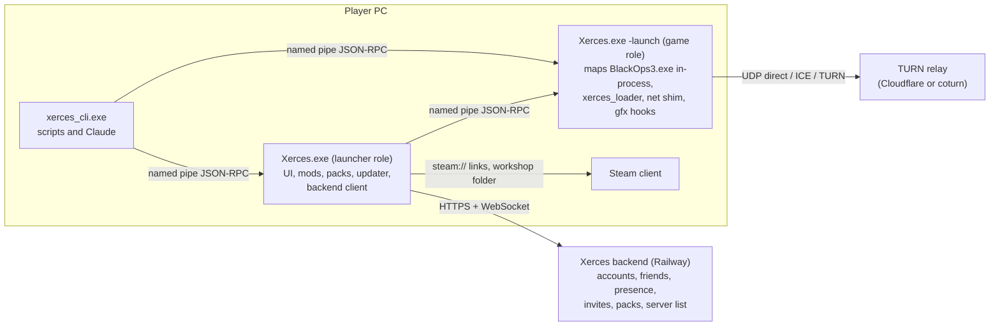

# Xerces design document

Status: **draft 2, for review** (2026-11-04). Draft 1 was reviewed by four independent reviewers
(completeness against your brief, technical accuracy, security, privacy and licensing, internal
consistency); this version fixes what they found. Nothing in the game client is implemented yet. The
first slice of the backend was built at your request and is ready to deploy (section 10.9).

Xerces is a rename and redesign of the Ezz BOIII client (itself a fork of momo5502's boiii, GPL-3.0)
into a multi-mod launcher and loader for Call of Duty: Black Ops III. It stays open source under the
same licence, keeps every upstream credit, and only targets self-hosted and offline play.

Research notes behind this document are in [`docs/research/`](research/). They come from reading the
code on 2026-11-04 (upstream `main` 5aa7fac and `mod-stack` ac356c3c, the fork's `refs/heads/main`
7805319) and from web research the same day. Treat them as leads with citations: anything marked
"runtime" still needs the real game. The networking notes were written against upstream `main`; they are
re-checked against the chosen base before milestone M6 (section 11).

---

## 0. Summary

### 0.1 What reading the code changed

1. **Start from current upstream, not from the fork's base.** The fork (`DeroXP/boiii-free`) is upstream
   as of 2026-04-09 plus 17 proof-of-concept commits; upstream is now 939 commits ahead. The installed
   `BlackOps3.exe` is the September 2026 Steam build (PE checksum `0x6531394`), and every address in the
   proof of concept targets the previous build (`0x888C368`).

2. **Upstream already built additive multi-mod loading.** The unmerged branch `upstream/mod-stack`
   (832-line `mod_stack.cpp`, 2026-10-15) loads extra mods' zones as `stack_<id>_<zone>` in the same
   `DB_LoadXAssets` batch and tiers as the main mod, routes their files, xpak streams and sound banks back
   to each mod's folder, and picks asset winners in `DB_OverrideAsset`. It is designed to avoid the `en_`
   language-pair wall and the `PMem_Free ... not at the top of the stack` crash without suppressing any
   error; the M0 session confirms that on real mods. Xerces builds its loader on that engine and adds what
   it lacks: manifests, dependency resolution, user-controlled deterministic order, conflict reports,
   merges, chained GSC hooks, safe mode and signature-resolved addresses for its hooks.

3. **The base has to include `beta`'s later security work.** `mod-stack` branched from `beta` before
   upstream's 2026-11-02 lobby-message security patches. Both `beta` and `mod-stack` also re-enabled the
   engine's remote lobby messages ("Resurrect lobby session system", 2026-10-11) and added voice chat, and
   both contain an anonymous Steam CM/CDN Workshop downloader (`workshop/steam_cdn.cpp`) that
   `mod-stack`'s join path calls automatically for missing mods. So: start from `beta` plus the two
   stacking commits (D1), and decide what happens to those downloaders (D15).

4. **"Survive game updates" can only be met in part.** Upstream's client, including the fenced
   anti-tamper and auth code, runs on per-build address tables and refuses to start on an unknown exe.
   After a Steam update the whole client is unusable until upstream publishes tables for the new build,
   and Xerces cannot port the fenced parts to signatures. What Xerces can do: resolve every address its own
   features use by signature, check the exe before loading it, and explain clearly what to do (4.1, D18).

5. **Two proof-of-concept findings should not be carried forward.** The "autoexec queue-add" function
   (old `0x1412D8810`) sits in the script-string (`SL_*`) cluster; its "export table" is exactly
   upstream's `gScrMemTreePub` and its begin/end flag is `gScrAnimPub[inst].animtree_loading`, so it is
   most likely a string-table routine, and calling it would corrupt script strings. The hidden FPS cap is
   already removed upstream by a `Com_FPSLimit` hook. Ledger: 2.3.

6. **Railway cannot carry game traffic.** Railway has HTTP/HTTPS and a TCP proxy, no public UDP. The API,
   WebSocket presence, invite signaling and Postgres fit it well; the relay has to be a TURN service
   elsewhere (D7).

7. **Temporal upscaling is feasible in principle but licence-gated.** A third-party BO3 mod (Luma
   Framework) ships DLSS through NGX D3D11 on build 24784313 by replacing the SMAA T2x resolve and
   patching its jitter, so depth, motion vectors and jitter are reachable. NVIDIA's RTX SDK licence forbids
   use that subjects the SDK to an open-source licence, which conflicts with a GPL-3.0 client. FSR 1, NIS
   and FSR 2.2 (MIT) do not have that problem (13.6).

### 0.2 Decisions

My recommendation comes first. "Needed by" says which milestone waits on the answer.

| # | Needed by | Decision | Recommendation | Alternatives |
|---|---|---|---|---|
| D1 | M0 | Upstream line Xerces starts from | `upstream/beta` (2026-11-03, has the lobby security patches) plus `mod-stack`'s two commits, conflicts resolved in M0, pinned. Provisional until the M0 session confirms stacking works (decision point in M0). Costs: AGPL-3.0 `sqlite_orm` comes with it (16.5), and `beta`'s build moved to premake 5.0.0 + ninja + LLVM | `mod-stack` as is (misses the security patches); `main` (no stacking) |
| D2 | M0 | Toolchain | Add VS "C++ Clang tools for Windows" and "MSBuild support for LLVM (clang-cl)" to your Build Tools, plus whatever `beta`'s ninja/LLVM build needs (checked first thing in M0). Upstream does not build with MSVC (verified) | Port the build to MSVC (diverges from upstream) |
| D3 | M0 | One supervised game session for runtime checks | Yes, with you nearby, using a build whose updater is already disabled (2.2) | You run a checklist yourself |
| D4 | M3 | Launcher UI technology | RmlUi, gated by a one-week spike | WebView2 (what upstream uses) |
| D5 | M3 | Visual direction | C / Signal, which you picked from the logos; please confirm now that all nine screens are on the canvas | A / Monolith, B / Vector |
| D6 | decided | Backend language | Python 3.12 + FastAPI + Postgres (slice M5a built, 10.9) | |
| D7 | M6 | Relay | Cloudflare Realtime TURN, coturn on Fly.io or Hetzner as fallback. Your brief asked for a relay on Railway; Railway cannot accept UDP, and a TCP or WebSocket relay there would share the spend limit that also stops the API and database, so I recommend dropping it | A WebSocket relay in a separate Railway project with its own spend limit |
| D8 | now (backend) | Railway plan | Pro ($20/month): native backups, point-in-time recovery, monitors | Hobby, plus a nightly `pg_dump` to storage outside Railway |
| D9 | M0 | Upstream download and swap features | Remove: the archive.org `BlackOps3.exe` download that deletes your exe, the launcher's version picker, the dedicated-server `-beta` self-download (all run executables without verification), and the "download page" popup for official Zombies DLC (replace with "this server uses DLC you don't own" and the Steam store page) | Keep them |
| D10 | M9 | Proprietary upscalers (DLSS, XeSS, FSR 4 binaries) | A separately built and distributed optional module, outside the GPL release, with vendor binaries supplied by the user; a legal opinion covering headers, static libraries and DLLs before anything ships | Skip them; ask vendors |
| D11 | M4 | Repo and releases | Rename `DeroXP/boiii-free` to `DeroXP/xerces` (GitHub redirects the old URL); first bring the fork's published `v0.0.x-alpha` releases into GPL compliance (source with submodules) or withdraw them | Keep the name |
| D12 | M1 | What v1.0 pulls forward from the "extra features" list | Updater client (must replace upstream's before any release), crash journal, safe mode and a basic diagnostics bundle (M1); translatable strings and the high-contrast theme (M3); dry-run, backup and rollback, profiles per game mode, manifest-only dependency resolution (M4) | Keep all extras in M8 |
| D13 | M3 | Names | `Xerces.exe` for the user-facing binary; C++ namespaces, libraries, DLLs, other executables and script builtins always `xerces_*`, never a bare `xerces` | `xerces_launcher.exe` |
| D14 | M0 | Upstream's Ezz infrastructure in Xerces builds | v1.0 keeps the read-only public server list from Ezz's masters, and turns off the parts that send identifiers to Ezz or third parties: friend presence, NAT rendezvous, the public-IP lookup and Ezz's Discord application. Xerces' backend replaces them in M5 and M6 | Keep everything until M6; or drop the server list too |
| D15 | M0 | Upstream's Workshop downloaders (anonymous SteamCMD, anonymous Steam CM/CDN client, FastDL v1 for maps) | Compile them out of Xerces builds with a build option, leaving their source untouched; Xerces' join path uses Steam subscriptions instead (9.5) | Keep them compiled but never called from Xerces flows |
| D16 | M3 | Update integrity | Sign update manifests with an Ed25519 key you keep offline before auto-update ships. This needs no certificate and is separate from code signing | Checksums only, as your brief says (then whoever can publish a release controls every client) |
| D17 | M0 | Activision and Demonware data inside upstream (a fastfile and service blobs embedded in the exe, `.gsh` headers in `data/`) | Keep them as upstream has them, as part of the frozen Demonware emulation; the rule becomes "Xerces adds no Activision data" | Strip them and accept what breaks |
| D18 | M1 | Goal 2 scope | Accept "Xerces features are signature-based; the client as a whole follows upstream's tables". Port non-fenced upstream symbols to signatures over time to shrink the dependency | Port nothing beyond Xerces' own hooks |
| D19 | M9 | FSR 3.1 upscaling | Port it to Xerces' DX11 backend after FSR 2.2 | Run it through Phase C's DX12 interop; drop it |
| D20 | M4 | Installer | Per-user installer (Inno Setup) with a Start-menu entry, an uninstaller and a `xerces://` link handler for invites and share codes | Portable zip only |
| D21 | M1 | Telemetry | None. The only thing that can leave the PC is a scrubbed crash bundle, uploaded only when you agree for that crash | Opt-in usage telemetry |
| D22 | M6 | Dedicated servers | Install the free "Unranked Dedicated Server" tool in M6 and give it its own signature set | M6 hardens listen servers only |

A position I am taking rather than asking: upstream's README advertises play without owning the game and
Workshop downloads without ownership. Xerces leaves that code exactly as it is, as you asked, builds
nothing on top of it, and its own docs and launcher describe it as a client for people who own Black Ops
III on Steam. None of Xerces' own features fetch game or Workshop content for someone who could not get it
through Steam.

### 0.3 Milestones at a glance

M0 foundation → M1 loader and manifest → M2 conflict system → M3 launcher UI and rename → M4 packs and
Workshop = **v1.0** (published publicly once code signing is in place, per your TODO; preview builds
before that) → M5 backend and friends (slice M5a built) → M6 servers → M7 performance → M8 extra
features → M9 upscaling. Section 18.

---

## 1. Scope

### 1.1 Goals

Goals from the brief map to sections: 1 rename and UI (7), 2 install-agnostic loader (4), 3 multi-mod (5),
4 conflicts (6), 5 in-game menu (7.6), 6 packs (8), 7 Workshop (9), 8 friends backend (10), 9 servers
(11), 10 performance (12), 11 upscaling (13). The must-haves are in 14 (display and input), 15
(automation), 16 (release, trust, privacy, operations) and 17 (compatibility). Appendix A traces every line
of the brief.

### 1.2 Non-goals

- Anything that touches official online matchmaking, Demonware or Treyarch services.
- Frame generation.
- Making the client independent of upstream's per-build address tables. Fenced code makes that
  impossible (4.1).
- Supporting the pre-September-2026 game build in new Xerces code.
- Merging compiled fastfiles offline. Mods are combined at load time.
- Hosting mod content. Xerces points at the Workshop and at author-provided URLs.

### 1.3 Hard boundaries

**Fenced code.** [`docs/FENCED.md`](FENCED.md) is the canonical list: Steam ownership and licence
handling, auth tickets, anti-tamper (Arxan), Treyarch anti-cheat (TAC) workarounds and fastfile
authentication. Xerces does not modify, extend or port these, and does not route new features through them.
Upstream merges may change them.

Some fences cover a whole file; others cover a block inside a file that Xerces does need to edit. Files
Xerces expects to touch outside their fenced blocks: `client_patches.cpp`, `patches.cpp`, `main.cpp` (game
detection and version checks only), `gsc/vm.cpp` and `gsc/gsc_funcs.cpp` (the `replacefunc` redirect code
is not part of the TAC fence), `network.cpp`, `nat.cpp`, `friends.cpp`. Enforcement (M0):
`tools/ci/check_fenced.py` keeps a normalized-token hash of every fenced function or block (anchored by
name) and fails any non-merge commit that changes one; whole-file fences are checked by path. Any commit
that touches a file containing a fenced block needs a "fence reviewed" note in its message.

**Matchmaking.** Demonware emulation is frozen. Every Xerces online feature is either a connectionless
command between Xerces peers or a call to the Xerces backend.

**Steam access control.** Workshop content reaches Xerces features only through the user's Steam client.
Xerces adds no new download path for Workshop content and never transfers it between players. Upstream's
own downloaders are covered by D15.

**Licence.** GPL-3.0 for the client (plus AGPL-3.0 for `sqlite_orm` if D1 brings it in). The backend is a
separate program under MIT. Release gates for compliance: 16.5.

---

## 2. Where we start

### 2.1 This machine (checked 2026-11-04)

| Item | Value | How it was checked |
|---|---|---|
| Game install | `C:\Program Files (x86)\Steam\steamapps\common\Call of Duty Black Ops III`, Steam build 24784313 | `appmanifest_311210.acf` |
| `BlackOps3.exe` | 106,059,256 bytes, PE checksum `0x6531394`, linked 2026-08-11 18:00:53 UTC | PE header |
| Matches upstream's supported build | Yes: checksum equals `supported_client_checksum` (`src/client/main.cpp:125`); xxh3-64 equals the `verification.json` entry | hashed locally |
| Code encrypted on disk | Yes: the first `.text` (47 MiB) averages 7.94 bits/byte of entropy, `.rdata` 7.91; plain x64 code is about 6 to 6.5 | entropy scan |
| Toolchain | VS 2022 Build Tools, MSVC 14.44, Windows SDK 10.0.22621 and 10.0.26100, premake 5.0.0-beta8, CMake 4.4. No ClangCL toolset | `vswhere`, toolset folders |
| Baseline build of upstream `main` | Fails: `MSB8020 The build tools for clangcl cannot be found`. Forcing MSVC fails on clang-only flags (`D8021`) | ran it |
| GPU | RTX 5070 Ti; WebView2 runtime 156 | WMI, registry |
| Workshop content | 17 items: 9 mods, 8 maps. Every mod ships `core_mod.ff`; 8 of 9 ship 12 language variants; 7 ship `zm_mod.ff`. Native DLLs: `T7Overcharged.dll` in DS4C, PEGASUS and the Super Mario 64 map (a different 2.9 MB build), `T7AAO.dll` in Ascendance | folder scan |
| Not installed | BO3 Mod Tools, the Unranked Dedicated Server, Node, Go, Docker, Railway CLI | PATH, Steam library |

### 2.2 Upstream today

| Branch | Head | Relation to `main` | Notes |
|---|---|---|---|
| `main` | 5aa7fac, 2026-09-27 (v3.0.0) | | September 2026 exe support; drops remote lobby messages |
| `beta` | f2fdc83d, 2026-11-03 | +464 | lobby system resurrected (4eb08543, 10-11) and patched (f01c6b5f, 9dc352b4, 11-02); voice chat; premake 5.0.0 + ninja + LLVM; AGPL `sqlite_orm`; Workshop rewrite including `steam_cdn.cpp` |
| `mod-stack` | ac356c3c, 2026-10-15 | +208 (206 from `beta` as of 10-15, plus 2 stacking commits) | stacking; has the lobby resurrection but not the 11-02 patches; join prompt auto-downloads missing mods (`check_valid_mod_stack` calls `start_download`) |

Bringing `mod-stack` onto today's `beta` conflicts in 6 files: `mods_menu/__init__.lua`,
`dedicated/setup_check.cpp`, `nat.cpp`, `party.cpp`, `workshop/workshop.cpp`, `workshop/workshop.hpp`.

Xerces reuses from upstream: the in-process loader; the component lifecycle; the symbol tables; mod
stacking; the UGC pools; the built-in GSC compiler with `detour`/`replacefunc`; the Lua UI layer and mods
menu; the networking layer; UPnP; the xxh3 install verifier; the ImGui overlay.

What Xerces must change before shipping any build, and when:

| Problem | Detail | When |
|---|---|---|
| Updater | In Release builds it replaces the running exe with upstream's `boiii.exe` whenever the hash differs, runs a forced first update **even with `-noupdate`**, and deletes every file under `%LOCALAPPDATA%\boiii` that is not in upstream's manifest. The fork had to stub it (e5968d07) | First commit of M0, before any build is launched |
| Unverified downloads | archive.org exe swap, version picker, dedicated `-beta` | M0 (D9) |
| Third-party endpoints | Ezz masters (server list, presence, rendezvous), ipify, `r2.ezz.lol`, Ezz Discord app, GitHub API, `steamcommunity.com` scraping, Steam Web API, Steam CM/CDN | M0 inventory and D14/D15 switches; a CI lint for hard-coded hosts |
| First-run detection | An inverted check in `find_steam_game_path` (`main.cpp:649-651`) loops forever when the game is outside the default library and the client lives elsewhere | M1 (4.7) |
| Release logging | Release builds write almost no log file | M1 (15.1) |
| One detour per address | MinHook refuses a second hook on a target and upstream's `detour::create` throws | M1 (3.4) |
| Hardcoded addresses and the checksum gate | 3,548 `symbol<>` objects, 138 inline `select()` sites, ~585 server relocations, 49 mid-function offsets; unknown checksums throw before anything else runs | 4.1 explains what can and cannot change |

### 2.3 The proof of concept: re-verification ledger

Status codes: **Verified** (checked on this machine today), **Superseded** (upstream solved it another
way), **Likely wrong**, **Runtime** (plausible, needs the game), **Dropped** (failed or unsafe). Rows 1, 5,
6 and 7 are re-tested in the D3 session; rows 10 and 11 are re-measured in M7.

| # | Lead from your commits | Status | Evidence today | What Xerces does |
|---|---|---|---|---|
| 1 | Additive loading by calling `DB_LoadXAssets` directly | Superseded | mod-stack hooks the `DB_ExpandZoneList` and `DB_LoadXZone` call sites inside `DB_LoadXAssets` and adds aliased zones to the same batch | Build on mod-stack; test live |
| 2 | Extra search paths (`FS_AddSearchPath`, promote-to-head) | Superseded | mod-stack routes aliased names in `FS_BuildOSPathForThread`. Your `FS_AddSearchPath` is upstream's `FS_AddGameDirectory` | Read-only diagnostic only |
| 3 | Skipping unload | Dropped | No working variant was recorded | Not ported |
| 4 | Slot redirection | Dropped | Never implemented; the address is a stream file-layer function | Not ported |
| 5 | Second mod's GSC stays inert until `Scr_LoadScript` | Superseded, Runtime | Upstream generates autoexec bootstraps for custom scripts since 2026-06-14; mod-stack runs each mod's entry script (`_clientids.gsc`) as a renamed copy in its own namespace | Test live |
| 6 | Autoexec queue-add function (old `0x1412D8810`) | Likely wrong | It sits in the `SL_*` cluster; its "export table" is `gScrMemTreePub`; its flag is `gScrAnimPub[inst].animtree_loading` | Never call it; falsification test on a live dump |
| 7 | PMem LIFO crash when two fastfiles share a name | Runtime (cause understood) | Same-named zones in different slots break the LIFO order; unique aliases in one batch are designed to avoid it | No suppression; test with 2+ mods |
| 8 | On-disk `.text` is encrypted | Verified | Entropy above | Signatures resolve in memory; offline work uses live dumps |
| 9 | Hidden FPS cap and the one-byte limiter patch | Superseded | Upstream hooks `Com_FPSLimit` to return `UINT32_MAX` | Not ported |
| 10 | "~200 FPS with the GPU at 58%: CPU-bound" | Runtime | Measured with the hidden cap still active, so the conclusion is a hypothesis | Re-measure without the cap (M0, M7) |
| 11 | Priority/timer changes crash during startup; Sleep and Wait hooks crash | Runtime | Commit text | Tweaks only after the main menu, opt-in; no Sleep/Wait hooks |

---

## 3. Architecture

### 3.1 Processes



- One binary, two roles, as upstream already does (`-launch`). The launcher stays open while the game
  runs, so friends, invites, presence and relay control keep working and the UI technology never lives in
  the game process.
- The game role keeps upstream's in-process model: map `BlackOps3.exe`, run component phases, jump to the
  entry point.
- `xerces_cli.exe` is a small console program for automation that talks to whichever process is running.
- The dedicated server is the same binary with `-dedicated`.

### 3.2 Code layout

| Path | Kind | Contents | Game headers |
|---|---|---|---|
| `src/xerces_core/` | static lib | manifest schema and parser, semver, resolver, planner, asset-index model, conflict engine, merge planners, packs and share codes, checksums, JSON log writer, IPC message types | no (headless, unit-tested in CI) |
| `src/xerces_tests/` | console app | doctest unit tests, scanner tests on synthetic buffers | no |
| `src/xerces_cli/` | console app | the CLI (15.2) | no |
| `src/client/xerces/` | client components | `xerces_loader`, `xerces_hookbus`, `xerces_sigscan`, `xerces_gfx`, `xerces_input`, `xerces_ipc`, later `xerces_net`, `xerces_perf`, `xerces_upscale` | yes |
| `src/xerces_launcher/` | launcher module | UI host, views, game detection, updater client, backend client | no |
| `src/xerces_dev/` | plugin DLL, dev builds only | RE tooling moved out of the production path (5.9) | yes |
| `data/xerces/` | assets | UI documents and styles, tokens, fonts (OFL), translations, in-game Lua scripts | |
| `tests/` | fixtures | loose fixture mods, scenario definitions, expected outputs | |
| `compat/` | data | `builds.json` (4.6) | |
| `backend/` | separate service, MIT | section 10 | |
| `tools/` | scripts | rename, signature tooling, memory dump (dev), release, deploy, CI checks | |

Headless code must not include `std_include.hpp`, `game/` headers or `dependencies.imports()`, because
`game/symbol.hpp` routes through the fenced `arxan::detail` proxy. Tests live under `src/` but outside
`src/client/`, which the client project globs.

### 3.3 Startup phases

Upstream's phases are implicit. Xerces names them and logs each transition:

1. `preload`: component constructors. No game memory access.
2. `image_mapped` (`post_load`): import-table and OS hooks only.
3. `symbols_resolved` (new, first step of `post_unpack`, after the fenced arxan component): the signature
   registry resolves Xerces' symbols and reports per feature.
4. `features` (`post_unpack`): Xerces components install hooks through the hook bus.
5. `game_ready`: first frame of the main menu. Process tweaks and anything that prints to the in-game
   console wait for this (both crashed earlier phases in your tests).
6. `shutdown` (`pre_destroy`).

Xerces components declare `depends_on` and are ordered by a logged DAG instead of link order.

### 3.4 Hook bus

One owner per engine function or vtable slot. The bus installs one detour and runs, in declared order:
`before` callbacks, a **chain** stage (each callback either handles the call and returns, or passes it on;
the last link is the original), and `after` callbacks that may inspect or change the result. A callback
that throws is logged and disabled instead of crashing the frame.

Shared targets known on day one: `IDXGISwapChain::Present`/`ResizeBuffers` (and `Present1`/
`ResizeBuffers1`), `DB_LinkXAssetEntry`, `DB_OverrideAsset`, `DB_FindXAssetHeader`, `DB_AssetPoolInit`,
`DB_LoadXAssets`, `FS_BuildOSPathForThread`, `Com_Error`, the `Scr_BeginLoadScripts` call site, and the
console interceptor. Upstream components that hook these move onto the bus with small, mechanical diffs.
Demonware's import-table hooks are not moved (11.2).

### 3.5 Paths and data

| Root | Contents | Owner |
|---|---|---|
| `<home>\app\` | binaries and data the updater installs | updater (the only folder it may clean) |
| `<home>\config\` | one versioned JSON config, packs, profiles, plans | user |
| `<home>\cache\` | signature cache, asset index, Workshop metadata | Xerces (safe to delete) |
| `<home>\logs\`, `crash\`, `backups\` | logs, crash bundles, pre-change backups | Xerces |
| `<home>\run\` | one file per running process: pipe name and token (ACL: current user) | Xerces |
| `<game>\xerces_players\` | files the engine expects next to the game (upstream's `boiii_players`) | engine |

`<home>` defaults to `%LOCALAPPDATA%\Xerces` and can be overridden with `XERCES_HOME` or `-xerces-home`.
The override matters for automation: on this PC, files that processes started from the Claude app create
under AppData land in a private copy other programs cannot see, so Claude-driven runs use a folder such as
`C:\Users\Ginld\XercesHome`.

Compatibility paths stay where they are: upstream's identity key (`%LOCALAPPDATA%\boiii\user\`, read by the
fenced `auth.cpp`) is never moved or regenerated, and `<game>\boiii\` (user scripts, script data, lookup
tables) keeps working. On first run Xerces offers a read-only import of settings, favourites and binds from
`%LOCALAPPDATA%\boiii` and `boiii_players`. All paths use wide-character APIs.

Developer memory dumps default to `C:\Users\Ginld\XercesDev\dumps` (outside OneDrive and AppData); the
dump tool refuses OneDrive folders.

### 3.6 Staying in sync with upstream

- Xerces code lives in its own folders (3.2), so upstream merges rarely touch it.
- The rename (7.7) has a brand tier, applied by a re-runnable script that never touches fenced paths, and a
  compatibility tier that keeps upstream identifiers.
- Upstream changes arrive on `sync/upstream-YYYYMMDD` branches: build, run the checklist, merge.
- `mod_stack.cpp` becomes Xerces-maintained code pinned to a known upstream commit; changes upstream makes
  to it are reviewed and taken by hand.
- Generic fixes (hook bus, updater, detection) could be offered upstream as pull requests. Your call.

---

## 4. Signatures and build compatibility (goal 2)

### 4.1 What survives a game update, and what does not

When Steam ships a new `BlackOps3.exe`:

- **The whole client stops** until upstream publishes address tables for the new build and Xerces merges
  them. Upstream's code, including the fenced anti-tamper and auth parts (1,223 integrity-check addresses
  in `integrity.hpp` alone), uses per-build addresses, and `main.cpp` refuses to start on an unknown
  checksum. Fenced code cannot be ported to signatures under the hard boundary, so Xerces cannot remove
  this dependency. Upstream adapted to the September 2026 build within weeks.
- **Xerces' own features** resolve every address they use by signature, so they keep working across
  upstream's table updates, and if one of their signatures misses, only that feature turns off (4.4).
- **Xerces explains the situation** instead of failing obscurely (4.2).

D18 asks whether to also port non-fenced upstream symbols to signatures over time. That shrinks the work
each update needs; it cannot remove the dependency.

### 4.2 Pre-flight check

Before mapping the game, the launcher compares the exe's size, checksum, link time and SHA-256 with
`compat/builds.json`:

- **Supported**: launch.
- **Newer than any supported build**: "Steam updated Black Ops III (build 24901234). Xerces supports build
  24784313. Play through Steam until a Xerces update supports the new build. Xerces will tell you when it
  does." No download offers, no file changes.
- **Unknown or modified**: the same message, plus "Verify the game files in Steam".

This replaces upstream's archive.org patch prompt (D9).

### 4.3 Signature registry

- A generated data file lists every symbol Xerces code needs: name, kind (function, data reached through a
  RIP-relative operand, mid-function site), one or more byte patterns with wildcards, an anchor and offset
  rule for data, the expected section, and known addresses for builds already mapped.
- Day-one entries include everything `mod_stack.cpp` uses: `DB_OverrideAsset`, `DB_LinkXAssetEntry`, the
  `DB_ExpandZoneList` and `DB_LoadXZone` call sites inside `DB_LoadXAssets`, `FS_BuildOSPathForThread`,
  `SND_StartHeaderRead`, `KeyValuePairs_GetNextValue`, `UGC_ModChange_ApplyQueued`, and the
  `UIElement_RenderLoadedMod` call site.
- Resolution runs once in `symbols_resolved`. It scans the first `.text` and `.rdata` (string anchors), and
  the `.interpr` section (the Havok Script interpreter, which holds three upstream symbols) read-only. It
  never scans or patches the second `.text`.
- A symbol must match exactly once in its section and agree with a known address when one exists. Zero or
  several matches fail closed.
- Results are cached by exe identity and re-validated by comparing bytes, so a normal start costs
  milliseconds.
- Code bytes are never written without first checking the whole expected instruction sequence.

### 4.4 When a Xerces signature misses

This happens on a build upstream supports when upstream's update moved something Xerces' pattern no longer
matches. Each feature declares the symbols it needs; a miss turns that feature off and the launcher says,
for example:

> Multi-mod loading is off on this game build. Xerces could not find `DB_OverrideAsset` (signature
> `db.override_asset`, 0 matches). Vanilla play and single mods still work. Diagnostics > Copy report.

### 4.5 Making and testing signatures

- `tools/dev/dump_memory.py` (from your `dump_bo3_memory.py`, with a process-name parameter, chunked reads
  and the protected sections skipped) saves the decrypted image of a running game to the dev dump folder.
  It runs out of process; Xerces has no in-process dump command.
- `tools/dev/sigmaker.py` proposes the shortest unique pattern for an address, wildcarding RIP-relative
  displacements and immediates.
- `xerces_cli sig check --dump <dir>` runs the registry against a dump offline. One dump of a new build
  shows exactly which signatures need work.

### 4.6 Supported-build matrix

`compat/builds.json` lists each known build with one status:

- **supported**: upstream's tables and every Xerces signature match;
- **upstream-only**: upstream supports it but some Xerces signatures miss, so those features are off;
- **unsupported**: upstream has no tables for it; the pre-flight check stops the launch.

### 4.7 Install-agnostic detection (M1)

A Xerces detection service, separate from the fenced Steam code:

1. a path the user saved earlier;
2. `HKCU\Software\Valve\Steam\SteamPath` and `HKLM\SOFTWARE\WOW6432Node\Valve\Steam\InstallPath`;
3. every library in `steamapps\libraryfolders.vdf` (parsed properly), checking `appmanifest_311210.acf`;
4. a folder picker in the launcher.

The game role loads `BlackOps3.exe` and its DLLs by absolute path (bare `LoadLibraryA` names let a same-named
DLL next to Xerces win today) and fixes the inverted detection check, so Xerces can live anywhere.

---

## 5. Multi-mod loader (goal 3)

### 5.1 Terms

- **Mod**: a Workshop or local BO3 mod, identified by a stable id.
- **Map**: a custom map. The engine allows one at a time, alongside mods.
- **Stack**: the ordered list of mods for a session. Position 1 has the highest priority.
- **Plan**: the resolved, deterministic description of one launch (stack, map, merges, hook chains,
  settings) with a `plan_id` hash.
- **Content id**: a narrower hash used to check that a joining player has the same content as the host
  (5.3).
- **Pack**: a named, versioned, shareable plan template (8). **Profile**: the default pack for a mode.

### 5.2 Mod manifest (`xerces.mod.json`)

Lives in the mod's root folder next to `workshop.json`. Schema: `docs/schema/mod-1.schema.json` (M1).

```json
{
  "schema": 1,
  "id": "vela.perk_rebalance",
  "name": "Perk Rebalance",
  "version": "2.1.0",
  "authors": ["vela"],
  "license": "CC-BY-4.0",
  "requires": { "xerces": ">=1.0 <2", "modes": ["zm"] },
  "source": { "workshop": 1234567890 },
  "dependencies": [ { "id": "orrin.better_hud", "version": "^1.4.0", "optional": false } ],
  "conflicts": [ { "id": "pell.faster_revive", "reason": "Both rewrite perk purchase" } ],
  "order": { "after": ["orrin.better_hud"], "before": [], "priority": 0 },
  "assets": {
    "provides":  [ { "type": "scriptparsetree", "name": "scripts/zm/vela_perks.gsc" } ],
    "overrides": [ { "type": "scriptparsetree", "name": "scripts/zm/_zm_perks.gsc", "reason": "perk limit" } ],
    "extends":   [ { "type": "stringtable", "name": "gamedata/weapons/zm/zm_levelcommon_weapons.csv", "key": [0] } ]
  },
  "scripts": {
    "entry": ["scripts/zm/vela_perks.gsc"],
    "hooks": [ { "target": "scripts/zm/_zm_perks.gsc::give_perk", "handler": "scripts/zm/vela_perks.gsc::on_give_perk", "kind": "wrap" } ]
  },
  "capabilities": {
    "native_code": false,
    "lua": { "unsafe": false, "net": [], "files": [] },
    "gsc": { "exec_command": false, "files": false, "replacefunc": false }
  },
  "settings": [
    { "key": "cost_mult", "type": "float", "default": 1.0, "min": 0.25, "max": 2.0,
      "label": "Perk cost multiplier", "dvar": "xm_vela_cost_mult" }
  ],
  "integrity": { "core_mod.ff": "sha256:...", "zm_mod.ff": "sha256:..." }
}
```

Rules: `id` matches `^[a-z0-9][a-z0-9._-]{2,63}$` and never changes; versions are SemVer 2.0; ranges use
npm-style syntax; unknown fields are kept with a warning. `xerces_cli mod validate <path>` checks schema and
semantics (files exist, hashes match, hooks name real exports once the mod is indexed).

**Mods without a manifest** (every Workshop mod today) get a synthesized one, marked **legacy**: id
`ws.<publishedfileid>` or `local.<folder>` (lowercased, invalid characters replaced, a short hash suffix on
collisions), name from `workshop.json`, version `0.0.0+ws.<time_updated>` or a content hash, `native_code`
set when the folder contains executable files, assets from the index (6.1).

### 5.3 Resolving a plan

All in `xerces_core`:

1. Expand dependencies transitively and pick the highest installed version that satisfies every range.
   Missing or unsatisfiable dependencies become a fix action (9.4), not a crash.
2. A declared conflict blocks the plan unless the user overrides it for this pack.
3. Order: a dependent ranks above its dependencies (so it can override them); manifest hints add
   constraints; the user's drag-and-drop order is applied last and wins. A broken hint is a warning, a
   broken dependency an error. Ties break by priority, the user's last saved position, then id.
4. Validate against mod-stack's limits: every stacked mod's folder name or Workshop id is at most 37
   characters (mod-stack skips longer ones, because its aliases must stay under 60 characters) and has no
   comma; a main mod is set.
5. Budget: count the zones the plan adds from the files actually present (each stacked zone, its language
   variant and `_patch` variant) on top of the stock zones of the plan's mode and map, against the engine's
   64-slot table (63 usable). Also check script and pool limits (500 linked script objects per VM; pool
   sizes from `assetlimits.txt`). Over budget is an error with the numbers.
6. Hash: `plan_id` = SHA-256 over canonical JSON of everything in the plan, including client-only
   settings. `content_id` = SHA-256 over what must match between host and joiner: mod ids, versions,
   content hashes, order, map, server-relevant settings, game build and the Xerces protocol version.

The planner explains every ordering decision ("Perk Rebalance is above Better HUD because it depends on
it"), shown in the dry-run (8.6) and by `xerces_cli plan explain`.

**Priority is the stack order.** In v1, conflicts are resolved by reordering. Per-script winners that
differ from the stack order (for example "use Faster Revive's perks script but keep Perk Rebalance on top")
are an M2 stretch: they need the hook bus chain stage to run after mod-stack's own `DB_OverrideAsset`
logic, keyed by script base so the `.gsc` and `.csc` halves always move together.

### 5.4 Loading a plan in the game

1. The launcher writes `config\plans\<plan_id>.json` and starts
   `Xerces.exe -launch -xerces-plan <plan_id> +set fs_game <top> +set fs_extramods "<rest, in order>"`.
2. M0 checks whether `+set fs_game` on a client reaches the engine's mod-load path the way it does on a
   dedicated server. If it does not, `xerces_loader` loads the main mod through
   `UGC_LoadModByPublisherId_Impl` once the front end is up.
3. After the dvars are loaded, `xerces_loader` only verifies them against the plan and the files (cached
   hashes) and registers its hook-bus callbacks: ownership capture, override policy, merges, GSC chains.
4. Asset pools are sized once at `DB_AssetPoolInit` from the largest limits of every installed mod, not
   just the current plan. mod-stack currently re-applies each extra mod's `assetlimits.txt` on every mod
   load through upstream's growth path, which copies only part of a pool and frees the previous extension
   while assets may still point into it. Xerces blocks pool growth once assets are live; a plan that would
   need bigger pools asks for a restart instead.
5. Front end: the engine loads the core tier, and mod-stack adds `stack_<id>_core_mod` and its language
   pair to the same batch. Map load does the same for the mode tier (`zm_mod`, `mp_mod`, `cp_mod`) and the
   map's zones. Xerces records every asset link and override decision.
6. Script load: mod-stack's entry-script copies load; Xerces binds hook chains after all scripts are known.
7. Every step writes JSON events (`loader.plan.applied`, `loader.zone.loaded`, `loader.asset.override`,
   `loader.gsc.chain.bound`, `loader.ready`) with the `plan_id`.

### 5.5 Unload and reload

- The stack changes only in the front end. mod-stack already supports it (`ModStack.Reload`, then a full
  mod reload): the engine unloads the mod tiers as one batch and loads the new plan.
- No partial unload of one mod in v1. Unloading one mod's zones can leave other mods holding stale
  references; your proof of concept hit exactly that ("Could not load default asset").
- In-game changes queue until the next front-end visit. A change that needs larger pools asks for a restart.

### 5.6 Safe mode and crash recovery

- A launch journal (`logs\journal.json`) records phases (`launching`, `symbols`, `frontend`,
  `loading_map`, `in_game`, `clean_exit`) with the `plan_id`.
- After **any** crash with mods enabled, the next launch defaults to safe mode (all mods off, same game
  settings) with one-click "Retry with mods", and the launcher names the plan that crashed. Other options:
  report, or "find the culprit", which bisects the stack over a few launches.
- Upstream's `-safe` flag forces windowed mode and turns vsync off; Xerces keeps that and adds mods-off.

### 5.7 No suppressed fatal errors

The proof of concept returned from `Com_Error` for the PMem and "default asset" errors. `Com_Error` does
not return normally, so the engine then ran code that assumed it had stopped. Xerces never does this.
Instead: unique aliased zones in one batch are designed to make the same-name collision impossible (tested
in M0), plans are validated before anything loads, pools never grow under live assets, and when the engine
still raises a fatal error, the journal ties it to the plan and safe mode takes over.

### 5.8 Native code and unsafe Lua in mods

From the code (to confirm in M0): upstream blocks a list of known mod DLLs by name, including
`T7Overcharged`, `T7Recharged`, `AAE` and `discord_game_sdk`, and pretends `T7Overcharged` is present to the
mods' Lua. On `main` and `mod-stack` no other Lua DLL loads; after the `beta` merge (D1), DLLs not on the
list load through the engine's `load_dll` path. Xerces:

- keeps upstream's block list and `-disable-loadlib` exactly as they are; consent never overrides them;
- adds consent inside the `load_dll` detour, keyed by the DLL's SHA-256 and its PE export name rather
  than its file name, and attributed to the mod or map whose folder it came from;
- treats consent as trust in the whole plan (all mods share one Lua VM, so consent is not isolation) and
  asks again whenever any mod in the plan changes;
- never accepts native-code consent for content that arrived through a join or a share code.

### 5.9 Debug and reverse-engineering tooling

The useful parts of the `bundle_*` commands move into `xerces_dev.dll`, built only with `--xerces-dev` and
loaded only with `-xerces-dev`: disassembly, byte dumps, string/xref/data-ref search, zone table, search
path and script inventory dumps, the `Scr_LoadScript` caller histogram, draw and Present profilers, and
file-open tracing. Memory dumps stay in the out-of-process tool (4.5).

Not carried over: hardware breakpoints and thread-creation hooks (they overlap the anti-tamper layer), the
unauthenticated command-file watcher, the arbitrary memory-patch command, `SendInput` automation, the
`Com_Error` suppression, the validator patch, skip-unload and the queue-add path.

**Plugins.** Upstream loads every DLL in two user-writable folders at startup, in Release builds too.
Xerces release builds compile plugin loading out; dev builds load only DLLs whose SHA-256 the developer
approved. Dev plugins use a versioned ABI (`xerces_plugin_query()` returning name, version and API version,
plus a host function table). Existing upstream plugins therefore stop loading in Xerces release builds.

### 5.10 Crash bundle and diagnostics

`xerces_cli diag bundle` and the launcher's "Copy report" produce one zip:

- a **minimal** minidump (thread stacks only; no data segments or referenced heap, which would hold
  transport keys, tokens and other players' addresses); full dumps stay local and are never uploaded;
- the last JSON logs (already scrubbed: profile paths replaced, no addresses) and the launch journal;
- the plan with mods in order, versions and hashes, and the signature report;
- system specs: Windows build, CPU, GPU and driver, RAM, displays and refresh rates, Proton detection,
  Xerces and game build.

Symbolication: release PDBs are archived for every version from v1.0 (M4 pipeline); Xerces frames are
resolved offline; game frames are labelled with the nearest signature-registry symbol plus an offset.
Uploading a bundle is opt-in for each crash and shows the file list first (D21). Upstream's "post it on
Discord" text goes away.

---

## 6. Conflict prevention (goal 4)

### 6.1 Asset index

- **Capture.** A hook-bus callback on `DB_LinkXAssetEntry` records type, name, zone, owning mod and size,
  plus an exact content hash for script parse trees, rawfiles, stringtables and localized strings. Other
  types (weapons, models, images, sounds, materials, effects) are identified by zone-file hash, type and
  name only. `DB_OverrideAsset` decisions are recorded too.
- **Cache.** `cache\index\<sha256 of the mod's zone files>.json`, plus a stock index per game build. A
  changed file means a new hash and a re-index.
- **Index runs.** For a mod Xerces has never seen, `-xerces-index` starts the game role, loads the stack
  and one stock map per mode it supports (so the mode tier, where most gameplay content lives, is indexed
  too), writes the index and exits. That takes minutes, not seconds, and runs once per mod version. The
  stock index is built the same way. Until a mod is indexed, the report says which tiers are missing.

### 6.2 Ownership map

`xerces_core` combines the plan and the indexes into `(type, name) -> owners in plan order -> winner and
rule`. It is computed before launch and checked against the runtime events; differences are logged as
`conflict.index_mismatch`.

### 6.3 Rules

1. Adding new assets is always allowed.
2. Extending a mergeable asset (stringtable, config, localized strings, precache list) is always allowed
   and merges (6.5).
3. Replacing an asset the game or another mod provides needs a declared override in `assets.overrides`.
   An undeclared override from a manifest mod is blocked (the next owner's copy wins) and reported; the
   user can allow it per mod.
4. Legacy mods declare nothing, so their overrides are implicit. Two legacy mods replacing the same
   hashable asset with different content is a conflict the user resolves once by reordering (saved in the
   pack).
5. Identical content is never a conflict, for the types that have an exact hash. Overlaps on other types
   are reported as "overlap, not compared, resolved by order" without asking.
6. The map ranks above all mods for its own scripts by default; the user can change that per pack.

### 6.4 Strategy per asset type

| Asset | Strategy |
|---|---|
| Stringtable (`.csv`) | Row and key merge, three-way against the base table |
| Rawfile config (`.cfg`, `.json`, key=value) | Merge by key for known formats; otherwise exclusive |
| Localized strings | Merge by key; the same key in two mods resolved by order |
| Precache lists (`BG_CACHE`) | Union (mod-stack already does this) |
| Scripts (`.gsc`/`.csc`) | Exclusive per script, `.gsc` and `.csc` always from the same mod (mod-stack); entry scripts run as per-mod copies (mod-stack); function-level chaining through declared hooks (6.6) |
| UI (`.lua` rawfiles under `ui/`) | Exclusive by order |
| Weapons, attachments, models, images, sounds, materials, effects | Exclusive by order; not compared |

### 6.5 Merges

**Stringtables.** Key columns come from the manifest (`extends[].key`), default column 0. The base is the
stock table; for a table the game does not have, the base is the lowest-priority provider's copy (or a
base declared by a shared dependency). Each mod's diff against the base (added, changed, removed rows)
applies from the lowest priority up, so the higher mod wins a cell both changed, and that cell is reported.
The result is a new `StringTable` built by Xerces (counts, cells, cell hashes, sorted cell index) and
served through a `DB_FindXAssetHeader` override registry scoped to the plan. The engine's cell-hash function
and sort order are found by signature and matched exactly: unit tests compare against reference tables the
engine built from Xerces' own fixture CSVs on this PC (derived data, no Activision content).

**Configs.** `.cfg` merge by dvar name, `.json` by key path, key=value files by key. Anything else is
exclusive. **Localized strings** merge by key.

### 6.6 GSC hook registry

Upstream today has `detour` and `replacefunc`: one replacement per target, no call-original, server VM
only, cleared on `G_InitGame` and by `clearreplacefuncs`. Xerces turns it into a chain:

- Each target function has an ordered list of hooks. Kinds: `before`, `after`, `wrap` (gets to call the
  next link once) and `replace` (needs a declared override; exclusive).
- The highest-priority mod's hook is outermost.
- Calling the next link uses a new unqualified builtin, `xerces_next(...)`. (A namespaced call such as
  `ns::next()` would compile into a script import, not a builtin call.) It is registered like upstream's
  other custom builtins and calls the next link or the original through a per-call bypass.
- Chains bind after every script in the plan has loaded, survive `G_InitGame`, and are rebuilt only when
  the plan changes. CSC gets the same support where the client VM allows it.
- The M2 spike proves call-next in the VM, and includes a handler compiled with Treyarch's Mod Tools to
  show their compiler accepts the syntax. If call-next fails, chains offer `before` and `after` only.

Legacy mods never declare hooks; their whole-script overrides stay exclusive. Every mod's entry script runs,
so mods that use the game's own callbacks (`callback::on_spawned` and friends) already combine.

### 6.7 Reports

> **1 conflict needs a decision.** Faster Revive and Perk Rebalance both replace
> `scripts/zm/_zm_perks.gsc` with different code. Perk Rebalance wins because it is higher in the order.
> Faster Revive's revive speed change will not apply. [Move Faster Revive up] [Keep order]
> [Disable Faster Revive]
>
> **12 rows merged.** Extended Box Pool and Classic Weapons Pack both add rows to
> `zm_levelcommon_weapons.csv`. Both apply.

`xerces_cli conflicts check --pack <file> --json` returns the same data for scripts. M2 promises that the
pre-launch report matches runtime events for the tiers that have been indexed.

### 6.8 Determinism

The same inputs always produce the same plan, load order and winners. Xerces code sorts every directory
listing (upstream lists files unsorted and loads rawfile trees in parallel with first-insert-wins races; no
Xerces path relies on either). A CI test shuffles inputs and checks the plan is byte-identical.

### 6.9 Proof that two mods editing the same element both apply

Two fixture pairs, both edited the same way: each mod adds a row to, and changes a different row of, the
same stringtable, and wraps the same GSC function with a hook that appends its id to a dvar and calls next.

- **Loose pair** (`tests/fixtures/mods/`, plain files): runs in CI as unit tests of the planner, the merge
  and the chain order. Loading loose files per stacked mod is new work (M2): compile each mod's `.gsc` with
  upstream's compiler, serve it through the override registry, link it with `Scr_LoadScript`, parse CSV into
  `StringTable`, and attribute these zone-less assets to their mod.
- **Fastfile pair**: two minimal mods built once on this PC with the free BO3 Mod Tools, kept out of git
  (they contain engine-built data). This pair exercises the real path every Workshop mod uses: zone-linked
  stringtables and mod-stack's `DB_OverrideAsset`.
- `xerces_cli test run both-apply` launches the game with each pair; a probe script reads the table and
  the dvar, writes the result and quits. M2 is done when both pairs show both rows, both edits and both hook
  ids in the right order. If the call-next spike failed, the expected result is both `before` hook ids.

### 6.10 Custom maps

Maps get the same treatment: a manifest (`"kind": "map"`, synthesized for Workshop maps), dependencies,
indexing and reports, and rule 6 above for their position. A plan holds mods plus at most one map;
mod-stack stacks only when a main mod is set, so a map-only plan is just the map. A test pairs a map and a
mod that override the same script.

---

## 7. Launcher, in-game menu, rename, installer (goals 1 and 5)

### 7.1 UI technology

| | RmlUi 6.3 (recommended) | WebView2 (upstream today) |
|---|---|---|
| Startup | Native; first frame in milliseconds | Runtime start plus browser processes, typically a few hundred ms cold |
| Memory | Tens of MB | 100 MB or more across `msedgewebview2` processes |
| Steam Deck / Proton | GL3 renderer runs on Wine's OpenGL; the DX11 renderer would go through DXVK like the game | Fragile; upstream detects Wine and falls back to the IE-era control rendered by Wine Gecko 2.47 |
| Styling | RCSS: flexbox, transitions, keyframe animations, transforms, gradients, CSS variables, `@font-face`; no CSS grid | Full CSS |
| Logic | C++ data models (Lua optional) | JavaScript plus a bridge |
| Attack surface | No web content | Browser engine; upstream's bridge passes any string to `ShellExecuteA` and sets no navigation allowlist |
| Accessibility | No screen-reader support | UI Automation |
| Licence | MIT | Microsoft SDK licence, binary-only loader library |
| Maturity | GL3 backend mature; DX11 backend new (August 2026) | Mature |

Spike (first week of M3), on the C / Signal home screen: typography against the mockup at 100, 150 and 200
percent scale; transitions at 144 Hz; first frame under 150 ms; controller navigation; GL3 and DX11
backends. Failing any of these on Windows switches M3 to WebView2 with a native splash and the same tokens.
The Proton check is recorded but does not decide the fallback.

### 7.2 Design language

C / Signal (your pick from the logos, D5). Mockups, all three directions with boot, home and mods screens:
https://claude.ai/artifact/ALqqCpC4HVuemFTfDFoz3r (private; share it from the page to show others).

- Colour tokens. Dark: background `#000000`, surface `#0D0D0D`, surface-2 `#161616`, rule `#2B2B2B`, text
  `#FFFFFF`, text-2 `#A6A6A6`, accent `#FF4A1C`, text on accent `#000000`, accent as text `#FF6A42`. Light:
  background `#FFFFFF`, text `#000000`, text-2 `#595959`, rule `#D4D4D4`, accent as text `#C2330B`. High
  contrast: black and white, accent `#FFD400`, 2 px rules.
- Type: Inter Tight (display 700 to 900, body 400 to 500) and IBM Plex Mono (data, labels, key hints), both
  SIL OFL and bundled unmodified. Scale 12, 14, 16, 20, 28, 40, 64, 80.
- Spacing on a 4/8 px grid; corners 0 to 2 px; 1 px rules instead of boxes where whitespace works.
- Motion: 200 ms ease-out opacity plus a 4 px move; never blocks input; reduced motion respected.
- Focus: 2 px accent outline, 3 px offset, always visible for keyboard and controller.
- Tokens live in `data/xerces/ui/tokens.json` and generate the launcher styles and the in-game Lua colour
  table. A lint checks every text and background pair for 4.5:1 contrast.

### 7.3 Screens

| Screen | Contents | Milestone |
|---|---|---|
| Boot | Native splash, first frame under 100 ms, mark animation at most 900 ms, signature and plan progress; never waits on the network | M3 |
| First run | Find the game (4.7), BOIII import (3.5), theme and scale, privacy; optional sign-in once M5 exists | M3 |
| Home | Mode switch with its profile, **Launch modded (multi-mod)**, **Launch vanilla**, load-order preview, status strip (build, signatures, safe mode, updates) | M3; **Dry-run preview** in M4; friends and host panels in M5/M6 |
| Mods | Search, filters, load order (drag and controller), enable switches, inline conflict notices, details (capabilities, what it touches, settings) | M3 (conflicts from M2) |
| Packs | List, apply, import and export (file or share code), pins, validation | M4 |
| Servers | Direct connect, favourites, public list per D14; browser filters and host flow | M3 (list), M6 (host, filters by pack) |
| Friends | Requests, presence, invites, block and report, privacy, parties | M5 |
| Settings | Game, display, input and binds, network, privacy, updates, accessibility, language | M3 |
| Diagnostics | Build and signature report, verify install, logs, crash bundles, copy report | M3; benchmark view in M7 |

Upstream launcher features and where they go (part of M3's exit):

| Upstream | Xerces |
|---|---|
| PLAY and 15 launch options | Home and Settings |
| Player name | Settings |
| Workshop downloader, browse and search (scraped HTML) | Not carried over (D15); Workshop items open in Steam (9.2) |
| Library (installed items, updates, delete) | Mods |
| Friends (local friend codes) | Friends, backed by the Xerces backend (M5); local friend codes per D14 |
| Settings: General, Graphics, Asset Pools, Binds, Diagnostics | Settings and Diagnostics |
| Settings: Patches (older exe downloads) | Removed (D9) |
| Verify installation | Diagnostics, plus "Verify with Steam" (`steam://validate/311210`) |
| Manage installation (deletes campaign, MP or ZM files) | Removed; Steam's own DLC settings do this safely |
| Version picker | Removed (D9) |
| Credits | About and Legal |

### 7.4 Navigation and input

One action map for keyboard (Enter, Esc, `/` search, Q and E tabs, Ctrl+Z undo) and controller (A, B, Y,
LB, RB, D-pad and sticks for spatial focus), read through XInput and friendly to Steam Input. Every screen
works without a mouse.

### 7.5 Localization and accessibility

Strings in `data/xerces/i18n/<lang>.json` with named placeholders, plus a pseudo-locale that exposes
truncation. UI scale 75 to 200 percent; light, dark and high-contrast themes; reduced motion.

### 7.6 In-game Xerces menu

Built in LUI (the game's Lua UI), not as an overlay: LUI already handles keyboard, mouse and controller,
pauses correctly and shows native button prompts. It starts from mod-stack's mods menu, restyled to the
C / Signal tokens with the game's fonts. Features: list, enable and disable, reorder (LB/RB, Q/E), inline
conflict warnings, per-mod settings (dvars from manifests), search, pack switching; changes apply at the
next front-end reload, or after a restart when pools must grow.

Security: every mod's Lua runs in the same VM as this menu. C++ exposes read-only `Engine.Xerces*`
functions to everyone; functions that change the plan check a loader-assigned origin tag on the calling
chunk (only Xerces' own scripts pass; chunk names can be faked, origin tags cannot) or become requests the
launcher asks the user to confirm. Consent, native-code approval and friends or invite actions never exist
in Lua.

### 7.7 Rename

- **Brand (renamed):** executable and workspace names, window titles and classes, version strings, URLs,
  user agent, Discord application, log and crash file names (`boiii_lua_errors.log`, `ezz-crash-*.zip`),
  CI, README and docs, `%LOCALAPPDATA%\boiii` (to `<home>`, except the identity key), `boiii_players` (to
  `xerces_players`), mutex and pipe names, splash and launcher art (upstream uses official Activision key
  art; Xerces uses its own).
- **Compatibility (kept):** `Engine.IsBOIII` and `Engine.IsEZZBOIII` (mods test them; `Engine.IsXerces` is
  added), `Boiii*` Lua menu names mods reference, `<game>\boiii\`, the identity key location, protocol
  strings (depending on open question 2), and everything in fenced files. Xerces never sets upstream's
  `boiii_invite` and `boiii_game_info` rich-presence keys; that path runs through fenced `steam_proxy`.
- `tools/rename/rename.py` applies the brand tier from an explicit list (about 230 lines in 57 source
  files, plus data, CI and docs), skips fenced paths (enforced in CI), shows a dry-run diff, is idempotent
  and runs again after each upstream merge. The Steam store URLs for official DLC are never rewritten.
- The identity key is never regenerated: a test checks the player's XUID is identical before and after
  migration.

### 7.8 Installer (D20)

A per-user Inno Setup installer into `%LOCALAPPDATA%\Xerces\app`, with the Xerces icon and wordmark, a
Start-menu entry, an optional `xerces://` handler for invites and share codes, and an uninstaller that
removes app, cache and logs, asks about config and backups, and says account deletion is separate. Unsigned
installers trigger SmartScreen; `TRUST.md` says so. A portable zip is published as well.

---

## 8. Packs, profiles and safety nets (goal 6 and extras)

### 8.1 Pack file

`<name>.xerces-pack.json`, canonical JSON:

```json
{
  "schema": 1,
  "id": "7b1e2c4a-1f0d-4f5e-9a51-3c2f8d0e9b11",
  "name": "Weekend Zombies",
  "mode": "zm",
  "map": { "id": "ws.3735179543", "content_hash": "sha256:..." },
  "mods": [
    { "id": "ws.1944930083", "version": "0.0.0+ws.1700000000", "source": { "workshop": 1944930083 },
      "content_hash": "sha256:...", "settings": {} }
  ],
  "order": ["ws.1944930083"],
  "requires": { "xerces": ">=1.0", "game_build": "0x6531394" }
}
```

No local paths, no user names, no third-party files: packs reference mods and never contain them.

### 8.2 Share codes

- **Offline code**: `XRC1.` + base64url of the zstd-compressed canonical JSON. Self-contained, no account
  needed, a few hundred characters for a typical pack.
- **Short code** (M5): `XRC-` + 8 Crockford base32 characters, stored by the backend, 90-day expiry.
- **Sharing with friends** (M5): send a pack to chosen friends; it appears under "Shared with you" (10.3).
- Importing always shows the dry-run first, and content that arrives this way never gets native-code
  consent (5.8).

### 8.3 Applying a pack

Validate (schema, versions, hashes) → resolve dependencies (offer subscriptions or downloads) → conflict
check → dry-run → backup → write the plan → verify. One click when everything is installed.

### 8.4 Profiles per game mode

Each mode has a default pack. Campaign defaults to vanilla.

### 8.5 Backup and rollback

Before any change to packs, config or plan, Xerces snapshots `config\` and the engine's config and bind
files into `backups\<timestamp>\` (last 10, with a size cap). Restore is one click and is itself backed up
first. Credentials are never in backups (10.4).

### 8.6 Dry-run preview

For a pack or a change: the plan diff, assets that change owner, scripts that get hooked, conflicts and
merges, downloads and their sizes, and safety flags (native code, unsafe Lua, capabilities).

### 8.7 Extras that build on this

- **Mod signing** (M8): optional Ed25519 author signatures over the manifest's file hashes, shown as "signed
  by" with a key fingerprint pinned on first use; unsigned mods allowed with a notice. Author-URL downloads
  on join need a signed author manifest (9.5), so the signing format lands in M6.
- **Capabilities** (Lua part in M6, GSC part in M8): declared Lua file and network access enforced on
  `game.httpget`, `game.httppost`, Lua file I/O and the unsafe gate; file writes to plugin, app or game
  executable folders, and writes of `.dll`, `.exe` or `.asi` files, are always denied. GSC capabilities
  (`exec_command`, `files` limited to a per-mod script-data folder, `replacefunc`) are enforced in wrappers
  around those builtins, attributed through the script-to-mod ownership map, outside the fenced TAC code.
  Legacy mods default to "allowed with a notice"; a strict mode denies undeclared capabilities. Tests: a
  fixture mod without `gsc.exec_command` is denied.
- **Dependency auto-resolver** (9.4).
- **Author tools** (M8): manifest validator, conflict linter (`xerces_cli mod lint`), project template
  (`xerces_cli mod new`), and hot reload. Lua UI reloads live through upstream's existing watcher; loose
  GSC source reloads on `map_restart`; a spike checks replacing a GSC function mid-match through the chain
  registry. Scripts compiled into fastfiles cannot be hot-reloaded.

---

## 9. Steam Workshop (goal 7)

### 9.1 Where mods come from

- Steam subscriptions: `steamapps\workshop\content\311210\<id>\`, with install state and update times from
  `appworkshop_311210.acf`.
- Local folders: `<game>\mods\` and `<game>\usermaps\`.
- Upstream's existing Workshop component keeps discovering and loading both (its UGC pools and scans).

### 9.2 Getting a mod

"Get on Workshop" opens the item in Steam (`steam://url/CommunityFilePage/<id>`); the player subscribes
there and Steam downloads it. For several items, a guided queue opens each in turn and moves on by itself
when the item's folder appears. Steam decides who may download what.

### 9.3 Updates and pins

Steam updates subscribed items itself. Xerces notices through the update time and the content hash. The
Workshop keeps no old versions, so a pinned pack means "expect this content hash": when an item changes,
the pack warns (or blocks, per pack setting) and shows what changed in the index.

### 9.4 Dependencies

- M4: manifest dependencies and the explicit mod lists in packs.
- M5: Workshop "required items", which need the keyed `IPublishedFileService/GetDetails` call, made by the
  backend so no key ships in the client.
- M6: author-URL downloads (9.5).

Missing dependencies show as one-click fixes: subscribe, download from the author's signed manifest, or
pick an installed alternative.

### 9.5 Downloads when joining (M6)

1. The host advertises its `content_id` and the list of what it runs: ids, versions, content hashes and
   sources.
2. The joiner's launcher computes what is missing and shows the total size.
3. Workshop items: the guided Steam queue (9.2). Never transferred between players.
4. Mods with an author URL: only when the URL comes from a signed author manifest or from Workshop
   metadata, never from the host's list; HTTPS, SHA-256 check, staged install.
5. Mods the host made and declared shareable: sent inside the authenticated game channel (11.3) with size
   caps, and labelled "unverified code from the host" in the prompt.
6. Nothing executable is ever installed during a join, and joined content never gets native-code consent.
7. mod-stack's own join prompt (`check_valid_mod_stack` and friends, which call upstream's downloaders) is
   replaced by this flow in Xerces builds.

### 9.6 Upstream's downloaders (D15)

Upstream ships three download paths for Workshop and map content: anonymous SteamCMD, an anonymous Steam
CM/CDN client (`workshop/steam_cdn.cpp`) and FastDL v1 (maps from a server's web folder, any file type,
trusting the server's own SHA-1 list). Recommended: a premake option, off by default in Xerces builds,
compiles them out without editing their source. Either way, no Xerces flow calls them and no Xerces screen
offers them.

---

## 10. Backend, accounts and friends (goal 8)

Offline and LAN play never need the backend. It adds accounts, friends, presence, invites, parties, pack
sharing, the server list and relay credentials.

### 10.1 Stack

Decided (D6): **Python 3.12, FastAPI, Uvicorn, PostgreSQL on Railway**, SQLAlchemy 2 (async) with Alembic
migrations, Pydantic validation, `argon2-cffi`, Ed25519-signed access tokens (JWT with the algorithm pinned
to EdDSA), structured JSON logs, a Dockerfile build. It mirrors how your `ghostshell-site` service already
runs on Railway. The code lives in `backend/` under the MIT licence.

The game client talks HTTPS through upstream's curl, pinned to an October 2023 release; M5 moves it to a
current release and CI gains a dependency-advisory check.

### 10.2 Data

| Table | Fields (summary) | Retention |
|---|---|---|
| `users` | id (UUID), username (unique, normalized), password hash, optional email, privacy settings, created | until deletion; deleted usernames reserved 90 days |
| `refresh_tokens` | hashed token, family, expiry, revoked, replaced-by (no address, no user agent) | 30 days |
| `friend_requests` | from, to, expiry | 30 days |
| `friendships` | pair, since | until either side removes it |
| `blocks` | blocker, blocked | until removed |
| `reports` | reporter, reported, reason code, short text, status | 90 days; links removed when an account is deleted |
| `invites` | from, to, session reference, pack code, expiry | 10 minutes |
| `packs` | short code, owner, validated pack JSON (64 KB cap) | 90 days |
| `pack_shares` (M5) | pack code, from, to, created | 30 days |
| `parties`, `party_members` (M5) | leader, members, expiry | while active, 24 h after the last activity |
| `servers` (M6) | listing fields, server key fingerprint, last heartbeat | while heartbeating |
| `sync_blobs` (M8) | user, kind, ETag, blob (size cap) | until deletion |
| `crash_reports` (M8, opt-in only) | scrubbed bundle | 30 days |

Presence lives only in memory in the WebSocket hub.

### 10.3 API

REST under `/v1` plus one WebSocket. Slice M5a (10.9) has the first block; the rest follows in M5 to M8.

- M5a: `auth` (register, login, refresh, logout); `me` (profile, privacy settings, password change,
  export, delete); `friends` (requests, accept, decline, cancel, remove); `blocks`; `reports`; `invites`;
  `packs` (create a short code, resolve, delete); `/v1/ws` (presence, pushes); `/healthz`, `/v1/meta`.
- M5: `packs/{code}/share` and `packs/shared` (friends pack sharing, with a privacy setting for who may
  send packs and a rate limit); `parties` (10.8); `workshop/details` (cached proxy for the keyed Steam Web
  API call, so no key ships in the client).
- M6: `sessions` (a host registers a session and its public key; friends request join tickets), `relay`
  (TURN credentials bound to a ticket), `servers` (signed listings).
- M8: `sync/{kind}` (GET and PUT with ETag and If-Match; kinds: packs, profiles, portable settings, never
  local paths or credentials; last writer wins with a conflict prompt; off by default; included in export,
  deleted with the account) and `crash` (opt-in bundle upload).

### 10.4 Security

- TLS only. Passwords: Argon2id at or above OWASP's minimum (19 MiB, 2 iterations, 1 lane), with hashing
  concurrency capped.
- Access tokens live 10 minutes and are checked for issuer, audience and type; the algorithm is pinned.
  Refresh tokens are 256-bit random values stored hashed, rotated on every use; reuse of an old one revokes
  the whole family (RFC 9700).
- Clients keep the refresh token encrypted with Windows DPAPI (current user) in its own file, never in
  config, backups, sync, logs or diagnostics bundles.
- WebSockets authenticate in the first frame, never in the URL. A socket closes when its token expires
  unless a fresh one arrives over it, and the hub drops sockets on logout, deletion, password change and
  token-family revocation. A new block stops every event between the two users at once.
- Password change needs the current password and revokes every session. Deleting the account needs the
  password. Password recovery needs a mail provider (Railway's SMTP is Pro-only); until one is chosen,
  email is optional and unused, and a forgotten password cannot be recovered (the sign-up screen says so).
- Rate limits are in the app (Railway has none built in): per account, and per client address keyed by an
  HMAC that is never stored; IPv6 addresses are keyed by /64. The client address is the first
  `X-Forwarded-For` entry. Railway staff say the edge replaces any header a client sends and puts the
  client first, and a forum measurement from September 2026 agrees, but Railway's docs do not say so, and
  one staff answer contradicts it. So the M5a deploy steps include a forged-header test, and
  `XERCES_PROXY_HOPS` counts from the right instead if the edge ever appends.
- Failed logins are limited per (account, address), 5 per 15 minutes, and per account across all addresses,
  50 per 15 minutes. Guessing at one account stays capped however many addresses are used, and locking an
  owner out takes at least ten addresses at once. Signed-in launchers refresh instead of logging in, so a
  lockout never signs anyone out. In M5, device tokens (OWASP's "device cookies") can let a known launcher
  skip the per-account cap. Counters are in memory in the slice and move to Postgres for registration in M5.
- Every input has a Pydantic model with length limits. Usernames are normalized (NFKC) and limited to
  `A-Z a-z 0-9 _ . -`. Pack JSON is schema-checked and rejects local paths.
- Secrets carry key ids and have a rotation runbook. Railway reported a security incident on 2026-10-20 to
  22 that exposed some environment variables; everything for Xerces is created after that and rotated on
  schedule.

### 10.5 Privacy and retention

What the backend stores is in 10.2. What the product as a whole processes, and must say in `PRIVACY.md`:

- **IP addresses.** The backend never stores them; it processes them in memory for rate limiting. Railway
  keeps request logs (7 days on Hobby, 30 on Pro). Cloudflare sees addresses when it relays (STUN and
  TURN). Direct play shows each player's address to the other players; relay-only mode avoids that. A
  public server listing shows the host's address to everyone, with a warning in "Host a game".
- **Game identity.** The game identity (XUID) inherited from upstream is derived from hardware ids,
  survives reinstalls and is sent to every server you join (upstream behaviour, fenced). Xerces' backend
  never stores it and never uses it to authenticate anything; Xerces bans use Xerces accounts.
- **Voice.** `beta` adds voice chat. Xerces defaults the microphone to off (or push-to-talk), says that
  audio reaches everyone on the server, and accepts voice only from authenticated session peers (11.2).
- **Discord.** Presence is off until you turn it on.
- **Deletion.** Self-serve and immediate in the live database. Backups roll off on published schedules
  (30-day lifecycle on the dump bucket; Railway's own schedules keep up to 89 days, so either use only its
  daily and weekly schedules or publish 89 days). A deletion journal of user ids is replayed after every
  restore so deleted accounts never come back. `PRIVACY.md` states the longest window.
- **Export.** JSON from the account page.
- **Telemetry.** None (D21).
- `docs/legal/PRIVACY.md` and `docs/legal/TERMS.md` are written in M5 and need your review; this is not legal
  advice. BO3 is rated M, so the terms state a minimum age.

### 10.6 Friend safety

- Blocking hides presence both ways and stops requests, invites and pack shares.
- Reports have reason codes and rate limits; an admin CLI lists them for review.
- Privacy settings: who can send friend requests (everyone, nobody), who can see presence (friends,
  nobody), who can invite (friends, nobody), who can send packs (friends, nobody).
- Invite limits: a per-recipient cooldown, hourly caps, and invites only between friends.
- Friend requests, blocks and reports answer the same whether or not the target exists, has blocked you or
  accepts no requests, and a request that is held back (blocked or "nobody") still shows in the sender's
  outgoing list like any other. Whether a username exists cannot be hidden completely (registration has
  to say a name is taken, and the outgoing list only holds requests to real accounts), so registration
  attempts are rate limited instead.

### 10.7 Operations

- **Deploy**: Railway's GitHub integration, root directory `backend`, Dockerfile build, health check
  `/healthz`; migrations run in the start script before the server starts (safe with one replica). These
  are set in the dashboard. Railway's config file (`railway.json`) is deprecated: new services cannot use
  it, and existing ones stop reading it on 2026-12-01. Its replacement, Infrastructure as Code
  (`.railway/railway.ts`, applied with the Railway CLI and Node), is worth adopting once there are more
  services than this one.
- **One replica**: presence and rate limits live in memory, so they reset on each deploy and clients
  reconnect with jitter. Going to several replicas needs Redis first.
- **Monitoring and alerting**: an external uptime check on `/healthz` and error-rate alerts to a Discord
  webhook you own; Railway monitors as well on the Pro plan (D8).
- **Logs**: JSON to stdout, no personal data, tokens or addresses.
- **Backups**: per D8, plus a nightly encrypted `pg_dump` to storage outside Railway with the key kept
  outside Railway. A scripted monthly restore test loads the latest dump into a scratch database, runs
  integrity queries, replays the deletion journal, then destroys the scratch database; its result is logged.
- **Cost caps**: Railway's soft-limit email alert, and a hard limit set well above normal use (reaching it
  stops every service, the database included). Nothing relay-related runs in this project (D7).
- **Abuse prevention**: rate limits, registration throttling, the username filter, report review.

### 10.8 Discord and parties

- **Discord**: a new "Xerces" application (Ezz's current one is turned off per D14). Rich presence and join
  secrets go over the Discord client's local IPC (the vendored MIT `discord-rpc` or a small own
  implementation), not the proprietary Social SDK. A join secret is redeemable only by a Xerces account that
  is the host's friend or that the host accepts. Under Proton presence needs `rpc-bridge`.
- **Parties** (data and API in M5, automatic joining in M6): a backend party (leader, members, expiry) that
  persists across matches. Events over the WebSocket: create, invite, join, leave, kick, promote. When the
  leader starts or joins a session, the backend issues join tickets to every member and their clients
  connect automatically; if the leader leaves, the oldest member becomes leader. Party invites respect the
  invite privacy setting. The UI is a party strip on Home and in the in-game menu. In game, members land on
  the same server through the engine's own party and lobby system, which `beta` extends to dedicated
  servers. Test: a three-player party plays two consecutive matches, one on a dedicated server, without
  re-inviting.

### 10.9 Slice M5a: the Railway service

At your request the first backend slice is built ahead of v1.0, in `backend/`: accounts and tokens,
friends, blocks, reports, privacy settings, presence over WebSocket, invites, short pack codes, export,
deletion, rate limits, health check, Dockerfile, Alembic migrations and tests. It has no game-server
sessions, relay credentials, server list, parties or pack sharing yet, and the game client does not talk
to it until M5. `backend/README.md` has the deployment steps.

It went through two rounds of adversarial review, each followed by fixes with regression tests. The tests
run on SQLite, Python 3.12 and 3.14, and against a local PostgreSQL 16, plus a smoke test against a real
uvicorn server. Not verified before the first deploy: the Docker build (no Docker on the build PC), how
Railway's edge fills `X-Forwarded-For` (the README's forged-header check), and the Markdown formatting
check (no Node on the build PC).

---

## 11. Self-hosted servers and netcode (goal 9)

The networking research was done on upstream `main`. `beta` and `mod-stack` differ in ways that matter
here (remote lobby messages are back, voice chat exists, the game binds its own socket again), so that
research is redone on the chosen base at the start of M6, and this section is revised from it.

### 11.1 How players connect

Paths in order: LAN, direct (open or UPnP-mapped port), ICE hole punching (public STUN such as
`stun.cloudflare.com`), then a TURN relay. Measured direct hole-punch success is around 70 to 80 percent;
the rest (both sides behind symmetric NAT, shared carrier-grade NAT) need the relay. Networks that block UDP
entirely are not supported unless D7's alternative is chosen. A relay-only privacy mode is always available
and refuses to connect when the relay is unavailable.

### 11.2 Where it sits in the client

- After demonware's `post_load`, the net shim overwrites the game image's import slots for `sendto` and
  `recvfrom` with its own functions and calls demonware's stubs as the next hop. `demonware.cpp` stays
  untouched, and traffic to emulated Demonware hosts passes through unchanged. `network::send_data` is
  wrapped in `network.cpp`.
- Direct peers: the same socket, with encryption added.
- ICE and relay peers: packets go through a libjuice agent (MPL-2.0). Each gets a synthetic IPv4 address
  from `240.0.0.0/4`, which is never a real source address; the shim checks it against local interfaces and
  ICE candidates, drops real packets that claim that range, and lets synthetic peers pass the engine's host
  checks only after the handshake.
- In Xerces sessions the shim drops every non-connectionless packet (engine lobby, party, voice) that does
  not come from an authenticated session peer or the host the player joined.

### 11.3 Authenticated join and encrypted transport

- **With the backend.** When a host creates a session it registers a session public key. A friend asks for
  a join ticket; the backend checks friendship, blocks and privacy, then signs a ticket (its own signing key,
  separate from access tokens) that carries the session id as audience, type `xerces-join`, a single-use
  ticket id, a 60-second expiry, the joiner's ephemeral key and the host's session key. Host and joiner run a
  mutually authenticated Noise IK handshake whose transcript includes the ticket. Hosts remember used ticket
  ids until they expire.
- Packets are sealed with XChaCha20-Poly1305 (libsodium, ISC), a counter nonce and a replay window, about
  24 bytes of overhead. The engine's own `getchallenge`, connect and rcon run inside that channel.
- **Without the backend** (LAN, self-run dedicated servers): the server has a persistent identity key,
  pinned on first use. Password servers use a PAKE (CPace), not a hash anyone can replay; rcon uses a
  generated high-entropy secret.
- A pinned or backend session never falls back to plaintext. Plaintext exists only in an explicit
  "BOIII-compatible" mode for joining upstream servers, which keeps `main`'s behaviour of dropping remote
  lobby messages.

### 11.4 Server hardening

These filters live in `network.cpp`'s connectionless-command dispatcher, before upstream's `auth.cpp`
handlers run. Anything that would need an `auth.cpp` change is brought to you first.

| Gap found upstream | Fix |
|---|---|
| Remote engine lobby, party and voice messages accepted again on `beta` and `mod-stack` | Accepted only from authenticated session peers or the joined host, with per-type size and rate limits; the dedicated-server filter stays |
| No rate limit on most connectionless commands; idle clients answer `getInfo` and `getchallenge`, leaking the friend code and enabling reflection | Token bucket per source for every command, before any crypto; only hosting processes answer, with a minimal reply |
| `getChallengeResponse` accepted from any sender | Clients accept it only from the address they are connecting to; challenges are bound to that address and used once |
| Unbounded challenge and fragment tables | Global caps and expiry |
| rcon password sent in plaintext with a simple compare | rcon inside the encrypted channel, with a generated secret; disabled when unset; lockout |
| `net_password` publishes an unsalted hash the server never checks | Server-enforced password through the PAKE |
| No ban system | Bans by Xerces account and by address (stored on the host only); kick and ban in the in-game and launcher UI |
| A new random dedicated-server identity on every run | Persistent server key, separate from `auth.cpp`'s GUID; fingerprint shown in the browser |
| `modStack` is a list of ids with no versions or hashes | Join compares `content_id`; a mismatch starts 9.5; a Xerces protocol mismatch says "update Xerces" |

### 11.5 Relay hosting and cost

Default: Cloudflare Realtime TURN (first 1,000 GB a month free, then $0.05 per GB). Fallback: coturn on
Fly.io (UDP needs a dedicated IPv4, $2 a month plus egress) or Hetzner, with private and loopback ranges
denied.

- Credentials are minted only for an issued join ticket, for that session's host and joiner, with a
  10-minute lifetime renewed over the authenticated WebSocket while the session lives, and a per-account
  cap.
- The budget uses measured usage: a cron polls Cloudflare's usage analytics (or coturn's counters),
  alerts at 80 percent of the monthly budget you set, and at 100 percent stops issuing credentials (direct
  connections keep working). Anomalies revoke the TURN key.
- BO3's real bandwidth per player is measured in M6 before the budget is set.

### 11.6 Server browser

- v1.0 shows upstream's public server list (D14). From M6 the backend lists servers that opt in.
- A listed address comes only from the heartbeat's source address, never from its payload. Heartbeats are
  signed with the server's key, and the launcher shows a server only after its `getInfo` reply proves the
  same key. Listings are capped per account and per source.
- The launcher pings only the rows on screen, at a bounded rate; a "no direct ping" option hides latency
  instead of revealing the player's address to every listed server.
- Joining a public server uses the server identity key path (11.3), not backend tickets.

### 11.7 Host a game

Pick a pack, choose who can join (default: invite only), create the session, map the port with UPnP
(skipped in relay-only mode), probe the NAT type, start a listen server or a background dedicated server
(D22), and send invites. Connection candidates go only to invited players. A hard NAT is reported with an
offer to use the relay.

### 11.8 Latency

A harness measures round-trip time, jitter and loss per path (direct, ICE, relay) between two instances
with repeatable network impairment. The shim sends immediately (no batching), keeps NAT bindings alive every
15 to 25 seconds, and keeps packets under a conservative MTU.

### 11.9 Dedicated servers (D22)

Dedicated mode maps a different executable (checksum `0x14C28B4`) that is not installed here. With D22,
M6 installs the free tool, dumps it, builds its signature set, and adds a dedicated-server acceptance test
(authenticated join, `content_id` check, rcon, bans). Without it, M6 hardens listen servers only and
dedicated servers keep upstream behaviour.

---

## 12. Performance (goal 10)

### 12.1 Where things stand

Your May measurements (previous build): about 200 FPS on the RTX 5070 Ti with the GPU near 58 percent;
cutting draw calls by two thirds gained 5 percent. Those runs still had the hidden FPS cap, so "the game is
CPU-bound" is a hypothesis. The M0 session records a baseline on upstream with the cap removed,
`com_maxfps 0` and vsync off, with PresentMon's CPU-busy and GPU-busy times; 12.4 and 13.8 are revised from
it.

### 12.2 Measuring

- PresentMon (MIT) for frame times, including on the official game.
- Xerces' own timestamps from the swap-chain hub: frame-time histogram, 1 and 0.1 percent lows.
- Load times from the launch journal.
- Tracy (BSD-3) zones in Xerces hooks in dev builds; ETW and WPA for deep dives.

### 12.3 The benchmark

`xerces_cli bench run <scenario>` runs each scenario 5 times after a warm-up and writes CSV and JSON with
mean, median, 1 and 0.1 percent lows and confidence intervals, plus the machine details. Scenarios: cold
start to main menu, map load (a stock and a custom map), front-end idle, and a fixed camera path through a
map with the simulation frozen. Variants:

- **official**: the Steam game itself, for cold start and map load (timed with PresentMon); scripted
  scenarios cannot run there;
- **upstream**: upstream's build at the same base commit;
- **xerces-off**: Xerces with every optional feature off;
- **xerces-on**: the default configuration.

M7 passes when xerces-on's mean frame time and 1 percent low are within the 95 percent confidence interval
of upstream on every scenario, and load times are no worse.

### 12.4 Candidate optimizations, in order

1. Hook overhead: the download overlay runs ImGui and a full DX11 state save and restore every frame even
   when nothing is shown; skip it when idle. Bind GSC chains only when they exist.
2. Load times: pools sized once, background preloading (upstream `beta` added it), cached file handles,
   I/O priority.
3. Shader compilation hitches: measure first-time material hitches, `d3dcompiler` use and the driver shader
   cache; keep or drop upstream's "reduce stutter" option (it renames `d3dcompiler_46.dll`) based on the
   measurement.
4. Frame pacing: expose the engine's maximum frame latency; test a waitable swap chain only if the engine's
   swap effect allows it.
5. Opt-in process tweaks after the main menu: timer resolution, priority, P-core affinity for the main and
   render threads on hybrid CPUs like your Core Ultra 9 285K.
6. Not pursued: Sleep and Wait hooks (crashed), draw skipping (no gain).

### 12.5 Per-mod profiler

- Script time per mod: sample the VM's current function every few milliseconds and attribute it to its mod.
- Memory per mod: asset entries and zone sizes by owner, from the index.
- Load time per mod: zone load timings.
- GPU cost cannot be tagged per mod; the profiler estimates it by re-running the benchmark with each mod
  disabled in turn (or bisecting) and shows the difference.

---

## 13. Upscaling (goal 11)

### 13.1 What the engine gives us

- `ResolutionPercent` from 50 to 200: the 3D scene renders at that percentage and the engine's own
  upsample pass scales it (bilinear or cubic; Phase A confirms which), while the UI renders at full
  resolution.
- Anti-aliasing options include SMAA T2x: two hard-coded jitter positions, motion vectors rebuilt from depth
  plus per-object vectors, stored in a 16-bit nonlinear format that saturates around 40 units, applied after
  tone mapping.
- Prior art: Luma Framework ships DLSS for BO3 (build 24784313 included) by replacing the non-Filmic T2x
  resolve and patching the jitter to a Halton sequence. Its licence forbids commercial use without
  permission, so Xerces only reads it as a reference.

### 13.2 Shared layer (`xerces_upscale`)

One integration layer every technique plugs into:

- the swap-chain hub and render-pass hooks found by signature (the upsample pass, the T2x resolve, the two
  jitter functions);
- inputs: colour, depth (copied to R32F), motion vectors decoded to pixels without jitter, jitter offsets,
  projection, exposure, frame time, and a reset on camera cuts, killcam, menus and map loads;
- mip bias per technique; the UI always composited after the upscale;
- runtime capability detection (adapter vendor and model, plus each SDK's own checks) and an automatic
  fallback chain: DLSS, FSR 4, XeSS, FSR 3.1 (if D19), FSR 2.2, FSR 1 or NIS in the engine pass, FSR 1 at
  Present, off. A missing signature removes only the techniques that need it.
- presets Quality, Balanced and Performance mapped to render scales, and a sharpening slider.

### 13.3 Phase A: render scale and spatial upscaling

Your brief asks for FSR 1 through the DX11 Present path. At Present the UI has already been composited at
full resolution, so upscaling there would mean rendering the whole frame, UI included, at a lower
resolution and blurring the UI. Phase A therefore replaces the engine's own upsample pass with FSR 1 (EASU
plus RCAS) or NIS, MIT-licensed and shader-only, shipped as precompiled DXBC (runtime shader compilation
breaks when upstream's "reduce stutter" option renames `d3dcompiler_46.dll`).

Phase A starts with a spike that finds the upsample pass in a memory dump and signs it. When that signature
misses, the Present path you asked for is the fallback: RCAS sharpening at Present, plus an opt-in
whole-frame EASU from a reduced back buffer with the UI included.

### 13.4 Phase B: temporal upscalers

First the temporal input contract: Halton(2,3) jitter with enough phases for the ratio (instead of T2x's
two), motion-vector decoding, depth copy, resets and mip bias, with the non-Filmic T2x path forced while
active. Then:

1. FSR 2.2.1 on native DX11, through AMD's own MIT-licensed DX11 backend patch. Any GPU.
2. DLSS Super Resolution through NGX D3D11, after the licence decision (D10). Not through Streamline:
   Streamline must be initialised before any DXGI or D3D11 call through its interposer or manual hooks,
   which does not fit a client that maps the game into its own process, and its DLSS plugin needs NGX
   anyway (cited in `research/upscalers.md`).
3. FSR 3.1 upscaling per D19.

**Feasibility gate** at the end of the Phase B spike, judged on your GPU: jitter replaced with a stable image
at 100 percent scale; motion vectors validated by visualising reprojection error; ghosting no worse than
T2x in standard scenes; overhead measured. If any fails, I will say so plainly, M9 ships Phase A only, and
Phase C's temporal techniques wait.

### 13.5 Phase C: FSR 4 and XeSS

FSR 4 (RX 6000, 7000 and 9000) and cross-vendor XeSS are DX12 or Vulkan only, so they run on a DX12 side
device on the same adapter with shared textures and fences (the method OptiScaler and Luma use), costing up
to about 10 percent. Native XeSS on DX11 works only on Intel Arc. Versions to re-check before building: AMD
FSR SDK 2.4.0 (2026-10-28), DLSS SDK 310.9.16 and Streamline 2.14.16 (2026-10-16), XeSS SDK 3.0.2
(2026-07-24).

Order: your brief says both "do the phases in order" and "keep Phase B last because it is riskiest". C's
temporal techniques need B's input contract, so B's spike runs before C, and upscaling as a whole stays the
last milestone.

### 13.6 Licences

| Technique | Licence | Plan |
|---|---|---|
| FSR 1, NIS | MIT | Ship in Phase A (with AMD's and NVIDIA's notices) |
| FSR 2.2.1 plus AMD's DX11 backend patch | MIT | Ship in Phase B |
| FSR 3.1.x | MIT source, no DX11 backend | D19 |
| FSR 4 | Signed AMD binaries; the SDK 2.4.0 licence file contradicts itself | Ask AMD; ship only as part of the D10 module |
| DLSS | NVIDIA RTX SDK licence; section 4(e) forbids use that subjects it to an open-source licence; this covers the headers and static loader library, not only the DLL | D10: separately built and distributed module, or skip |
| XeSS | Intel Simplified Software License, binary-only | D10 |

A GPL section 7 linking exception would need every upstream copyright holder, which is not practical.

### 13.7 Benchmarks

- Frame time with PresentMon, native against each mode and preset.
- Image quality with the simulation frozen (paused or time scale 0) at fixed camera keyframes, captured
  after enough frames for temporal methods to converge, compared on identical frames against a 200 percent
  render-scale reference and against native with your usual anti-aliasing: SSIM, PSNR and FLIP per scene and
  preset, plus side-by-side crops in the docs.

### 13.8 Expectations

If the M0 baseline confirms the game is CPU-bound on your PC, upscaling mostly buys image quality (better
anti-aliasing than two-sample T2x) and helps weaker GPUs, and an ML upscaler's fixed 1 to 2.5 ms cost can
lower very high frame rates.

---

## 14. Display and input

| Item | Today | Xerces | Milestone |
|---|---|---|---|
| FOV | Engine 65 to 120 plus upstream's FOV scale | Slider in the launcher; higher cap where safe; viewmodel FOV | M3 (slider), M7 (cap, viewmodel) |
| Ultrawide | FOV widens already; experimental `-ultrawide` | 16:9 clamp for HUD and menus after fixing upstream's aspect comparison in `render.cpp` and `GfxWindowParms` | M7 |
| Multiple monitors | Engine `Monitor` setting | Monitor picker in the launcher | M3 |
| Borderless windowed | Engine `FullScreenMode 2` | Exposed in the launcher | M3 |
| Key rebinding | Engine binds plus upstream persistence | Bind editor in the launcher; fix upstream's filter that drops batches of more than 3 binds within 100 ms; archive yaw and pitch speed; Xerces actions bindable | M3 (editor), M7 (fixes) |
| Graphics menu | Returns early whenever any mod is loaded (compares a function, not its result) | Fixed | M7 |

---

## 15. Automation and testing

### 15.1 Structured logs

JSON Lines, one file per session: `logs\<date>-<time>-<role>.jsonl`. Fields: `ts`, `level`, `role`
(launcher, game, server, cli), `component`, `event` (a stable dotted name such as `loader.zone.loaded`),
`msg`, `plan_id`, `session`, `data`. Profile paths are written as `%USERPROFILE%`; addresses never appear
(network debugging writes a separate local file). Schema: `docs/schema/log-1.schema.json`. Last 20
sessions kept.

### 15.2 Command interface

Each running Xerces process opens a named pipe with a random per-session name, created with
`PIPE_REJECT_REMOTE_CLIENTS`, `FILE_FLAG_FIRST_PIPE_INSTANCE` and an access list for the current user only,
and writes its name to `<home>\run\` (also restricted to the current user). Clients check the server's
process id and image path before talking. Protocol: JSON-RPC 2.0. Consent and identity actions are not on
the pipe.

| Command | Does |
|---|---|
| `xerces_cli status [--json]` | build, signatures, plan, phase |
| `xerces_cli mods list / info / enable / disable / order` | catalogue and order |
| `xerces_cli plan resolve / explain / apply` | planning (offline) and applying |
| `xerces_cli load / unload / reload` | stack changes in the front end |
| `xerces_cli conflicts check [--pack f] [--json]` | the conflict report |
| `xerces_cli index run <mods>` | index runs (6.1) |
| `xerces_cli packs export / import / apply / validate` | packs and share codes |
| `xerces_cli mod validate / lint / new` | author tools |
| `xerces_cli sig check [--dump dir]` | signature report |
| `xerces_cli bench run <scenario>` | benchmark |
| `xerces_cli test run <scenario>` | in-game integration tests |
| `xerces_cli diag bundle` | diagnostics bundle (5.10) |
| `xerces_cli logs tail [--follow]` | live log stream |

Exit codes: 0 success, 1 error, 2 validation or conflict failures, 3 Xerces not running, 4 signature
failures. The command set is versioned (`xerces_cli --api-version`). Commands that only need `xerces_core`
work without the game.

### 15.3 Tests

| Level | Where | Runs |
|---|---|---|
| Unit: manifests, planner determinism, merges, share codes, scanner on synthetic buffers, loose fixture pair | CI on every push and pull request | automatically |
| Lints: formatting, fenced blocks, no hex offsets in Xerces code, hard-coded hosts, SPDX licences, token contrast | CI | automatically |
| Backend: auth flows, rate limits, forged headers, deletion cascade, migrations | CI with SQLite now, Postgres service container in M5 | automatically |
| Signatures against stored memory dumps | this PC | `xerces_cli sig check --dump` |
| In-game: `selftest`, `both-apply` (loose and fastfile pairs), `stack-legacy` (Solo Easter Eggs with DS4C), `safe-mode`, `pack-roundtrip` | this PC, Steam running | `xerces_cli test run <scenario>` |
| Network: two instances on one PC; ICE and relay from a second network | this PC plus another machine | partly manual |

"Headless" means nobody at the keyboard, not "no window": the client always creates its game window
(minimised during tests). Only the dedicated server runs without one.

### 15.4 What only you can check

`docs/TESTING.md` (M1, grown each milestone) is the manual checklist: modded and vanilla launches, two
legacy mods together, the conflict report matching what happens in game, safe mode after a crash,
controller navigation and themes, joining from another network, relay fallback (a phone hotspot is a good
carrier-grade NAT test), upscaler image quality, performance runs, and Proton or Steam Deck if available.

### 15.5 Scripts

`tools/build.ps1` (generate, build, unit tests), `tools/release.ps1` (version, package, installer,
checksums, source archive, PDB archive, notes), `tools/deploy_backend.ps1`, `tools/rename/rename.py`,
`tools/dev/*` (memory dump, signature maker).

### 15.6 CLAUDE.md

The repository root has a `CLAUDE.md` with the architecture, build and test commands, the fences, the
offset policy and working rules (never launch the game without asking; never launch a build whose updater
is not disabled).

---

## 16. Release, trust and operations

### 16.1 Releases

GitHub Releases (D11), each with the installer, a portable zip, `SHA256SUMS.txt`, a source archive that
includes the submodules (GitHub's automatic archives leave them out, which matters for the GPL), and notes
from `CHANGELOG.md` (Keep a Changelog format). PDBs are archived privately for every release from v1.0.

### 16.2 Updates

- Channels: `stable` and `beta`.
- Each channel has a manifest published as a release asset: channel, version, minimum launcher version,
  expiry, files with size, SHA-256 and URL, notes link, and a signature.
- The launcher checks after its UI is up, downloads into `app\staging\<version>\`, verifies, swaps on the
  next start (keeping the previous version for rollback), and only deletes files it installed itself. A
  failed first start of a new version rolls back automatically.
- With D16 (recommended): an Ed25519 public key (with a key id and one backup key) is built into Xerces;
  the verifier fails closed when the signature is missing or wrong and refuses a version lower than the one
  installed; the private key stays offline, never in GitHub or Railway secrets. Without D16, as your brief
  says: SHA-256 only, with `verify_manifest_signature()` called from the first release and accepting unsigned
  manifests until keys exist.
- CI publishing: actions pinned by SHA, no long-lived tokens, a protected release environment.

### 16.3 Antivirus and trust

`docs/TRUST.md` lists every behaviour an antivirus might flag and why it exists: loading `BlackOps3.exe`
into Xerces' own process (upstream design), the import-table hooks and detours (listed), the small TLS
helper DLL that upstream extracts to `%TEMP%`, and window subclassing used only for UI input. Xerces does
not inject into other processes, install drivers, or load plugins in release builds (5.9). Every release has
checksums and builds from documented, pinned tools so anyone can rebuild and compare. The loader and TLS
helper are on the pending fence-review list before anything about them changes.

### 16.4 Code signing (deferred)

> **TODO before any public release:** add Authenticode code signing (a certificate or a signing service)
> for `Xerces.exe`, `xerces_cli.exe` and the installer. v1.0 is published publicly only after this is in
> place; until then, builds go out as previews to testers, with SHA-256 checksums.

### 16.5 Licence compliance (M4 release gates)

- `LICENSE` (GPL-3.0) kept. New: `NOTICE` ("Xerces is a modified version of Ezz BOIII, itself based on boiii
  by momo5502 and contributors", with dates), `CREDITS`, `THIRD_PARTY_NOTICES` for every dependency and font,
  and an About and Legal page (GPL-3.0 section 5(d)). Corrected `VERSIONINFO`.
- Rewrite `src/common/str.hpp`, which contains GPL-2.0-only kernel code (incompatible with GPL-3.0
  according to the FSF), and add a CI SPDX scan so upstream merges cannot bring such code back.
- Replace `src/tlsdll/tlssup.cpp` (Microsoft CRT source) with a clean-room version, after the fence review
  of the loader and TLS helper.
- AGPL-3.0 `sqlite_orm` (if D1 brings it): servers advertise a source link in `getInfo`, shown in the
  browser and on connect, and the docs tell operators of modified servers to publish their source.
- The Steamworks headers in `deps/SteamworkSDK` carry no licence and the submodule is fenced; get advice on
  pointing to upstream's pinned mirror (a "designated place" under GPL section 6(d)) instead of repackaging.
- The fork's `v0.0.x-alpha` releases get full source archives or are withdrawn before the rename (D11).
- libjuice changes stay MPL-2.0 and marked. Fonts ship unmodified.

### 16.6 Privacy, terms and telemetry

Section 10.5 and D21. Documents: `docs/legal/PRIVACY.md`, `docs/legal/TERMS.md`.

### 16.7 Documentation site

MkDocs Material on GitHub Pages, built from `docs/site/` in CI: install, troubleshooting, mod author guide
(manifests, loose mods, hooks, capabilities, packs), server hosting, privacy, compatibility matrix and
changelog.

### 16.8 Outbound endpoints

M0 inventories every host the client contacts: Ezz masters, ipify, `r2.ezz.lol`, Ezz's Discord links, the
GitHub API, `steamcommunity.com`, the Steam Web API, Steam CM and CDN. D14 and D15 switch the identifying
ones off in Xerces builds, a CI lint flags new hard-coded hosts, and `PRIVACY.md` lists what remains.

---

## 17. Compatibility

### 17.1 Game builds

| Build | Checksum | Status (4.6) |
|---|---|---|
| September 2026 Steam client (build 24784313) | `0x6531394` | supported |
| Previous client (the proof of concept's build) | `0x888C368` | upstream-only |
| Unranked Dedicated Server | `0x14C28B4` | upstream-only until D22 |
| Anything else | | unsupported (pre-flight message, 4.2) |

### 17.2 Steam Deck and Linux (Proton)

**Proposed policy: best effort, never blocking a release.**

- The client already runs under Proton (vanilla BO3 is rated Gold on ProtonDB; reports for BOIII on the
  Deck are mixed).
- RmlUi's GL3 renderer runs on Wine's OpenGL; its DX11 renderer would go through DXVK like the game.
  WebView2 is unreliable under Proton, which is one reason for D4.
- Windows only by nature: DLSS and the DX12-interop upscalers. On the Deck, gamescope already offers FSR 1
  and NIS.
- Discord presence needs `rpc-bridge`.
- Not breaking it by accident: no hard WebView2 dependency, no DLL proxies, no kernel or ETW requirement in
  core features, and a Proton smoke test on the release checklist.

The trade-off: Proton support costs testing time and narrows UI choices; dropping it would simplify both but
lose Deck players.

---

## 18. Milestones

Sizes are relative (S, M, L, XL). Every milestone ends with CI green, its manual checklist items run with
you, and the docs updated.

| Milestone | Delivers | Done when | Size |
|---|---|---|---|
| **M0 Foundation** | 1. First commit on the chosen base disables the updater and the `-beta` self-download, before any build is launched. 2. Base per D1 (merge, conflicts) and toolchain per D2; baseline build. 3. Fence inventory re-derived on the base; block-level `check_fenced.py`; CI (build, tests, lints, host lint). 4. Outbound endpoint inventory; D9 removals; D14 and D15 switches. 5. Tag `archive/bundle-poc` on your fork's `main`. 6. `xerces_core` and test skeleton. 7. Supervised session (D3): stacking with Solo Easter Eggs, DS4C and a third mod; PMem and `en_` behaviour; `+set fs_game` on the client; a memory dump; the queue-add falsification test; Lua DLL load paths; the uncapped performance baseline; first signatures for mod-stack's targets | builds locally and in CI; the ledger (2.3) updated with runtime results; D1 decision point recorded: stacking works → M1; fixable bugs → Xerces fixes them in `mod_stack.cpp` and offers them upstream; fundamental failure → v1.0 becomes single-mod plus conflict reporting and multi-mod moves to its own milestone | S |
| **M1 Loader and manifest** (driven by the CLI) | manifest and validator; planner with budgets, `plan_id` and `content_id`; signature registry, cache, per-feature failure messages and the pre-flight check; hook bus with upstream's shared hooks moved onto it; `xerces_loader` on mod-stack (command-line dvars, pool policy, ownership events); detection service, absolute DLL paths, `find_steam_game_path` fix; JSON logs; journal, safe mode, diagnostics bundle; pipe and CLI (status, mods, plan, load, unload, reload, diag); dev module; plugins compiled out of release; `XERCES_HOME`; `docs/TESTING.md` | a plan with two Workshop mods loads through the CLI; a forced crash leads to safe mode; load, unload and reload work from the CLI | L |
| **M2 Conflict system** (driven by the CLI) | asset index (capture, cache, index runs with stock maps, stock index); ownership map; rules; CLI reports; stringtable, config and localized-string merges; GSC chain spike, then chains or the fallback; per-stacked-mod loose loader; loose fixtures (CI) and fastfile fixtures (Mod Tools, local); maps through the pipeline; determinism tests; per-script winners as a stretch | both-apply passes on both pairs; the pre-launch report matches runtime events for indexed tiers | L |
| **M3 Launcher UI and rename** | RmlUi spike (gate); tokens; the M3 screens in 7.3; boot; first run and BOIII import; keyboard and controller; themes; translatable strings; in-game Lua menu with origin checks; rename script; update client (D16); launcher display settings (14); upstream parity table | the whole flow works without upstream's launcher; every row of the parity table is placed or explicitly dropped | L |
| **M4 Packs and Workshop = v1.0** | pack format; offline share codes; import, export, apply, validate; profiles; backup and rollback; dry-run; Workshop subscriptions, guided queue, updates, manifest dependencies; installer (D20); release pipeline (installer, zip, checksums, source archive with submodules, PDB archive); licence gates (16.5); `TRUST.md`; docs site v1; D11 | the release candidate passes the full manual checklist; public release once code signing is in place (16.4) | M |
| **M5 Backend and friends** (M5a built) | the rest of the API (pack sharing, parties, Workshop proxy); client integration (Friends screen, presence, invites, token storage); forged-header and other security tests; privacy policy and terms; monitoring, backups with a tested restore, cost alerts; Discord (opt-in); curl update | security tests green; a restore test passed; two accounts can become friends, see presence, invite and share a pack | M |
| **M6 Servers** | network research redone on the base; net shim; signed tickets and the mutual handshake; ICE and TURN; host flow and NAT probe; the 11.4 table; `content_id` check and join downloads; Lua capabilities; the author-manifest signing format; server browser with signed listings; dedicated servers (D22); parties joining automatically; latency report | a friend on another network joins through each path; the relay budget stops credentials at 100 percent; a three-player party plays two matches in a row without re-inviting; a Xerces build sends nothing to `*.ezz.lol` | L |
| **M7 Performance** | benchmark harness; baselines; profiling; optimizations; per-mod profiler; engine display fixes (14) | the published comparison meets the 12.3 threshold | M |
| **M8 Extra features** | mod signing UI; GSC capabilities; dependency auto-resolver; opt-in crash upload; cloud sync; author tools and hot reload; translations; accessibility polish | per-feature checklists | L |
| **M9 Upscaling** | Phase A (spike, FSR 1 and NIS, Present fallback, presets, benchmark); Phase B spike and gate, then FSR 2.2, the temporal layer and DLSS per D10, FSR 3.1 per D19; Phase C (DX12 interop: FSR 4, XeSS; native XeSS on Arc) | per-phase image-quality and frame-time report; if the gate fails, Phase A ships alone | XL |

v1.0 is M0 to M4; M5 to M9 ship as later releases in that order, except slice M5a, which you asked for now.

---

## 19. Risks

| # | Risk | Likelihood | Impact | Mitigation |
|---|---|---|---|---|
| R1 | mod-stack misbehaves on real mod combinations | Medium | High | Tested first in M0 with a decision point and a single-mod fallback for v1.0 |
| R2 | Upstream changes or drops mod-stack, or moves fast elsewhere (939 commits in 7 months) | High | Medium | Pinned commit, `mod_stack.cpp` maintained by Xerces, isolated folders, re-runnable rename, regular sync branches |
| R3 | A Steam update stops the whole client until upstream ships tables | High | High | Pre-flight message; follow upstream's table updates and release as soon as they are merged; Xerces features fall back one by one; D18 |
| R4 | New hooks trip anti-tamper checks | Medium | High | Hook where upstream already hooks; call-site hooks rather than prologues; test each one |
| R5 | GSC call-next is not achievable in the VM | Medium | Medium | `before`/`after` fallback |
| R6 | Stringtable hash or sort differs from the engine's | Medium | Medium | Unit tests against engine-built tables |
| R7 | Index runs are slow or miss content | Medium | Medium | One-time per mod version; partial indexes labelled |
| R8 | Legal exposure of the project as a whole (upstream advertises play without owning the game) | Medium | High | Xerces makes no such claim, documents owner-only use, leaves fenced code untouched, compiles out the anonymous downloaders (D15); the project's posture is your decision |
| R9 | Proprietary SDKs versus GPL-3.0 | High | Medium | MIT techniques first; separate module; legal opinion |
| R10 | Railway: no UDP; the hard limit stops everything; October incident | High | Medium | Relay elsewhere; limits with margin; secrets created after the incident and rotated |
| R11 | Relay cost | Medium | Medium | Measured usage, per-ticket credentials, budget cut-off |
| R12 | Mod native code (3 mods and 1 map here ship DLLs) | High | High (for players) | Upstream's block list stays; per-plan consent by hash; never from joins |
| R13 | RmlUi falls short of the design | Medium | Medium | Spike gate, WebView2 fallback |
| R14 | Proton regressions | Medium | Low | Best-effort policy; smoke test |
| R15 | Antivirus false positives | High | Medium | Minimal injection, `TRUST.md`, checksums, code signing before public release |
| R16 | Real-game testing depends on your time | High | Medium | Scripted scenarios, batched sessions, clear checklists |
| R17 | Zone slots, script and pool limits cap stack size | Medium | Medium | Planner budget with numbers |
| R18 | Upstream's updater overwrites Xerces or deletes its files | High until M0 | High | First commit of M0 disables it; nothing is launched before that |
| R19 | Re-enabled lobby messages expose players to known exploit classes | Medium | High | `beta`'s patches in the base; Xerces sessions accept them only from authenticated peers |
| R20 | Upstream features keep talking to Ezz or third parties | High | Medium | Endpoint inventory, D14 and D15 switches, CI host lint, "nothing to *.ezz.lol" test in M6 |
| R21 | Automation state is invisible across the Claude app's AppData redirect | High (on this PC) | Low | `XERCES_HOME` for Claude-driven runs |
| R22 | Account data obligations | Medium | Medium | Minimal data, deletion with backup handling, plain-language policy you review |
| R23 | Scope | High | High | v1.0 is M0 to M4; later milestones ship independently |

---

## 20. Open questions

1. Should Xerces stay wire-compatible with upstream BOIII servers (version strings, protocol), or present
   itself as a separate client? This decides 11.3's compatibility mode and the protocol rows of 7.7.
2. Do you have a second machine or network for NAT and relay tests (a phone hotspot works for carrier-grade
   NAT)?
3. Which Railway region should the backend use (US East, US West, EU West, Singapore)?
4. Do you want the generic pieces offered back to upstream?
5. Minimum age and email policy for accounts.
6. Will you create the "Xerces" Discord application (it needs your Discord account)?

---

## Appendix A. Requirement traceability

| Requirement from the brief | Section | Milestone |
|---|---|---|
| Rename everywhere (titles, binaries, installer, README, logs, config paths), credits kept, `xerces_*` naming | 7.7, 7.8, D13 | M3, M4 |
| Design direction, logo and wordmark, boot screen, tokens, light theme, keyboard and controller | 7.1 to 7.5 | M3 |
| 2 or 3 mockups before building the UI | 7.2 (link) | done; awaiting confirmation (D5) |
| Screens: home, mods and packs, servers, friends, settings, diagnostics, first run | 7.3 | M3 to M6 |
| Install-agnostic loader; signature scanning; clear failure message | 4 | M0, M1 (partial by design, D18) |
| Manifest; load sequence; unload and reload; safe mode | 5.2 to 5.6 | M1 |
| No suppressed fatal errors; root causes | 5.7 | M1 |
| RE and debug tooling in a separate dev module | 5.9 | M1 |
| Asset ownership map; conflict report before launch | 6.1, 6.2, 6.7 | M2 |
| Merges; add and extend; declared overrides; deterministic order; both-apply test | 6.3 to 6.9 | M2 |
| Custom maps through the same pipeline | 6.10 | M2 |
| In-game mods menu | 7.6 | M3 |
| Packs, share codes, file export and import, pins, one-click apply | 8 | M4 |
| Friends pack sharing | 8.2, 10.3 | M5 |
| Steam Workshop via official mechanisms; updates; dependencies | 9 | M4, M5 |
| Friends and invites backend on Railway (stack proposal, security) | 10 | M5 (M5a now) |
| Join invites carrying the server and the required pack | 10.3, 11.3 | M5, M6 |
| Self-hosted servers, NAT traversal, relay, hardening, latency tuning | 11 | M6 |
| Relay fallback on Railway | 11.5, D7 | re-scoped, needs your agreement |
| Performance, profile first, benchmark against vanilla | 12 | M7 |
| Upscaling A, B, C with presets, benchmarks and fallback | 13 | M9 |
| Antivirus and trust, checksums, code-signing TODO | 16.1 to 16.4 | M4 |
| Privacy policy, terms, deletion, minimization, opt-in telemetry | 10.5, 16.6, D21 | M5 |
| Friend safety | 10.6 | M5 |
| Backend operations (monitoring, backups with a tested restore, abuse, logs, cost cap) | 10.7, 11.5 | M5, M6 |
| Display and input options | 14 | M3, M7 |
| Build matrix and incompatibility message; Steam Deck and Proton decision | 4.2, 4.6, 17 | M1, M3 |
| Docs site and changelog | 16.7, 16.1 | M4 |
| Auto-download packs on join (checksums, size warning) | 9.5 | M6 |
| Per-mod profiler | 12.5 | M7 |
| Dry-run preview | 8.6 | M4 (D12) |
| Mod signing, checksums, per-mod GSC permissions | 8.7 | M6 (format), M8 |
| Dependency auto-resolver | 9.4, 8.7 | M4 to M6, M8 |
| Profiles per game mode | 8.4 | M4 (D12) |
| Backup and rollback | 8.5 | M4 (D12) |
| Crash reporter and diagnostics bundle (symbolicated, mod list and order, system specs) | 5.10 | M1, M4 (PDBs), M8 (upload) |
| Server browser (favourites, ping, filters by pack, join friend) | 11.6 | M3 (list), M6 |
| Auto-updates with channels; checksums now, signatures later | 16.2, D16 | M3 |
| Mod author tools (validator, linter, template, hot reload) | 8.7 | M8 |
| Cloud sync (optional) | 10.3 | M8 |
| Discord rich presence; party system that persists between matches | 10.8 | M5, M6 |
| Localization and accessibility | 7.5 | M3, M8 |
| JSON logs; CLI for load, unload, list, conflict check | 15.1, 15.2 | M1, M2 |
| Headless test mode; regression suite with fixture mods; manual checklist | 15.3, 15.4, 6.9 | M1 onward |
| Build, deploy and release scripts | 15.5 | M0, M4, M5a |
| CLAUDE.md | 15.6 | done |

## Appendix B. Research notes

| File | Contents |
|---|---|
| [`research/poc-findings.md`](research/poc-findings.md) | Every `bundle_*` command, every finding with evidence, old-to-new address map |
| [`research/upstream-core.md`](research/upstream-core.md) | Loader, lifecycle, symbols, exe identity, paths, logging, plugins, rename scope |
| [`research/upstream-mods.md`](research/upstream-mods.md) | Mods, usermaps, zones, asset overrides, GSC pipeline, structs, pools, FastDL |
| [`research/upstream-launcher.md`](research/upstream-launcher.md) | Launcher, bridge, updater, Workshop downloader, verification |
| [`research/upstream-net.md`](research/upstream-net.md) | Transport, connect flow, discovery, NAT, friends, protections, Lua networking (read on `main`; redo on the base before M6) |
| [`research/upstream-render.md`](research/upstream-render.md) | D3D11 hooks, overlay, display options, performance, upscaling facts |
| [`research/upstream-build.md`](research/upstream-build.md) | Build, CI, versioning, licences, tests |
| [`research/upscalers.md`](research/upscalers.md) | SDK versions, DX11 support, licences, BO3 renderer facts, sources |
| [`research/backend-net-proton.md`](research/backend-net-proton.md) | Railway, relays, NAT libraries, auth, Discord, Proton, UI libraries, sources |
